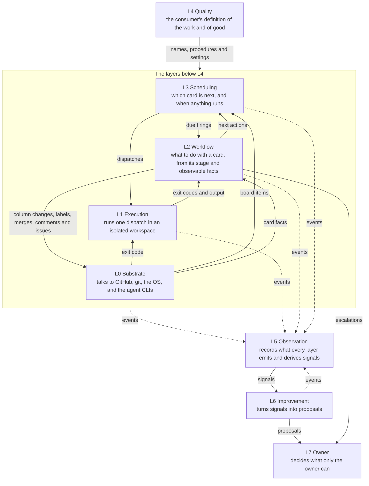

ABOUTME: Rigger's architecture of record: the eight layers and their boundaries, every extension
point a consumer has, the failure model, and the CI-enforced budgets.

# Architecture

Read this before changing anything. It fixes boundaries, contracts and budgets, and the few
internals a boundary depends on. It is not a design document for any one module.

`docs/spec/requirements.md` says what must be true of Rigger. This document is the structure that
satisfies it, and it is one structure among the several that could. Where the two disagree, the
requirement is right and this document is wrong. What must be true is therefore stated there and
never repeated here; what follows is how it is met.

Rigger is eight layers. Each has one job, one vocabulary at its upper boundary, and one change
authority. A fault is handled at the lowest layer that can handle it and crosses a boundary only
translated into that boundary's vocabulary. That rule is the reason the layers exist: in the
system Rigger replaces, a stray compiler helper process crossed four boundaries unchanged and
ended as a decision on the owner's desk.

## Bird's eye

A board holds cards. Scheduling (L3) decides which card is next and when anything runs. Workflow
(L2) decides what to do with that card from its stage and observable facts. Execution (L1) runs
the dispatch in an isolated workspace and returns an exit code. Substrate (L0) talks to GitHub,
git, the OS, and the agent CLIs. Quality (L4) is the consumer's definition of the work and of
good, and every layer but L7 reads some part of it without it being part of Rigger. Observation (L5) records what
every layer emits and derives signals. Improvement (L6) turns signals into proposals. The owner
(L7) decides what only the owner can.

## The layers

| Layer | Decides | Never decides | Emits, in part | Changed by | Lives in |
|---|---|---|---|---|---|
| **L0 Substrate** | How to talk to one external system: the forge (board, issues, PRs, CI through `gh`), git, the OS process model, each agent CLI. Retries, timeouts, containment mechanics, and which of its own git operations on one repository run one at a time. | Anything about cards or work. L0 does not know what a card is. | Each forge and git call's latency and outcome, process spawn and exit, survivors killed by name and command line | Engineer cards, within the L0 budget | `src/substrate/` |
| **L1 Execution** | How to run one dispatch in one workspace: isolation, lifetime, result as exit code plus captured output. Making the workspace an attempt at a card runs in. | Whether to run it, or what the result means | Dispatch start, end, duration, exit, timeout, and the workspace each runs in. A workspace made or removed. | Engineer cards, within the L1 budget | `src/execution/` |
| **L2 Workflow** | The next action for a card from its stage and observable facts, including which kind selects a ready card and the provider each role's dispatch runs on, and whether its acceptance passes the form check. Every change to a card's column; the review loop; the gate rule, and whether a card's pull request merges; escalation routing; whether a failure is the work's, or the environment's, card-local or `out`. Which provisioning steps a card runs, whether a step's failure stops its attempt, and whether a failed attempt is tried again. The card a clock trigger's due firing opens, and whether an earlier firing's card exists. | Which card is next; what good means | Card transitions with cause, verdicts, loop rounds, escalations by category, provisioning failures and attempts, by class | Spec rows, ratified by the owner | `src/workflow/` |
| **L3 Scheduling** | Pull order by priority; concurrency; claims taken synchronously before any await; the repo lane, which runs the merges L2 decides one at a time. Admission, which is whether any card may be pulled; the hold that closes admission; the three trigger kinds, and when each clock trigger is armed and due. The halt on starts while the sink refuses an event, which is not the admission hold. When Rigger reads the forge again for a write it has not yet shown, and when it stops. | What a card requires or whether it passed | Triggers by kind and target, queue depth, in-flight count, wait, lock contention, throughput, admission holds and their reason, clock triggers' armings and each firing's outcome | Spec rows and config | `src/scheduling/` |
| **L4 Quality** | What the work is and what good means: kinds of work, their maker and judge sets, and the providers those run on, roles, review procedure, provisioning steps, recorded decisions, which improvement roles run and which signals count | How Rigger runs, beyond the engine settings the extension points name | Nothing. L2 records what a role produced: findings by code and judge, rounds per kind of work, rework, later defect escape. L3 records each dispatch's role and tier, from which L5 derives the tier corrections tier accuracy counts ("Telemetry") | The owner, in the consumer's repository | The consumer's repository; Rigger ships templates under `templates/` |
| **L5 Observation** | How every layer's events are recorded and which signals derive from them. Whether and when the stream is pushed to the data ref | Anything that acts on them. L5 records and derives, never decides | The report. Each push's outcome | Engineer cards | `src/observation/` |
| **L6 Improvement** | What to propose, and to whom, from L5's signals. The object-level loop reorders L3's queue and re-tiers within L4. The meta-level loop proposes changes to any layer. | It changes no code, in any layer, ever | Proposals with target layer, and their outcome | Spec rows | `src/improvement/` |
| **L7 Owner** | Recorded decisions, config, the last verdict when named as a judge, or where the consumer's own check asks for it, answers to escalations | | | | A person |

## Boundary rules

1. **Faults stop at the lowest layer that can handle them.** A lingering process after a build is
   L0's: kill it, log its name, return the exit code. L1 sees a clean result. L2 never learns the
   process existed. A card reaches the owner only through L2's escalation categories, never
   through a substrate event.
2. **Each boundary has one vocabulary.** L1 gives L2 exit codes and output, or that a command never
   started, or that a directory was refused. L2 gives L3 next actions. L3 gives L2 a due firing,
   the trigger's name and occurrence, and L2 answers the card it opened or found. L2 also gives L3
   `k`, the number a firing's start records ("How a clock trigger fires"). A card L2 opens from a
   firing is the only card code moves into Ready, and L2 records that move under the cause
   `created`, which no other move takes. L5 gives L3 the report it derives, and L3 hands it to
   the verb unread. L2's notice function also
   gives L3 each rename a hold's closer is to take, and the number that rename attaches. A next
   action that dispatches a role carries what that dispatch is handed, which L2 composes. L1
   delivers it unread, through L0's provider adapter. L3
   gives L1 dispatches, and has L1 make the workspace each
   attempt at a card runs in. L1 gives L3 the tip of a card's line of work in that workspace once a
   continuing attempt's maker exits, and L3 hands it to L2 unread. L0's workspace adapter,
   `src/substrate/worktrees.mjs`, makes and removes workspaces and reads that tip, and only L1
   reaches it. L0's forge adapter gives L3 the board's items and L2
   a card's facts. It carries L2's column changes back to the board, and no
   other layer changes a card's column. The forge adapter has four sides. Each sends only through
   its own runner, which refuses any request outside its side:

   - The read side changes nothing on the forge, and any layer or verb may use it.
   - The item-write side changes a board item, and adds an issue to the board, and only L2 reaches
     it.
   - The schema-write side changes the board's fields and their options and the repository's
     labels. Only the CLI's verbs reach it, never a layer.
   - The repository-write side admits these writes:
     - a merge of a pull request;
     - a comment on a pull request, or on an issue;
     - adding a label to a card's issue, and removing the status label from an issue;
     - opening an issue, and closing one.

     L2 is the one layer that reaches it. The `verdict` verb also reaches it, for one write: a
     comment on a pull request holding the owner's verdict, which L2's `composeMarker` composes.

   Beside the forge adapter's four sides, L0 has a push side, `src/substrate/data-ref.mjs`. It
   admits one write: setting the data ref, `refs/rigger/events` on `origin`, to a commit holding
   the whole stream. Only L5 reaches it. It is no part of `src/substrate/forge/read.mjs`, and it
   sends through no forge runner. L3 has L5 push at each drain trigger, and L5 gives L3 each push
   that did not succeed, which L3 hands to the verb unread ("Pushing the stream").

   The gate script reaches only the read side. The gate's workflow, which is no layer, posts the
   gate's status. L4 gives the layers below it names, procedures and settings. If a layer needs to
   know something from two layers down, the design is wrong; fix the boundary, do not reach through
   it.
3. **The meta loop may target the core, on conditions.** A proposal against L0 through L3 must
   cite the signal from that layer's own telemetry it would improve, must pass the budget check,
   and goes to the owner. A proposal against L4 goes to the owner. L6 changes no code itself, in
   any layer, and its proposals are themselves telemetry, so the report shows whether they
   helped.
4. **Values are checked where they enter Rigger.** Rigger's trust boundary is the edge of its own
   process. A value from outside it enters at an entry point, and that entry point is the one
   place Rigger defends against it. The entry point checks the value and hands on plain data, or
   refuses it with a failure it builds itself. Plain data is null, a boolean, a finite number, a
   string, or a list or plain object of those, holding no accessor. The entry points, by layer:

   - **L0.** The forge adapter, for every answer `gh` gives on any of its sides. The process
     adapter, for each command's exit code and output, and for its reads of the process table.
     The workspace adapter and the push side, for what git answers. `src/substrate/launchd.mjs`,
     for the loaded job. Each provider adapter, for the agent file it reads and what its CLI
     answers.
   - **L1.** `src/execution/groups.mjs`, for the record of process groups.
   - **L2.** Each module that parses text the forge holds: `marker.mjs`, `escalation.mjs`, the
     module that parses a hold's notice, and the one that parses the mark line.
   - **L3.** `src/scheduling/admission.mjs`, for the entries of `.rigger/admission/`.
   - **L5.** The sink, for each line of the stream it reads back.
   - **The config.** `consumerConfig`, the one import of the consumer's code. Its default export
     can be any value, so `consumerConfig` hands on a plain-data copy, read once. The validator
     and every layer read only that copy.
   - **The CLI.** Each verb, for its arguments and, for `verdict`, its standard input. Each module
     that reads the environment, for the variables it reads.

   An agent Rigger dispatches is outside the process. Its output, its commits and its comments
   reach Rigger only through these entry points.

   Inside the boundary, a value one layer hands another conforms to the producing layer's
   contract. That contract is this document's vocabulary for the boundary, and the shape the
   producing function documents for what it returns, throws or rejects with. The consuming layer
   relies on that contract, and never defends against a value it does not allow. Such values
   include an accessor that throws, a proxy, and an object posing as another layer's failure. A
   producer that can hand on a value outside its contract, from any input an entry point admits,
   is defective, and the producer is where it is fixed.

   A contract allows any string where it names text, so text from outside stays any string
   inside. A verb that prints such text makes it printable where it prints it.

   The Failure model and "Telemetry" bind for every value the contracts allow. That covers an
   action made outside Rigger, a refused event, a failure after a write, and calls that interleave.
   Reporting a failure never throws on a value the contracts allow.

   A test of hostile input drives the entry point that admits it. A test of a consumer hands it
   doubles drawn from its producer's contract, as `AGENTS.md`'s "Test behaviour at observable
   boundaries" has them drawn.

   Two things would reverse this rule. Rigger running code it does not own in its process, other
   than the config, would put a producer inside the boundary that no contract binds. So would
   Rigger being run as a library inside another program, whose values would then cross into a
   layer through no entry point.

## The layer map

The eight layers as one diagram: which layer hands what to which. The edges carry the
vocabularies boundary rule 2 names, the exit code rule 1 names, and the events, signals,
proposals and escalations the layer table states. Every layer but L7 reads some part of L4, and
the edge drawn is the one boundary rule 2 names.



## Scenario binding

A scenario is defined entirely in L4. Rigger's loops are scenario-neutral machinery that L4
parameterizes. L2 runs the maker and judge loop; L4 names the maker and the judges for each kind
of work. L6 runs the improvement loop at its cadence with the report as input; L4 names which
roles run in it and which signals count. A consumer that switches L6 off still has a complete
scenario. Software development binds an engineer and a code reviewer, and a Re-planner reading
review rounds and rework. Content operations would bind a writer and an editor, and an editorial
planner reading editor rounds and time to publish. Nothing in L0 through L3, L5, or L6 changes
between the two.

## Extension points

Everything a consumer can change is declared in L4 and read by whatever the row names beside it —
a layer, or something Rigger ships that no layer reads. There are no other hooks. A need that does not fit one of these rows is a design conversation, not a
workaround.

| Extension point | Declared by the consumer as | Read by | v0 |
|---|---|---|---|
| **Engine settings** | The repository, the board, and its column display names as options of the board's `Status` field. The board's owner, as `board.owner` in the form given below the table. The concurrency N, the state directory (`.rigger/` by default), and whether telemetry pushes. The worktree root and the rule that derives a worktree's topic from a card, as `worktrees` in the form given below the table. The board field holding a card's priority, and that field's options in rank order, as `board.priority` in the form given below the table. The declared order ranks cards, whatever order or options the board's own field holds. A card with no value and a card holding a value the consumer did not declare share one rank, below every declared option. Cards that share a rank are ordered by issue number, oldest first | L0 for the repository, the board and the board's owner. L1 for the worktree root, which the verb resolves and hands it, and the topic rule. L2 for the topic rule's line of work, by which it finds a card's pull request. L3 for N. L5 for whether telemetry pushes, and with it off L5 reaches no push side | Yes, N defaults to 3. The worktree root defaults to `../<name>-worktrees`, where `<name>` is the part of `repo` after the slash. The topic rule defaults to `rigger-{number}`. |
| **Kinds of work** | A name per kind, with its maker role, ordered judges (`owner` last if at all), each a role and optionally its provider rule, provisioning steps, the review loop bound in rounds, and the card labels that select the kind. Beside the kinds, the one card label that marks an epic, in the form given below the table | L2 for which kind selects a card, the provisioning steps it runs, the loop, the gate, the provider each judge runs on, and the provider the gate requires of each judge's marker | Yes |
| **Roles** | A name, an agent file in the consumer's repository, a provider, a default model tier, the card labels that select another tier, the card labels that select another provider, and the time its dispatch may run | L2 selects the role a card needs and the tier its labels select. L2 selects the provider its labels select. L3 dispatches it. L1 runs it through L0's provider adapter | Yes |
| **Where provider assets live** | Nothing. A role names its agent file by path, so the directory is whatever the provider reads: Claude Code reads `.claude/` and `.mcp.json`, and a second adapter reads its own. The tools and connectors a dispatched agent may use are among those assets. `init` forks each template where its provider looks for it | L0, through the provider adapter, from the directory the dispatch runs in | Fixed by the provider |
| **Role skills** | Skills in the consumer's repository, invoked by a role's agent file: the review procedure a judge runs, and how an author writes a card's acceptance | Nothing in Rigger reads them; the role does | Yes |
| **Verdict vocabulary** | Fixed by Rigger. A judge returns sound, needs revision, or critical | L2 | Fixed |
| **Escalation categories** | Fixed by Rigger: recorded-decision change, critical, ambiguous. A maker or the loop raises one; a judge does not. A maker raises one by an escalation note on the card's issue. L2's escalate answer carries which raised it, `maker` or `loop` | L2 | Fixed |
| **Document checking** | Which documents the resolver checks and at what fail level, which sources it reads anchors from, and what each check exempts | The resolver ships under scripts/ in the package. The consumer's own checks invoke it with the consumer repository's root as an argument. No layer reads it | Yes |
| **Provisioning steps** | A command line, which L1 runs under `/bin/sh` in the card's workspace. Optionally a working directory under that workspace, and the time the step may run. Whether the work requires it, and the labels that select it. A kind's list and a step's own labels both apply, and a step runs when both admit it. | L2 selects a card's steps and reads whether each is required. L3 dispatches each. L1 runs it. | Yes |
| **Escalation destinations** | Where each of the fixed categories goes: the owner, or one of the consumer's roles. A category given no destination goes to the owner. A role may receive only an ambiguity a maker raised, never critical or a recorded-decision change | L2 routes. The config validator refuses `escalate` where any of these holds: | Yes, every category to the owner by default |
| | | — it is a list; | |
| | | — a key is no category; | |
| | | — a destination is not a string; | |
| | | — a destination names no declared role; | |
| | | — a role is the destination of critical or a recorded-decision change. | |
| **Improvement roles** | Per loop: the role, its cadence (drain or clock), and the signals it reads | L6 | After v0 |
| **Clock triggers** | Per trigger, a schedule, a card template or an internal job, and a catch-up policy. Beside the triggers, the board poll's interval, which `run` waits between two polls of the board while idle. Both in the form given below the table | L3 for the schedule, the catch-up policy, the internal job and the poll. L2 for the card template, its author included | Yes |
| **Provider adapters** | A module implementing the adapter interface for one agent CLI. It turns an agent file, a tier and a prompt into the CLI's invocation in one directory. It names the one folder its CLI keeps for that directory outside the dispatch's directories, or none. It loads only the tools and connectors that directory declares | L0 | Claude Code shipped; Codex shipped in M4 |
| **Forge adapter** | A module implementing the board, issue, PR, and CI interface, with the forge assets `init` forks. The one asset is the gate workflow, and `init` reads its destination from `src/substrate/forge/assets.mjs` | L0, and `init` for each asset's destination | GitHub only; the interface exists so a second forge is an L0 change and nothing else |
| **Deliverable** | Fixed in v0: a pull request merged behind the gate. Content scenarios still deliver by branch and PR. A publish adapter for non-git targets is a later L0 extension | L2 | Fixed |

The config file declares the rows whose v0 column says Yes. The rows marked fixed are Rigger's, and
Role skills and Document checking are files the config points at rather than contains. The two
adapters are code, added to Rigger itself. The shape, abbreviated:

```js
// Rigger's own config, with every key Rigger offers spelled out: it is its own first consumer.
export default {
  repo: 'williacj/rigger',
  board: { owner: 'williacj', project: 1, columns: { ready: 'Ready', coding: 'Coding', review: 'Review', owner: 'Owner', done: 'Done' }, priority: { field: 'Priority', options: ['High', 'Normal', 'Low'] } },
  concurrency: 3,
  worktrees: { root: '../rigger-worktrees', topic: 'rigger-{number}' },
  roles: {
    engineer:      { agent: '.claude/agents/engineer.md',       provider: 'claude', tier: 'standard', labels: { 'tier:high': 'high' },
                     providerLabels: { 'maker:codex': 'codex' }, timeout: 14400000 },
    reviewer:      { agent: '.claude/agents/reviewer.md',       provider: 'claude', tier: 'high' },
    pm:            { agent: '.claude/agents/pm.md',             provider: 'claude', tier: 'high' },
    architect:     { agent: '.claude/agents/architect.md',      provider: 'claude', tier: 'high' },
    spikeEngineer: { agent: '.claude/agents/spike-engineer.md', provider: 'claude', tier: 'high' },
  },
  kinds: {
    // One judge. rounds omitted, so the default of three applies.
    change:    { select: { labels: ['type:change'] },    maker: 'engineer',
                 judges: [{ role: 'reviewer', provider: { claude: 'codex', codex: 'claude' } }],
                 provisioning: ['npm-ci', 'vhs'] },
    // The panel case: three agent judges concurrently, the owner last. The architect rules on a
    // proposed requirement here, which is the gate D18 rule 5 puts before the cards are cut.
    spec:      { select: { labels: ['type:spec'] },      maker: 'pm',
                 judges: [{ role: 'reviewer', provider: { claude: 'codex', codex: 'claude' } },
                          { role: 'engineer', provider: { claude: 'codex', codex: 'claude' } },
                          { role: 'architect', provider: { claude: 'codex', codex: 'claude' } }, 'owner'],
                 rounds: 2, provisioning: ['npm-ci', 'vhs'] },
    // The architect makes this document's own deltas (D18 rule 1).
    structure: { select: { labels: ['type:structure'] }, maker: 'architect',
                 judges: [{ role: 'reviewer', provider: { claude: 'codex', codex: 'claude' } }, 'owner'],
                 provisioning: ['npm-ci', 'vhs'] },
    // Decomposition: the PM cuts larger work into cards (D18 rule 4). A kind no role makes is
    // never dispatched, so the role that decomposes needs a row of its own.
    intake:    { select: { labels: ['type:intake'] },    maker: 'pm',
                 judges: [{ role: 'reviewer', provider: { claude: 'codex', codex: 'claude' } }, 'owner'],
                 provisioning: ['npm-ci', 'vhs'] },
    spike:     { select: { labels: ['type:spike'] },     maker: 'spikeEngineer',
                 judges: [{ role: 'reviewer', provider: { claude: 'codex', codex: 'claude' } }],
                 provisioning: ['npm-ci', 'vhs'] },
  },
  epicLabel: 'type:epic',
  provisioning: {
    'npm-ci': { run: 'npm ci', cwd: '.', required: true, timeout: 1800000 },
    // Only cards that touch the demo tape pay for this.
    'vhs':    { run: 'brew list vhs || brew install vhs', select: { labels: ['area:demo'] } },
  },
  escalate: { 'recorded-decision': 'owner', critical: 'owner', ambiguous: 'owner' },
  clock: {
    poll: 60000,
    triggers: {
      audit: { interval: 86400000, anchor: '2026-10-28T08:00:00Z', catchUp: 'fire',
               card: { title: 'Audit the dependencies', labels: ['type:change'],
                       acceptance: '- The dependency audit records its findings.', author: 'engineer' } },
      report: { interval: 3600000, anchor: '2026-10-28T08:00:00Z', catchUp: 'skip', job: 'report' },
    },
  },
  // Improvement roles arrive with M9. A consumer that leaves them unconfigured
  // still has a complete scenario.
  telemetry: { push: false },
};
```

The priority declaration is one key under `board`: `priority`, an object whose `field` is the
board field's display name and whose `options` lists that field's option display names, highest
rank first.

The board-owner declaration is one key under `board`, beside `project`. In the published config
shape the line reads `board: { owner: 'williacj', project: 1, … }`. Its value is a string holding
the login of one GitHub user or organisation, and that account is the board's owner. The key is
optional. Where it is absent, the board is the one numbered `board.project` among the boards of the
repository's owner. The repository's owner is the user or organisation named before the slash in
`repo`. L0's forge adapter reads the key and applies that absence rule. No other layer and no verb
supplies the repository's owner in the key's place. The key changes which board L0 reads and
writes, and nothing else. It changes neither which repository's issues are cards nor which
repository's labels L0 reads and creates, and `repo` names that repository for both.

The epic declaration belongs to Kinds of work. It is one top-level key beside `kinds`, and it
reads `epicLabel: 'type:epic',` in the published config shape. Its value is a string naming one
card label. L2 reads it when it decides which kind selects a card, and `R-SCHED-11` states what
follows for a card carrying that label. The key is optional. Where it is absent, no label marks an
epic, and L2 selects every card by the kinds' own labels alone.

The worktree declaration is one top-level key beside `concurrency`, and it reads `worktrees: {
root: …, topic: … },` in the published config shape. `root` is a path, and a relative one
resolves against the top level of the consumer's repository. The verb resolves `root` to an
absolute path, and hands it to L1. `topic` is a string holding `{number}`, which L1 replaces with
the card's issue number, and it holds no `/`. L1 derives a card's workspace as the directory the
topic names directly under `root`, and its line of work as the branch of the same name. The key is
optional, and so is each key under it. Where one is absent, it takes the default the Engine
settings row states.

The clock declaration is one top-level key, and it reads `clock: { poll, triggers: { … } }`.
`triggers` holds each clock trigger the consumer declares, keyed by its name, and each declares
what the Clock triggers row lists. `poll` is the milliseconds `run` waits between two polls of the
board while idle, as "Triggers" sets out. `poll` is required wherever a trigger is declared, and it
has no default. The config validator refuses a clock declaration without `poll` (`R-SCHED-10`).

Each trigger under `triggers` declares these keys, and every key but `author` is required:

- `interval` and `anchor`, its schedule. `interval` is the milliseconds between two occurrences,
  and `anchor` is an ISO 8601 date and time carrying its offset. A trigger's occurrences are the
  anchor plus a whole number of intervals, so none falls before the anchor.
- `card`, its card template, or `job`, its internal job, and never both. `card` holds the card's
  `title`, `labels` and `acceptance`, and `author`, who writes that acceptance. `author` names
  `owner` or a declared role, and the author is `owner` where it is absent (`R-CARD-41`). `job`
  names `report`.
- `catchUp`, its catch-up policy: `fire` or `skip`.

`acceptance` is one string, which L2 places under the opened card's `## Acceptance` heading.
The validator reads it so (`R-SCHED-40`).

One function in `src/config/` parses a trigger and computes its occurrences. The config validator
refuses with it (`R-SCHED-10`), and L3 imports it, so one parser serves both. The function that
computes the `ExitTimeOut` bound also lives there ("Supervising `run`").

The schedule is an interval and an anchor, not a calendar expression. Every other duration in the
config is milliseconds, and the pair covers every trigger M7 names in a few lines. "How a clock
trigger fires" says what would reverse it.

`poll` has no default because nothing in this repository fixes a figure for it, and a default
with no source would be a judgment presented as a measurement. What would reverse it: a measured
count of the forge calls one poll makes, giving a figure that stays inside the forge's rate limit
at a stated board size.

The fenced shape above holds exactly what the validator offers at every commit.

A provider adapter is the one place Rigger holds a fact about its agent CLI. That covers how
`doctor` asks whether the CLI is signed in and where `init` forks its templates. It also covers
which model each tier selects, and how an agent file, a prompt and a directory become the CLI's
command line, standard input and environment. A variable the adapter sets holds a path under the
dispatch's directory or its scratch directory, and is never one that L1 removes. L1 runs that
command line as it runs a step's. The adapter also names, from the directory a dispatch runs in and
the environment it runs under, the one folder its CLI keeps for that directory outside the
dispatch's directories, or none. This document uses folder for that directory alone. The Codex
adapter names none. The adapter passes the CLI no setting that widens what the
consumer's own provider settings allow, with two exceptions:

- **A reached directory.** A directory a dispatch reaches is one Rigger gives the dispatch beside
  the directory it runs in, and today that is only a judge's `head`. For each such directory, the
  adapter lets the agent read and edit there and change into it. Changing into it is entry, and
  allows no command. Every command run there still needs a rule the consumer's settings declare,
  and the consumer's deny rules still apply there.
- **A temporary directory.** The adapter may give each dispatch one directory the agent may write,
  inside that dispatch's scratch directory, and point `TMPDIR` and `TMPPREFIX` at it. It belongs
  to that dispatch alone and lies outside every worktree. A process working there is within L0's
  sweep of the scratch directory. It allows no command, and the consumer's deny rules still apply
  there.

A provisioning step's working directory is `cwd`, a relative path naming a directory under the
card's workspace. Where it is absent the step runs in the workspace itself. A step's `timeout` is
the milliseconds it may run, and a step that declares none may run for 1,800,000 milliseconds,
which is 30 minutes.

A role's `tier` names one of the tiers Rigger fixes, `standard` or `high`, and its provider
adapter maps each to a model. `labels` is optional, and maps a card label to the tier that label
selects for this role. A role's `timeout` is the milliseconds its dispatch may run, as a step's
is, and a role that declares none may run for 14,400,000 milliseconds, which is four hours. A
role's name names a directory, so it holds no `/`.

A role's `providerLabels` is optional. It maps a card label to the provider that label
selects for this role, and each provider it names is one Rigger has an adapter for. Without
a selecting label, the role runs on its `provider`.

A judge is a role name, or `{ role, provider }`. A role name runs the judge on its role's
provider, and `owner` is written only that way. In the object, `provider` is the judge's
provider rule. A provider name fixes the provider. A map from the provider the maker runs on
to the provider the judge runs on makes it follow the maker's, and it holds a key for every
provider the maker can run on. Where an entry carries a rule, L2 reads neither its role's
`provider` nor its `providerLabels`. L2 answers every role's provider from one function, and
the dispatch, the marker's instruction and the gate all take their provider from it.

## Triggers

L3 owns three trigger kinds. **Pull** fires on board occupancy: a card in Ready and a free slot.
**Drain** fires on quiescence: nothing in flight. **Clock** fires on a schedule from config.

Scheduled work is visible work. A clock trigger declares whether its work is a card; when it is,
the trigger creates the card and L2 runs it like any other. A trigger declaring an internal job
runs it in-process, with no card, as "How a clock trigger fires" sets out. `R-SCHED-5` names
what else may run without a card. An occurrence missed
while Rigger was down fires once at the next start, or not at all, as the trigger's own catch-up
policy says.

A clock trigger is declared where the clock declaration's `triggers` names at least one trigger. A
clock declaration holding a `poll` and no trigger declares none. With no clock trigger declared,
`run` ends once the board drains, and launchd's relaunch is what reads the board again ("How `run`
is supervised", below). While a clock trigger is declared, `run` stays up after the board drains
and fires each trigger as it comes due. Under `once`, no clock trigger arms or fires, and nothing
in the two subsections below applies (M7-U2 Q12 on #1009).

### While a clock trigger keeps `run` up

`loop.mjs`'s `run` decides not to end at drain while a clock trigger is declared. No module outside
it makes that decision. In every state this subsection does not name, `run` acts as it does with no
clock trigger declared.

**The board poll.** While no claim is held, `run` polls the board every `poll` milliseconds. A
poll is Pull's own read, not a fourth trigger kind:

- It is how L3 sees a card ready and a slot free once launchd no longer relaunches `run`.
  `R-SCHED-6`'s three occasions are unchanged.
- Each poll fires the pull trigger, and records the event a pull trigger records: `trigger`, with
  `trigger: 'pull'`.
- A poll that claims nothing fires no second drain in the same idle period. Drain still fires once
  per idle period.
- A poll that claims a card ends the idle period.

The poll starts whenever no claim is held, whatever ended the last claim. A drain, a merge claim's
end and a claim whose move the board refused each leave `run` holding no claim. Where no drain
fired before the poll started, the first poll that finds nothing in flight and nothing to pull fires
it.

While one or more claims are held, `run` does not poll. It pulls again at each slot release, as
with no clock trigger declared. A partly occupied `run` therefore sees a new Ready card only at its
next release.

Two polls never run at once. The next poll fires `poll` milliseconds after the previous poll
settles, not after it starts. A poll whose reads outlast `poll` therefore delays the next one, and
never overlaps it.

The timer lives in `src/scheduling/clock.mjs`, with a clock its caller injects, so a test needs no
sleeps. That one timer wakes L3 both for the poll and for each trigger's next occurrence.
`loop.mjs` wires it into `run`, and holds no timer of its own. What would reverse it: a third
timer need unrelated to the clock, which would make the module a scheduling utility.

A clock trigger's firing is no claim, so it never counts as in flight. That holds for an internal
job's firing as for a card's: it holds no claim and no slot, so it holds back neither the poll nor
the drain, and neither waits for it. A card a firing creates ends the idle period only when a pull
claims it. What would reverse it is what would reverse the in-process job ("How a clock trigger
fires").

**A poll in each idle state.**

| State | What happens |
|---|---|
| admission closed | the poll claims nothing (`R-SCHED-3`), and names each closer as "Failure model" says |
| a read of the board, the priority, the facts or admission fails | the next poll fires on schedule, and `run` hands the failure to the verb as set out below |
| the sink refuses the poll's `trigger` event | the poll claims nothing, under the halt ("Failure model"); the next poll fires on schedule, and `run` hands the refusal to the verb |
| a hold's closer could not be saved | `run` polls no more. It ends once the claims it holds finish, and exits non-zero naming the failure, as "Failure model" says |

`run` ends on a hold's closer it could not save, rather than polling on. No pull claims a card
after that failure, so a `run` that stayed up would poll and claim nothing for the rest of its
life. Ending it lets launchd's next start read admission again. What would reverse it: a `run`
that can read admission again and clear that failure itself.

**Where `run`'s outcomes go.** With no clock trigger declared, `run` hands the verb what every card
answered once it ends. The verb prints it and picks the exit status. While a clock trigger keeps
`run` up, it hands the verb its outcomes as follows:

- At each drain trigger, `run` hands the verb what settled since the previous drain: each card's
  outcome, the closers a closed admission answered, and each failure.
- A poll that fails, or whose `trigger` event the sink refuses, hands its failure to the verb as
  that poll settles. The failure is among that idle period's outcomes, and the next drain does not
  hand it again.
- A clock trigger's firing hands the verb, as it settles, each failure "How a clock trigger fires"
  names. A `report` firing hands it the report L5 returned, unread, as one hand-over.
- The verb prints each hand-over as it prints a whole run with no clock trigger declared, and exits
  at none of them.
- A `run` ended by a signal while its launchd job stays loaded runs L0's exit cleanup, which sets
  the exit status ("Failure model"). launchd relaunches it at the job's next `StartInterval`.
- A `run` ended at a `bootout` runs the same exit cleanup. The `bootout` unloads the job, so nothing
  relaunches `run` until the job is loaded again (`README.md`, "To unload the label").
- A `run` ended on a hold's closer it could not save hands the verb what settled since the previous
  drain and was not yet handed, and the verb exits non-zero, as above.

**Cards this run set aside.** A card L3 keeps out of later pulls under "Failure model"'s memory is
**set aside**. With no clock trigger declared, a set-aside card stays skipped for the run's life,
which ends at the drain. While a clock trigger keeps `run` up, a set-aside card stays skipped until a
read of the board begun after the run set it aside finds it in a column other than its compared
column (M7-U4 Q20 (c) on #1009). That holds whatever set the card aside.

A set-aside card's **compared column** is the column the pull that claimed it read. Each column
change this run made to the card that the board accepted changes the compared column to the
change's target. The claim's move to Coding, L2's moves, the lane's moves at a merge's end and an
escalation's move to Owner are such changes, so none of them ends the skip. A change the board
refused leaves the compared column as it was.

Each read of the board ends a skip, or leaves it, as follows:

| A read of the board | What follows |
|---|---|
| begun before the run set the card aside | the skip holds, whatever column the read shows the card in |
| begun after, finding the card in its compared column | the skip holds. A card whose compared column is Ready stays skipped while each read finds it in Ready |
| begun after, finding the card in Ready, its compared column being another | the skip ends, and a pull claims the card as it claims any Ready card, at the next poll or slot release |
| begun after, finding the card in a column other than Ready and other than its compared column | the skip ends, and a pull answers the card as it answers any card in that column |
| begun after a refused change that the forge made anyway | the read finds the card in the change's target column, so the skip ends under the two rows above |

L3 sees only what each read shows. A card moved out of its column and back again between two of
this run's reads therefore stays skipped, because a change undone before the next read is not
seen. A skip that ends removes the card from the memory, and a later setting aside starts its
entry afresh. A new `run`, as after launchd's relaunch, starts with no card set aside.

`loop.mjs`'s `run` keeps the memory, in place of its set of excluded card numbers. For each
set-aside card it keeps the card's number, its compared column, and how many reads of the board
had begun when it set the card aside. Each of L2's column changes answers, once the board accepted
it, the column it left the card in, and `run` takes that as the compared column. `take`'s
`available` is the step that compares: for a read begun after the setting aside, it compares the
compared column with the item's `column`, which `readPriority` already answers. No other module
holds the memory. What would reverse it: a second reader of the memory, such as `plan` or `doctor`
showing which cards are skipped.

**What a poll costs.** One idle poll is one `take`. With admission open, it makes about 3 + *a* +
6*r* forge calls, where *a* counts the cards in Ready, Coding, Review or Owner. Of those, *r*
counts the ones in Coding, Review or Owner holding exactly one open pull request. This figure is a judgment,
not a measurement, and its premise is the reads `take` and `facts.mjs` make:

- `readColumns` and `readPriority`, once each, with one more page of `readPriority` per 100 items;
- `readBranches`, once, where any card is in one of those four columns;
- one read of each such card's pull requests;
- for each card *r* counts, `readMergeBase`, `readDiff`, `readComments`, `readMergeable` and
  `readEffectiveRules`, then `readCheckStates`.

The figure leaves out admission's reads, which read the state directory and not the forge. A card
in Done costs nothing. M7-24 on #1009 measures the figure on a fake forge.

### How a clock trigger fires

L3 arms and fires each clock trigger under `run` alone. The architect's r1 review on #1009 places
the schedule and the job (S6), the last firing (S7) and the card's creation (S8). Its r2 review
places the duplicate guard (§2, F3) and arming (§3, F4).

**Arming.** A start under `run` reads each declared trigger. L3 records `trigger.armed` `{ name,
interval, anchor }` where the record holds no `trigger.armed` of that name, or where the newest one
holds another `interval` or `anchor`. Arming acts on nothing outside Rigger, so it is no start. A
sink that refuses it is the halt, and no trigger fires ("Failure model").

**Identity.** A trigger is its name, the key it is declared under. A changed schedule re-arms it,
and nothing else does: not its card template, its author included, nor its internal job, nor its
catch-up policy. The config is read at a start, so a change takes effect at the next start under
`run`.

**The last firing, and which occurrences are due.** A trigger's last firing is the newest outcome of
a firing of its name in the event record, and never a file. L3 compares outcomes by the occurrence
each names, never by when it was recorded. An occurrence is due where it falls after the trigger's
newest arming and after its last firing's occurrence, and not after the present. An occurrence at
or before the newest arming is therefore never due (M7-U2 Q13 on #1009).

**Catch-up.** An occurrence due at a start under `run` was missed while Rigger was down. The
trigger's catch-up policy decides what follows:

- `fire` makes one firing, carrying the newest missed occurrence;
- `skip` makes none, and no missed occurrence fires later in that run.

Neither makes one firing per missed occurrence (`R-SCHED-8`). After the start, L3 fires a trigger
at each wake at which an occurrence after the start is due, carrying the newest such occurrence.

**When a firing runs.** The timer in `src/scheduling/clock.mjs` wakes L3 at each trigger's next
occurrence. L3 fires it then, whether or not claims are held, because a firing claims no card and
takes no slot. Two firings never run at once. Where several are due together, L3 fires them in the
order of their occurrences, and by trigger name in code-unit order where two occurrences tie. A
trigger with a pending firing, set out below, fires no other occurrence until that one settles.

**A firing whose work is a card.** The template carries the card's title, labels and acceptance,
and the author the trigger names, `owner` where it names none (`R-CARD-41`). The author is a key of
the template, so a trigger whose work is a job names none. A firing runs in these steps, so that a
crash never leaves two cards for one occurrence:

1. L2 reads `k`, the number of the repository's newest issue or pull request, as the hold's step 5
   in "Failure model" reads it.
2. L3 records the firing's start as `trigger` `{ trigger: 'clock', name, occurrence, after: k }`.
3. L2 opens the card from the template and adds it to the board in Ready, recording the move under
   the cause `created`. The card's body opens with the mark line, which names the trigger and the
   occurrence, outside the card's `## Acceptance` section.
4. L3 records the outcome as `trigger.outcome` `{ name, occurrence, outcome: 'card', issue }`.
5. A firing's start with no outcome is **pending**, and L3 settles each pending firing as the next
   paragraph says.

One module under `src/workflow/` composes the mark line and parses it back, as `escalation.mjs`
does for notes, so the two cannot drift.

**Settling a pending firing.** At `run`'s start L3 finds each pending firing in the record, and
after that it knows each firing it made. At each trigger of any kind, as it acts on each hold's
closer, L3 settles each pending firing before that clock trigger fires again. L3 tells a pending
firing's work by its recorded start, never by the trigger's present declaration: a start carrying
`after` is a card's, and one without it is `report`'s. It settles one whose work is a card in this
order, whatever the trigger now declares:

1. L2 reads the number `<j>` of the repository's newest issue or pull request. It then reads each
   issue numbered above `k` and up to `<j>`, as the `hold-<id>-after-<k>.json` bullet of "Failure
   model" reads them: by number, in any state, passing over a number that names no issue. L2 reads
   a mark only on an issue written by an account with write access to the repository.
2. Where one carries that trigger's and that occurrence's mark, L2 places the card in Ready where
   the issue is open and the board holds it in no column. It leaves the card where it is otherwise,
   a closed card included. L3 then records the outcome naming that issue. Where the placing fails,
   L3 records no outcome, and the firing stays pending.
3. Where none does, L2 opens the card only where all of these hold:
   - the trigger is still declared under its name;
   - its work is still a card;
   - the record holds no `trigger.armed` of its name after the pending start.

   L2 then opens the card from the template the start reads now, its author included, as step 3
   above, and L3 records the outcome, as step 4 above. Otherwise L2 opens nothing, and L3 records
   the outcome as `trigger.outcome` `{ name, occurrence, outcome: 'abandoned' }`. The record keeps
   an arming across any later crash, so that exclusion holds at every later start.

A pending firing whose work is `report` is settled as abandoned, whatever the trigger now declares,
and the job does not run again. The next occurrence's report shows every event the lost one would
have shown, so a late one adds nothing. Its start carries no `k`, so no card is opened for it even
where the trigger now declares one.

**A firing whose work is `report`.** `report` is the only internal job (M7-U2 Q6 on #1009). L3
records the firing's start as `trigger` `{ trigger: 'clock', name, occurrence }`. It then calls L5's
report in-process, with no L1 dispatch, no agent, no group and no slot. L3 records the outcome as
`trigger.outcome` `{ name, occurrence, outcome: 'job' }`. L3 hands the verb the report L5 returned,
unread, as one hand-over, and writes nothing to standard output itself. The verb prints the report
as it prints each hand-over, and the LaunchAgent's log under `~/Library/Logs/rigger/` keeps it.

Where L5's `report` throws, as on a line of the stream that does not parse, L3 records the outcome
as `trigger.outcome` `{ name, occurrence, outcome: 'failed' }`. It hands the verb the failure in
place of the report, as one hand-over. The firing is settled, so the job does not run again for
that occurrence, and the trigger's next occurrence fires as any other.

**Admission.** A firing is no pull, so admission does not govern it. Under a closed admission, a
trigger whose work is a card still creates its card, and no pull claims that card until admission
reopens (`R-SCHED-3`). The `report` job runs whatever admission says (M7-U2 Q4 on #1009).

**An unreadable record.** A start under `run` that cannot read the record arms and fires no clock
trigger for that run's life. Rigger names the record and why it could not read it, with the line
that would not parse where one would not. Pulls continue (M7-U2 Q14 on #1009). A line that does not
parse stays so until a person mends it, so the run reads the record again only at its next start.

**A clock trigger in each state.** Every state below is under `run` with a readable record, unless
its row says otherwise.

| State | What happens |
|---|---|
| under `once` | no trigger arms or fires |
| the record unreadable at the start | no trigger arms or fires for that run's life; Rigger names the record and the line; pulls continue |
| no `trigger.armed` of the trigger's name in the record | L3 records `trigger.armed`; no occurrence at or before it is ever due |
| its schedule differs from its newest arming's | re-armed, as in the row above |
| its schedule changed back to one an earlier arming holds | re-armed, because the newest arming holds another schedule (`R-SCHED-37`; M7-U7 Q31 (a) on #1009) |
| removed, then declared again under its name and its newest arming's schedule | not re-armed, so a missed occurrence may fire once under its catch-up policy |
| its card template, its author included, internal job or catch-up policy changed, and its schedule did not | not re-armed |
| a card-shaped occurrence comes due, admission open | steps 1 to 4; the card enters Ready |
| a card-shaped occurrence comes due, admission closed | steps 1 to 4; the card enters Ready, and no pull claims it until admission reopens |
| an occurrence of `report` comes due, whatever admission says | L3 records the start, runs `report` in-process and records the outcome; no dispatch, no slot |
| `report` throws while a firing runs | L3 records the outcome `failed` and hands the verb the failure in place of the report; the occurrence is settled, and the next one fires as any other |
| an occurrence comes due while the card of the trigger's previous firing is open | another card (M7-U2 Q3 on #1009) |
| occurrences missed while Rigger was down | one firing carrying the newest missed occurrence under `fire`, and none under `skip`; never one per missed occurrence |
| a card-shaped firing pending at a start | settled as "Settling a pending firing" says |
| a card's firing pending, its trigger unchanged | step 1's scan; a card found is placed as step 2 says; none found: L2 opens the card |
| a card's firing pending, its trigger no longer declared under its name, as after its removal, its renaming or the clock declaration's removal | step 1's scan; a card found is placed as step 2 says; none found: the outcome is abandoned |
| a card's firing pending, its schedule changed, or changed back, so that a `trigger.armed` of its name follows the pending start, at this or any earlier start | step 1's scan; a card found is placed as step 2 says; none found: the outcome is abandoned |
| a card's firing pending, its trigger removed and declared again under its name and its newest arming's schedule | as with the trigger unchanged, because no arming follows the pending start |
| a card's firing pending, its trigger now declaring `job: 'report'` at an unchanged schedule | step 1's scan; a card found, as when the crash followed its opening, is placed as step 2 says; none found: the outcome is abandoned, because no template remains to open it from |
| a card's firing pending, its card template changed, title, labels or acceptance, at an unchanged schedule | step 1's scan; a card found is placed as step 2 says, as it was opened; none found: L2 opens the card from the template the start reads now |
| a card's firing pending, its template's author changed at an unchanged schedule | as for a changed template: a card not found is opened with the author the start reads now |
| a card's firing pending, its catch-up policy changed | as with the trigger unchanged: the policy decides only which missed occurrences fire, never how a pending one settles |
| a `report` firing pending, its trigger unchanged, undeclared, re-armed, now declaring a card, or with its catch-up policy changed | its outcome is recorded as abandoned, and no job runs and no card is opened |
| a firing pending, another trigger or `poll` changed | the pending firing settles as its own trigger's row gives |
| the occurrence's card, found while settling, on the board in a column other than Ready, or closed | its outcome is recorded; the card is not moved |
| the occurrence's card, found while settling, open and in no column, and placing it in Ready fails | L3 records no outcome, and the firing stays pending; `run` hands the failure to the verb, and the next trigger settles it |
| an issue numbered above `k` carrying the mark, written by an account without write access | not read as the occurrence's card |
| the read of `k` fails or times out | L3 records no start, and the occurrence stays due; `run` hands the failure to the verb, and L3 fires the trigger again `poll` milliseconds later |
| a read of `<j>`, or of an issue numbered above `k`, fails or times out while settling | no card is opened and no outcome is recorded; the firing stays pending, and L2 reads again at the next trigger, as for a hold's `after-<k>` closer |
| opening the issue, or adding it to the board, fails after the start was recorded | L3 records no outcome, and the firing stays pending; `run` hands the failure to the verb, and the next trigger settles it |
| the sink refuses `trigger.armed`, or a firing's start | the halt: nothing fires ("Failure model"); `run` hands the refusal to the verb |
| the sink refuses a firing's outcome | the firing stays pending; `run` hands the refusal to the verb; the next trigger settles it, finding the card, or recording a `report` firing as abandoned |
| an internal job's firing while no claim is held | not in flight: it holds back neither the poll nor the drain |
| two triggers come due together | they fire one at a time, by occurrence, then by name |
| an occurrence comes due while claims are held | it fires then, because a firing takes no slot |

In every other state, a trigger arms and fires as the rows above give for its record, its
admission and its occurrence, and nothing else fires.

A card whose mark line a person edited out, before a crash, is outside this placement. Settling
then finds no card, and a second card can follow. That is the residual a note carries ("What the
gate cannot tell apart").

**What would reverse each choice:**

- **The interval-and-anchor schedule:** a consumer needing a calendar schedule, such as weekdays
  only.
- **The in-process job:** a job that must spawn a command, which only L1 runs.
- **A failed `report` settled as `failed`:** the record showing `report` failures that clear on a
  retry within the same run, which would argue for leaving the firing pending.
- **The record as the last firing's source:** a start's whole read of the record becoming
  measurably slow, or a requirement that a firing survive the loss of the local record.
- **The duplicate guard:** the event record showing two cards for one occurrence.
- **Identity by name:** an owner ruling that a renamed trigger keeps its history, which would need
  an identity key apart from the name.

### Supervising `run`

Keeping the Rigger process alive across reboots is the OS scheduler's job. The launchd assets that
do it are L0. A Windows equivalent arrives with native Windows, which is not in v0. On macOS the
asset is one per-user LaunchAgent template under `templates/launchd/`, and `D28` records why. Spike
#744's report measured launchd on the owner's host, and each cell named below is one of its cells:
- **What `init` does.** `init` neither forks the template into the consumer's repository nor loads
  it. A plist carries host paths, and loading a job changes the host, which is the owner's act.
  `init` forks only the directories under `templates/` that have an asset destination.
- **How `run` is supervised.** `StartInterval` re-launches the unchanged `rigger run`, and
  `RunAtLoad` is true. launchd never starts the job while a run is in progress, and starts it again
  one interval after it exits, with no firing queued (Q-a3). Without `RunAtLoad`, the first start
  waits one interval (Q-a1, Q-a2). While a clock trigger is declared, `run` does not end at drain,
  so launchd's relaunch covers only an exit while the job stays loaded: by a signal, or on a failure
  that ends `run`. A `bootout` unloads the job, and launchd relaunches nothing after it until the job
  is loaded again (`README.md`, "To unload the label").
- **When it starts.** A LaunchAgent starts after the owner logs in, never before it (Q-l). Across
  a reboot, the job therefore starts at the owner's next login, not at boot (U1 Q5 on #740).
- **The job's process groups.** launchd never signals a process in a group of its own, at a
  `bootout` or at the job's exit (Q-d4). Only Rigger's own exit cleanup therefore ends a dispatch's
  group. Where launchd cuts that cleanup short, the next start meets the groups it left, and ends
  them under `R-STATE-10`. launchd sends `SIGTERM`, not `SIGKILL`, to the rest of the job's own
  group, at its kill and at its normal exit. A member that ignores `SIGTERM` survives (Q-d3).
- **`ExitTimeOut`.** The template sets it explicitly, and never leaves it at launchd's default,
  which is 5 s on the owner's host (Q-d2). One dispatch's cleanup, with one read that never
  answers, took about 5.5 s as a test's measured duration (Q-e2).
- **The bound.** A function in `src/config/` computes the least `ExitTimeOut` the job needs, and
  the CLI only calls it. It multiplies `concurrency` by the largest agent-judge panel a kind names,
  never fewer than one, and that by the per-dispatch cleanup figure. That figure is `KILL_BOUND`
  plus `READ_TIMEOUT`, which L0's process adapter exports and the function imports. The bound is a
  judgment on Q-e's premises: `concurrency` counts cards, a panel's judges run at once, and Rigger
  cleans up dispatches one after another, each within that figure. At this repository's config the
  report recommends 150 s (Q-e, a judgment). Exit cleanup makes no push, so the bound holds no
  network call ("Pushing the stream").
- **What L0 answers, and what `doctor` compares.** `doctor` reads a loaded job through a new L0
  module, `src/substrate/launchd.mjs`, which spawns only through the process adapter. It answers
  only the loaded job's fields, because L0 knows neither `concurrency` nor a kind. `doctor`
  compares the loaded job's exit timeout, as L0 answers it, against the bound. The template is
  static, so it holds an `ExitTimeOut` the owner sets at installation to at least the bound.
- **`doctor`'s check.** Where a job under the documented label is loaded, `doctor` checks that its
  program's real path is an installed package outside the target (`R-SAFE-5`). Where none is
  loaded, the check prints no line, as S7 in the architect's review r1 on #740 places it.
- **The environment.** launchd's default environment finds none of `gh`, `claude` or `codex` by
  name, and `codex` fails by absolute path without `node` on `PATH` (Q-f1). The template therefore
  sets `PATH` to reach `node`, `gh`, `claude` and `codex`, and each then ran signed in (Q-f2 to
  Q-i2). The template names no host directory, because each host installs them where it does.
- **Logs.** The job's standard output and standard error go under `~/Library/Logs/rigger/`,
  outside `.rigger/` and outside every checkout.
- **The Self-hosting list.** Neither the template nor the live plist in `~/Library/LaunchAgents`
  is a Self-hosting path. The live plist is a host file, not a repository path, and the template is
  not what the engine runs under.

## The gate

The gate is one L2 rule, enforced in two places: by a required check on the forge, and by the
engine's merge decision. The rule lives in `src/workflow/gate.mjs`. It reads a card's markers, its
kind's judges and the provider each agent judge must run on, the pull request's head, the acceptance
digest and the required checks' states. It answers admit, or a refusal naming each missing, stale or
unsound piece. The rule tells the owner by the role `owner`. It refuses an agent judge handed no
provider, and a card whose labels select two providers for one of its roles.

The rule holds no opinion. It reads no text outside the marker's schema, and it never decides which
judges a card needs or which checks count. L4 names the judges and their providers. The forge's rules name the checks.

The client hooks under `.githooks/` are an early check and not the boundary, because a session can
run code it wrote (`D23` rule 2). A hook refuses some routes early, and the required check is what
binds.

### Markers

A judge's verdict is a marker: one comment the judge writes on the card's pull request. The
comment opens with a line for the person reading the pull request. The fenced block under that line
holds:

- the card and the pull request;
- the head SHA the judge ruled on, and the acceptance digest it ruled against;
- the judge's role, the provider an agent judge ran on, and its verdict;
- each acceptance item, keyed by its ordinal, as met or unmet;
- the ruling on whether the acceptance covered what the card asked (`R-LOOP-6`);
- the dispatch id and the evidence digest, where Rigger dispatched the judge.

L2 owns the one function that computes the acceptance digest from the card's acceptance items. An
edit to the card's prose outside its acceptance therefore stales no marker. L2 also owns
`src/workflow/marker.mjs`, which composes the judge's instruction and parses the marker back. One
module does both, so the two cannot drift.

L3 mints the dispatch id, and L2 writes it and the evidence digest into the judge's instruction.
`report` flags an agent judge's marker that carries no dispatch id. The rule reads markers as
follows:

- The governing marker for a role is the latest by creation time at the head and the acceptance
  digest.
- One round is one distinct pair of head and acceptance digest.
- The rule reads only markers written by an account with write access to the repository. A
  marker on a pull request from a fork admits nothing.
- The rule refuses a marker that has been edited.
- The rule refuses an agent judge's marker whose provider is absent, or is not exactly the one
  L4 requires of that judge on that card. L2 owes that judge a marker, as for one that is
  absent. That holds whether or not the consumer declares a provider rule.
- The rule refuses an owner's marker that names a provider, and L2 leaves it for the owner, as
  an edited one.

The owner's verdict is a marker in the same schema, with the role `owner`, and the owner writes it.
L2 never writes it. A marker the owner writes, or one written by a judge Rigger did not dispatch,
carries neither a dispatch id nor an evidence digest. The owner's `verdict` verb builds the head,
the acceptance digest and the items itself, with the functions the gate script and the
`self-hosting` check build them with. A judge Rigger did not dispatch takes them, and the provider
required of it, from the gate check's run summary. The owner's marker carries no provider.

The verb runs the Rigger the owner installed. The gate runs the Rigger it pins (`D25` rule 6), and
this repository's `self-hosting` check runs the default branch's tree. Where either reads a card's
acceptance differently from the verb, that check refuses the owner's verdict, naming why.

The verb asks for its confirmation only on a terminal at its standard input, and reads the answer
there. No process L0 starts has a terminal at its standard input. A process under one that opens a
terminal of its own can still confirm, which `D25` rule 2 accepts.

### The required check on the forge

The forge requires the status `rigger/gate` before it merges a pull request into the main line.
The forge reads the check's workflow from the default branch, whatever the pull request's base.
The workflow runs the rule from Rigger at the commit it pins (`D7` rule 1). It never runs the rule
from the pull request's head, nor from the default branch's own source. Changing the pin changes the
live gate.

The gate script ships under `scripts/`, beside the resolver. It reads through L0's read side, with
the job's read-only `GITHUB_TOKEN`, and never sees the App's private key or its minted token. It
reads:

- the pull request's base from the pull request, never from `GITHUB_REF`, which names the default
  branch even for another base;
- the config from the default branch, at the commit the run reads at its start, whatever the pull
  request's base: a base branch other than the default one is not gated, and the config is code the
  posting job runs before it mints the App's token;
- the card's markers, its acceptance and its labels.

The script hands the rule no required checks, because the forge enforces those itself. One run of
the script rules on one pull request. It exits 0 to admit, and prints the head SHA it read and its
reasons. On an `issues` event the script maps the card to its open pull requests itself, because the
event names none.

The gate workflow's posting job declares `environment: gate`, which admits it only from the default branch.
Its steps run in this order:

1. The gate script runs once for each pull request the event concerns. On an `issues` event, those
   are the card's open pull requests the script mapped.
2. An inline step, with no third-party action, mints the gate App's token.
3. For each run of the script, a step posts `rigger/gate` on the SHA that run printed. Its state is
   taken from that run's exit status alone.

With no pull request open, the script rules on none and the workflow posts nothing. With several
open, the workflow posts on each one's head the state of that pull request's own run.

The App's private key and its minted token reach only the mint and post steps of each posting job.
Two jobs post: the gate workflow's, and this repository's own `self-hosting` check's. No step of
either posting job runs an action, so no code but the workflow's own runs in a job the key reaches.

This repository's `self-hosting` check is its own and does not ship. Its script lives under
`.github/scripts/`. An inline step fetches the tree at the commit the run's workflow file was read
from, a commit of the default branch. The check runs from that tree, never from a pinned install,
because it rules on this repository's own lists. It takes the gate script's card resolution,
mapping and config read from that tree. It reads the lists at the default-branch commit it read
the config at, and reaches the forge through L0's read side alone.

Both `rigger/gate` and, in this repository, `self-hosting` are posted with the App's token. Each
of those two contexts is pinned to the App's id. Pinned to GitHub Actions' integration, 15368,
neither would do: any Actions run's `GITHUB_TOKEN` satisfies such a pin, a workflow on another
branch included (#643, Q-a).

Correctness never relies on cancellation, because a run GitHub marked cancelled still posted (#701,
finding 6). Each posting job instead runs in a concurrency group keyed on the card, with
`cancel-in-progress: false`. Each run reads its facts at its start, and posts on the SHA it read. One
card's runs then execute one at a time, so the last run starts after the last event and posts last.
That one run of a group executes at a time is GitHub's documented behaviour, not measured here. Two
overlapping runs of one group would reverse this.

The `workflows` ruleset rule is not used. #701 measured it refused on a probe repository that a
personal account owns.

### What the owner provisions

The forge-side pieces other than the workflow are forge settings the owner provisions, as the
ruleset is (`D23`):

- the gate App, holding Commit statuses (write) and Metadata (read), and its installation;
- the `gate` environment, with a deployment-branch policy admitting only the default branch, and
  `can_admins_bypass: false`;
- the variable `GATE_APP_ID` and the secret `GATE_APP_PRIVATE_KEY`, both in that environment;
- the required contexts: `rigger/gate` and, in this repository, `self-hosting`, each pinned to
  the App's id; and, in this repository, `check (26)`, pinned to GitHub Actions' integration,
  15368.

Of the gate's forge-side pieces, `init` forks only the workflow.

`doctor` reads each of those settings through L0's read side but the App and its installation,
which a user's token cannot read (#659). Of the required contexts it checks only `rigger/gate`:
that the rules require it, and, in the App's place, that its pin matches the variable
`GATE_APP_ID`. No verb writes any of them.

### The engine's merge decision

The engine's lane runs the rule again before it merges. There the rule takes the checks the base
branch's effective rules require, read through L0's read side, less the gate's own context. No config
key names them. A person's merge does not run the rule again, and the required check is what binds
it.

Where the forge reads the pull request's mergeability as unknown, L2's answer says so in a field of
its own, beside its reason. L2 answers the same where the forge refuses the merge call for that
reason. The lane then reads the card again and has L2 run the rule again, holding its turn, until L2
answers otherwise or the bound `R-SCHED-26` sets has passed. A wait that ends unknown leaves the card
where it is.

### What the gate cannot tell apart

- A marker a session wrote with the owner's token, from one the owner wrote.
- A card's kind changed by relabelling, from the kind its author gave it.
- A marker naming one provider, from one the other provider wrote.
- A card's maker provider changed by relabelling, or a label that does not match the maker a
  person dispatched.

The App design's named residual, and what reverses the design, are `D25` rule 3's.

The forge check carries three residuals of its own:

- After an acceptance edit, the earlier status stands until the next run of the card's concurrency
  group posts. Under `cancel-in-progress: false`, an earlier run that read the old acceptance can
  still post after the edit.
- An issue event whose read of the card's pull requests fails leaves the earlier status in place.
- A head can go without a status. A newer run in the card's concurrency group cancels one still
  pending, whatever `cancel-in-progress` says. In #664's exit run, GitHub cancelled 28 of the
  fixture's 60 gate runs (#758). The last run still starts after the last event and posts last.

Neither place stops a token that can rewrite the repository's settings (`D23` rule 3).

## Escalation

L2 routes every escalation, whatever raised it. For an escalation to the owner, L2 writes three
things, in this order:

1. one comment on the card's issue, naming the category and the reason, and the pull request and
   its head where they exist;
2. the move to Owner;
3. the escalation label, last.

A refused write therefore never leaves the label on without its comment. A later invocation
escalates the card again, and the comment may repeat. L2 posts the comment on the issue, never on
the pull request, so one place holds every escalation, a maker's and a refusal's included.

The escalation label is `rigger:escalated`, one of Rigger's two fixed labels. `src/config/` names them
beside the escalation categories, so the validator, `setup-board` and L2 read one list. The
repository-write side's runner admits a label write, and an issue's opening or closing, by its
shape alone: one label added to or removed from one issue, or one issue opened or closed. It never
checks which label, and L2 alone chooses it, an opened issue's title and body, and which issue it comments on or
closes. L2 opens the status issue in one request carrying its title, body and the status label; no write
adds that label to an issue afterwards, and the repository-write side rejects an opening whose forge
answer lacks it. L2 answers no action, in every column, for an item carrying any of Rigger's fixed labels,
before it asks which kind selects it. The status label, `rigger:status`, is the second, and
Rigger fixes no other label. The one exception is the
escalation label's, and it never reaches an item carrying the status label, whatever other label it
carries: L2 answers a card whose pull request the forge holds as merged as `R-WORK-35` and its table
require. No code of Rigger's removes the label:
the owner answers an escalation by removing it.

A maker that cannot meet an acceptance item writes one escalation note and ends. The note is a
comment on the card's issue holding a fenced block: the category, the item's ordinal, the reason,
and the dispatch id its instruction names. `src/workflow/escalation.mjs` composes the instruction
for the note and parses the note back, so the two cannot drift, as `marker.mjs` does for markers.
L2 reads notes when it answers the maker's outcome, through the forge adapter's read side. It reads
only notes written by an account with write access to the repository. A note a session writes with
the owner's token is the same residual a marker carries ("What the gate cannot tell apart"). Such
a note can halt a card. Where a maker's `ambiguous` may go to a role, it can also dispatch that
role, which may change the acceptance, and the card's judges then rule again. L2 ignores an edited
note, because the forge answers only a comment's current body and keeps no first version to read.
That keeps each note as its writer wrote it, as `D25` rule 2 keeps each verdict. Of the notes the
filters below leave, L2 reads the earliest in the read's oldest-first order, and keeps the forge's
order between notes that tie. A maker writes one note and ends, so the earliest is the one written
when it stopped. The event record showing escalations lost to a maker editing its note, or makers
writing a second note to correct the first, would reverse these two rules. L2 filters the comments
on the card's issue in this order:

1. by write access to the repository;
2. by being unedited;
3. by parsing as a note;
4. by the dispatch id L2 reads notes under.

L2 answers each escalation's destination from one function in `src/workflow/escalation.mjs`. It
reads the category, the raiser, the configured destination, the card's kind's maker and judges,
and L2's routing comment on the card's issue. An escalation goes to the owner, whatever its
configured destination, where any of these holds:

- the loop raised it;
- the card already carries L2's routing comment;
- its configured destination is the card's maker or one of its kind's judges.

When L2 sends a card to a role, it posts the routing comment on the card's issue first. The
comment's first line is one `escalation.mjs` fixes, and L2 finds the comment by that line. L3
dispatches the role only after that comment is posted, so a crash between the two sends the card
to the owner at its next note. Where the forge refuses the routing comment, L3 dispatches no role.
The card is then an escalation whose write the forge refused, a case L3 keeps out of later pulls.
No code of Rigger's removes the routing comment. A person who deletes it lets the card go to a
role again.

## Failure model

Rigger owns every process it starts. Every command Rigger runs, a dispatch or not, runs in a process
group of its own that L0's process adapter creates. L0's own reads of the process table, made to
contain those groups, are the one exception. L0 holds each group it created until the group is
empty, and on Rigger's own exit it kills every group it holds. Rigger's own exit is every ending in
which its code still runs: a return, an uncaught exception or rejection, and every signal that ends
the process by default and that Node lets a listener handle safely.

L1 also records each dispatch's group, so that a later start can end what a dead engine left. L0
hands L1 the group in the step that creates it, and L1 records it there. A dispatch whose group L1
cannot record runs no command. Each entry names:

- the group's id;
- what L0 needs to tell that group from a later one given the same id;
- the dispatch's id;
- the dispatch's card, where it has one.
- the dispatch's directory, where it has one, and what L0 needs to tell that directory from a
  later one at the same path.

L1 removes an entry once its group is empty, and on Rigger's own exit. On start, L3 has L1 kill
every group it recorded, before L3 records or reads anything. L0 kills a recorded group only once it
has confirmed that the group is the one recorded. A start that cannot confirm a recorded group kills
nothing in it, keeps its entry, and stops, as an unrecorded kill does. Every kill of a dispatch's
processes, on Rigger's exit or on a later start, is recorded under that dispatch and its card.

Where L0 cannot read the process table, it kills the group whole, and records the group's kill and
that it could not name the processes in it. A refused event never stops a kill. L0 ends every
process a kill covers before it records any of them, and reports every kill it could not record to
its caller. On Rigger's own exit no caller is left, so L0 writes those kills to standard error. A
kill left unrecorded stops what made the call: a start at L3, as a refused start event does, or a
verb, which exits non-zero naming it.

L3 then reads the board, and L2 computes each card's next action from its stage and observable
facts. Those facts are the card's column, its line of work's open, merged and closed pull requests, and
each open request's head SHA. They include the head SHA and acceptance digest each marker names,
and the last transition the board shows. They also include
the escalation label the card carries, the escalation notes on its issue, and L2's routing comment
where it sent the card to a role. L2 derives them on every read, so no card state is kept. The one
exception is L3's memory of the cards it does not pull again in one invocation, set out below,
after the rule that an environment failure retries the card once.

`.rigger/` holds three things and no others: the process groups L1 must read back to kill, each with
its dispatch and card, whether admission is open and why it closed, and L5's event stream. Each record's
temporary file, which a write renames or links into place, belongs to its record. Two more things
outlive a restart outside it: a card's workspace, and the markers on its pull request, which
the forge holds. Nothing reads a workspace back once its attempt has ended. An attempt that starts
a card's work from the beginning replaces it, as `R-WORK-10` and `R-WORK-13` require. An attempt that continues a card's
work, after a judge returns it to its maker, starts in a workspace at the head of the card's line of
work. Rigger writes no other state. Recovery machinery
enters L1 only after a recorded production incident in which redo was demonstrably insufficient.

Admission lives in the directory `.rigger/admission/`, which holds one file per closer. Admission is
open where no closer exists, and that is its only open state. An entry in it whose name starts
with `.`, whatever its type, is not a closer, and no reader opens it. That covers each temporary
file, named `.tmp-<id>`, and a file such as `.DS_Store` that the operating system or a person's
tools leave there. Every other entry in it is a closer. A closer file names the reason, the time and
the run id, and no closer file's content changes after it appears. A closer whose name or content
does not parse is unreadable. An entry of no closer form whose name does not start with `.` is
therefore an unreadable closer. L3's `src/scheduling/admission.mjs` is the one
module that reads, closes and opens it, and `pause` and `resume` are the CLI's thin callers of that
module.

Every write is one `link`, `rename` or `unlink` of a name no other write reuses, so no write
replaces another and no lock is needed. Each `pause` links its own `owner-<id>.json`, and each hold
links its own `hold-<id>.json`, each from a temporary file of its own. Each id is one no other
closer has had, in this run or any earlier one, such as a random id. A temporary file's id is one no
other file in the directory has had, in this run or any earlier one, so no two writes share a
temporary file. `admission.mjs` writes a closer's content to its temporary file before the link, and
removes that temporary file after it, so the closer is then the file's only name. A temporary file
left by a write that died is never reused. A `pause` while an owner closer exists still links its
own, and a second card's hold is a second file, so no closer wins over another. Only `resume`
removes the owner's closers. A `pause` adds its closer beside a hold's, and replaces nothing.

An opening removes its closer by name. Where the status issue's close opens admission, L3 removes
exactly that hold's closer and never the owner's, so closing the issue never lifts the owner's own
`pause` (`R-SCHED-23`). An opening on the status issue's close removes a hold's closer only where L3
read the issue's state after it listed that closer by name. `resume` reads the directory. Where any
closer is unreadable, it names that closer and changes nothing. Otherwise it removes every closer it
read, and removes a hold's closer under whatever name its id now carries, reading the directory
again until no file carrying that id remains. No write recreates a closer that `resume` removed. A
closer with an id `resume` did not read survives, and counts as coming after the `resume`. A
`resume` that dies partway leaves admission closed, and running it again finishes the job.

`once` and `run` list the directory inside `take`'s synchronous claim, and a pull is admitted at
that read. A `pause` whose link comes after that read finds the card already running, and claims
already held finish (`R-SCHED-3`). `plan` and `doctor` read the directory through the module before
they print. No reader counts an unreadable closer as open: L3 claims nothing and names it, as a
start does for an unreadable record of process groups. A closed admission is no failure of the
pull. `take` claims nothing and answers the closers it read, and `once` and `run` say whether each
closer is the owner's or a hold's, name its reason and time, and exit 0. An unreadable admission is
a failure of the pull. `take` claims nothing and rejects, naming each unreadable path and its cause,
and the verb exits non-zero naming them. Under a closed admission, `plan` names each closer's kind,
whether the owner's or a hold's, and its reason and time. A closed admission is no failure of
`plan`, which exits as it would with admission open. Under an unreadable admission, `plan` names
each unreadable path and its cause, and exits non-zero. Under either, `plan` still reports the cards
it refuses and the escalated cards, where it reads the board and each card's facts. `R-SCHED-18`
says what `plan` must show. `pause` adds its closer beside an unreadable closer and replaces
nothing.

L3's own event family records each change of admission. `pause` and `resume` append those events to
the same stream from their own process, beside a running engine's.

A hold's closer also carries, once L3 attaches it, the number of the status issue, in its file name.
A hold runs in this order:

1. L3 links the hold's closer, `hold-<id>.json`, because closing is the safe direction.
2. L3 calls L2's notice function, handing it the hold's id and the issue numbers the other hold
   closers name.
3. L2 reads each issue those numbers name, by its number, and picks the first that is open and
   carries the status label. Otherwise it asks L0's read side for the repository's open issues
   carrying the status label, by label and not through the search index, and picks one.
4. Where L2 picked an issue `<n>`, L3 has `admission.mjs` attach its number by renaming the closer
   to `hold-<id>-issue-<n>.json`. L2 then comments on it as `R-SCHED-25` requires, naming the
   hold's id.
5. Where L2 picked none, it reads the number `<k>` of the repository's newest issue or pull request.
   L3 renames the closer to `hold-<id>-after-<k>.json`. L2 then opens issue `<n>`, its body naming
   the hold's id, and L3 attaches `<n>` by renaming the closer to `hold-<id>-issue-<n>.json`.
6. L2 places the issue on the board in Owner where the board does not hold it there.

L3 makes every rename these steps name, between two of L2's answers. L2's notice function answers
the rename a step needs, and L3 makes it through `admission.mjs`. L3 then hands L2 the outcome
unread, before L2 writes again. L2 never renames a closer, and no layer hands it a means to. Where
a rename finds its closer gone, L3 ends that call, and L2 writes nothing more for it. Each call
acts on the closer under the name L3 lists when that call starts.

Each name the closer takes says where its notice can be: `hold-<id>.json` that L2 has written
none, `hold-<id>-after-<k>.json` that an issue numbered above `<k>` may hold it, and
`hold-<id>-issue-<n>.json` that issue `<n>` holds it. A crash between any two steps therefore
leaves a name from which L2 finds the notice by the hold's id, whatever labels or state that issue
then has. One module under `src/workflow/` composes the comment and the body, and parses the hold's
id back from them, as `escalation.mjs` does for notes. L2 reads only those written by an account
with write access to the repository.

L3 makes its calls to L2's notice function one at a time, as its repo lane makes merges. One call's
steps 2 to 6 finish before the next call's step 2 starts, so a later hold is handed the number an
earlier one attached, and reads that issue by number. One engine works a repository (`D11`), and
`resume` opens no issue, so no other process opens a notice beside it.

A rename needs no temporary file. Where `resume` already removed that file, the rename fails, so the
hold does not come back. Where the issue a hold's closer names is deleted or transferred, or is
otherwise no longer that hold's notice, L2's notice finds or opens another, `<m>`. L3 then has
`admission.mjs` rename `hold-<id>-issue-<n>.json` to `hold-<id>-issue-<m>.json`. Where L2 opens
`<m>`, the closer passes through `hold-<id>-after-<k>.json` first, as step 5 says. Every name a rename
gives carries the hold's id, so no other write reuses it. No write touches another closer's file.

The issue's body links the failing card, the two attempts' class and step, their dispatch ids, the
run id and the path of `.rigger/admission/`. The owner's `pause` opens no issue. A hold while the
owner's `pause` holds admission still opens the notice and attaches its number, so the failure
reaches the owner.

`rigger resume` runs in this order:

1. It reads each hold closer's issue number from its file name, because a person may have removed
   the label from that issue.
2. It has `admission.mjs` remove the closers it read.
3. It calls L2's notice function to close that issue and every other open issue carrying the status
   label. For each, L2 removes the status label, then closes the issue. Where the label's removal is
   refused, L2 leaves that issue open, and `resume` exits non-zero naming it.

Where `resume` changes nothing, it removes no label and closes no issue. The CLI never reaches a
write side itself. An issue whose label `resume` removed is no longer the status issue
(`R-SCHED-27`), so `resume`'s own close never clears a hold. A hold linked after `resume`'s read
may still attach such an issue, and `resume` leaves its closer. At the next trigger that issue is no
longer the closer's notice, so L2 finds or opens another. `resume` removes the closers it read
before it removes any label, so no closer it read outlives the label's removal.

The closers in `.rigger/admission/` govern, and the status issue is a notice the owner can act on.
While a hold's closer names an issue, L3 reads that issue's state by its number, once per trigger
and never per claim. It reads through L0's read side, which gains an issue's state. L3 never reads
a label. A read that fails or times out counts as unreadable: admission stays closed, and the next
trigger reads again. At each trigger, after it lists the directory, L3 acts on each hold's closer:

- For a hold's closer that names no issue, L3 calls L2's notice function for it. For
  `hold-<id>.json`, the hold's steps 2 to 6 run.
- For `hold-<id>-after-<k>.json`, L2 reads the number `<j>` of the repository's newest issue or pull
  request. It then reads each issue numbered above `<k>` and up to `<j>`, by its number, in any
  state and with any labels. A number that names no issue of the repository is passed over. Where
  one's body names the hold's id, L3 renames the closer to name that issue, and the next bullet
  applies. Otherwise the hold's steps 2 to 6 run again.
- For a hold's closer naming an issue whose state L3 read, L3 hands L2's notice function the hold's
  id and that number. Where neither the issue's opening nor a comment on it names the hold's id, as
  after a crash in step 4, the notice never reached it. L2 then comments as step 4 says where the
  issue is open and labelled, and otherwise answers that it is no longer the notice. L2 answers one
  of three things:
  - the notice closed for that hold, and L3 removes that hold's closer;
  - the issue is still that hold's notice, and open, and L2 places it on the board in Owner where
    the board does not hold it there;
  - the issue is no longer that hold's notice, and L2 finds or opens another, and L3 has
    `admission.mjs` rename the closer to name it.

L2 answers from the issue's labels and its timeline of comments, label changes, closes and reopens,
which L0's read side also gains. Where L2 cannot read them, the issue counts as unreadable, as above.
A hold's notice reached the issue at the issue's opening or L2's comment, whichever first names the
hold's id. The notice closed for that hold where the timeline shows a close after that point, made
while the issue carried the status label. That holds whatever state L3 read, so a close and a
reopen between two triggers still count. Otherwise the issue is no longer that hold's notice in any
of these cases:

- it is deleted, or transferred;
- it carries no status label, as after a person's removal or `resume`'s two writes;
- it is closed, by a close before the hold's notice reached it or without the status label.

A close of the status issue after a hold's notice reached it therefore reopens an admission that
hold alone closed, whoever closed it. A close older than the hold's notice applies only to the holds
whose notices it followed. The closers and the issue can disagree:

| Closers | Issue | Admission | What happens |
|---|---|---|---|
| a hold's closer naming the issue | open | closed | — |
| a hold's closer naming the issue | closed by anyone, then reopened before the next trigger | opens | L2 finds the close in the issue's timeline, after the hold's notice, and L3 removes that hold's closer; admission opens where no other closer remains |
| a hold's closer naming the issue, which an earlier close preceded | the earlier close came before the hold's notice reached the issue | closed | that close is not the hold's; where the issue is open and labelled it stays the notice, and where it is closed L2's notice finds or opens another |
| a hold's closer naming the issue | closed, by anyone | opens | L3 removes that hold's closer, and admission opens where no other closer remains; the event names the issue's close as what reopened it |
| a hold's closer naming the issue | deleted, or transferred | closed | L2's notice finds or opens another, and L3 has `admission.mjs` rename the closer to name it; deleting the issue never clears a hold |
| a hold's closer naming the issue | unreadable, or its read timed out | closed | L3 claims nothing, names the issue, and reads again at the next trigger |
| a hold's closer naming the issue, or one that has not yet attached it | closed by anyone while it carried the status label, then its label removed | opens | the close followed the hold's notice and carried the label, so L3 removes that hold's closer |
| a hold's closer naming the issue | its status label removed, by a person or by a `resume` that then stopped, and only then closed, or still open | closed | L2's notice finds or opens another, and L3 has `admission.mjs` rename the closer to name it; the former notice's close reopens nothing |
| a hold's closer `resume` did not read, naming the issue `resume` closed | its status label removed, then closed, by `resume` | closed | L2's notice finds or opens another, and L3 has `admission.mjs` rename the closer to name it; the closer survives `resume`, as one it did not read |
| a hold's closer naming the issue | opened, and its placing on the board refused | closed | Rigger names the failure in its output and its event, and L2 places it again at the next trigger |
| a hold's closer naming no issue | never opened, or its opening refused or timed out | closed | Rigger names the failure in its output and its event; at the next trigger L2's notice finds or opens the issue, and L3 has `admission.mjs` rename the closer to name it |
| a hold's closer naming the issue, then the owner's `pause` | closed | closed | L3 removes the hold's closer; the owner's closer stays; `rigger resume` removes it |
| the owner's closer, then a hold's | open | closed | the notice names the card; its close reopens nothing; `rigger resume` removes every closer and closes the issue |
| a hold's closer naming the issue, then a second card's hold | open | closed | L2 comments on the open issue, naming the second card |
| an unreadable closer, then `rigger resume` | open | closed | `resume` names the closer, changes nothing, and closes no issue |
| no closer, after `resume` | `resume`'s close refused | open | `resume` removes every closer first, then closes the issue, and exits non-zero naming the issue left open |
| no closer | open | open | absent means open, and the issue is stale; a later hold reuses it and comments naming the new card |
| no closer | reopened by a person | open | a reopened issue changes nothing while admission is open |
| any | the status label copied onto another issue by a person | unchanged | that issue is never worked, and `rigger resume` closes it too |

The result of a command is its exit code and captured output. The direct child decides the exit
code, and no process that outlives it changes that. A command ended by a signal has a non-zero
integer exit code, and so has a command L0 ended at its timeout, whatever it then exited with. The
captured output is everything that reached the command's standard output and standard error until L0
stopped reading them. L0 stops once they close after it has killed what was left of the group. A
command that never started has no result: L1 reports to its caller that it did not start, naming
what was missing.

For a judge's dispatch that never started, L1's report to L3 names why it did not start. Where the
cause concerns one thing that L2 counts by, the report also names it:

- the judge's provider;
- the agent file, by the path the configuration names;
- the path, by its real path;
- the variable, by its name and never its value.

L1 reports in its own terms, and never names a row of `R-FAIL-8`'s table. L2 classes the report,
and compares two reports by the row each falls under and the thing each names, as that row's "The
same way when" column has it. Only a judge's scratch directory not made names that directory as
what was missing, as step 4 below sets out. L1 reports a judge's directory it could not make as
that make's failure, before any dispatch, so it is never a dispatch that did not start.

L2 classifies a failure as the work's, or in one of three classes that are not the work's:

- **`environment`:** the six failures listed below, which take in every row `R-FAIL-8`'s table
  classes host. It also takes in a judge L2 withholds for one of these causes:
  - its directory was not made;
  - a required step in its `head` failed;
  - its scratch directory was not made, because the file system gave no answer, or none in time.

  `R-FAIL-8`'s table classes those judges out, so this class is not exactly that table's host rows.
- **`card-local`:** a failure `R-FAIL-8`'s table classes card-local. L2 escalates the card, as set
  out below.
- **`out`:** exactly three causes, each a row `R-FAIL-8`'s table classes out. They are the line of
  work moved or deleted since L2 read it, a derived branch name git refuses, and a worktree root
  that is not an absolute path.

L2 answers `stop` for a failure of class `out`, and never `again` or `hold`. L3 attempts the card no
more under that claim, and admission stays open.

L2's class `out` is not the whole of `R-FAIL-8`'s out class. Every other row that table classes out
keeps the outcome the table states. An optional step that failed or never started lets the work
proceed (`R-PROV-2`). A maker that ran its first command and then failed stays the work's failure.

An environment failure retries the card once, with three exceptions:

- a dispatch of the role an escalation goes to that never started, which L3 retries alone as set
  out below;
- a judge's dispatch that never started for a cause `R-FAIL-8`'s table classes host, for which L3
  dispatches that judge again alone, as set out below;
- a judge L2 withholds, for which L2 answers neither `again` nor `hold`. `R-FAIL-8`'s table sets
  that judge's outcome, in its rows for a judge's directory and a judge's scratch directory not made.

Where the second attempt fails the same way as the first, as `R-FAIL-8`'s table counts it, L2
answers `hold` in place of `stop`, and L3 closes admission. L3
hands L2 the first attempt's failure unread, as it hands the attempt number, so the count needs no
memory and is never persisted. For a judge's dispatch that never started for a host cause, the
second attempt is that judge's next dispatch, as set out below.

L3 keeps one memory, for one invocation alone: the cards it does not pull again in that
invocation. The next invocation pulls them as it would any other. L3 keeps a card out of later
pulls for these reasons, and no others:

| Case | Why |
|---|---|
| stopped after two attempts that failed in different ways | no hold fires, and without the memory the next pull attempts the card again at once |
| stopped at one attempt for a derived branch name git refuses, or for a worktree root that is not an absolute path | no hold fires, and without the memory the next pull attempts the card again at once, which `R-FAIL-8` rules out |
| stopped after a judge's two dispatches that never started for different host causes | no hold fires, and without the memory the next pull dispatches that judge again at once, where `R-FAIL-8`'s table has the card stop |
| judges L2 withheld for an environment failure, among them a judge whose scratch directory was not made | the memory is how L3 meets the rows of `R-FAIL-8`'s table for a judge's directory not made and a judge's scratch directory not made |
| a move, return or escalation whose write the forge refused | it bounds retries of a refused write, since a released claim fires the next trigger (C22) |
| a merge, whatever it answered | a merge the lane refused, because the head moved, checks were pending or mergeability was unknown, would be pulled again at once and poll the forge |
| a continuing attempt that did not settle | L2 moved nothing, so the next pull would read the same head and markers, answer `continue` again, and dispatch the maker again at once |
| a closed-card removal followed by a refusal | the refusal leaves the removal conditions unchanged, so the next pull would remove the same directories again at once |

Where a hold's closer could not be saved, L3 pulls no card for the rest of the invocation, and
claims it already holds finish. The command exits non-zero, naming the failure. Without a lock, only
a file-system error leaves a hold unsaved.

A card stopped after two attempts that failed the same way needs no memory, because the hold closes
admission. An escalated card needs none either, because L2 answers no action for a card carrying the
escalation label. A card stopped because its line of work moved or was deleted since L2 read it
needs no memory either, because `R-FAIL-8` has the next pull read the forge again. A card sent to
a role needs no case of its own. Each outcome of the role's dispatch either escalates the card, or
leaves it for the next pull to answer, and a refused routing comment is the case of a refused
escalation write.

An attempt at a card runs in this order, under the card's one claim and slot:

1. L3 has L1 make the workspace the attempt runs in.
2. L3 dispatches each provisioning step L2 selected, one at a time, in that workspace.
3. L3 dispatches the maker once L2 finds that no required step failed. Once a maker continuing the
   card's work exits 0, L3 has L1 read the tip of the card's line of work in the workspace.
4. L3 dispatches every agent judge L2 names, at once, once L2 finds the maker's work delivered.
   For each judge, L3 first has L1 make the judge's directory, and dispatches the card's
   selected steps there. L1 makes the judge's scratch directory after the judge's directory, and
   before L3 dispatches that judge. Where the file system gave no answer for it, or none in time,
   L1 reports that the judge's command did not start, naming that directory as what was missing.
   L3 hands L2 that report unread, and L2 withholds the judge. Where L2 instead routes the
   maker's note to a role, L3 dispatches that role in the judges' place, first having L1 make the
   role's escalation directory.

A card L3 pulls from Review starts at step 4.

The role an escalation goes to runs no provisioning steps, and L2 answers its provider from the
one function that answers every role's. `src/workflow/escalation.mjs` composes its instruction
from the card's number, title and acceptance, the maker's note, and the pull request and its head,
where they exist. The instruction also says that only the card's author changes an acceptance. It
hands the role no marker, so the role can change the bar as the author, but never rules on a
verdict. While the role works, `R-ESCALATE-23` sets the card's column and label.

A role that exits 0 with no note under its dispatch id has handled the card. What follows turns on
the pull request and on what the forge holds of the card's line of work:

- **An open pull request.** The card moves to Review, and its judges rule against the revised
  acceptance.
- **No pull request, and nothing of the line of work on the forge.** The card stays in Coding, and
  the maker's next attempt starts from the beginning.
- **No pull request, but the maker pushed its line of work.** The card stays in Coding.
  `R-WORK-19` refuses the next attempt's start from the beginning, and `R-ESCALATE-12` sends the
  card to the owner.

Two other ends of the role's dispatch escalate the card. L2 answers each with raiser `loop`, so
`R-ESCALATE-15` sends it to the owner:

- **A note under the role's dispatch id** (`R-ESCALATE-24`). L2 keeps the note's category.
- **A non-zero exit** (`R-ESCALATE-25`). L2 answers it as `ambiguous`.

While L2 reads a continuing attempt's pull request at a head other than the tip L1 read, L3 has L2
read it again under the same claim and slot, until the bound `R-WORK-34` sets has passed. Every wait for the forge to show a write runs this way:
L3 owns the pause, the clock and the bound, and L2 owns what each read shows.

L1's directory-removal operation lives in `src/execution/workspace.mjs`. L2 selects it, and L3 invokes it under the card's claim. It serves both `R-WORK-35` and `R-WORK-36`.

Once L2 reads a card's pull request as merged, whoever merged it, L3 has L1 remove the card's
directories: its workspace, and each of its roles' judge, escalation and scratch directories
(`R-WORK-35`). L2 moves the card to Done once no removal failed. A directory the replace rule
refuses is left and named, and does not hold the move back. Where a removal failed, the card stays
where it is, and the next pull that reads it removes again.

For a card satisfying `R-WORK-36` to `R-WORK-40`, L2 answers removal carrying the action it would otherwise answer. L2 chooses that following action before L3 acts. Its qualifying forge-refusal escalation carries `raiser: 'loop'`. L3 treats removal as pullable work and follows this order:

1. L3 claims the card and records the claim's start without moving the card to Coding.
2. L3 invokes L1's removal and retains its remaining paths, failures and unrecorded events for its caller.
3. L3 performs L2's following action under the same claim, even where the removal failed or its event could not be recorded.
4. L3 releases the claim once the following action ends, and reports the retained removal failures with that action's outcome.

A following attempt moves the card to Coding only after removal, through L2's existing claim operation. Its own start and event boundaries still apply. A sink that continues refusing records therefore prevents the following action's unrecordable start; the removal failure alone does not.

L2 preserves an ordinary refusal's reason and precedence. It converts only the qualifying forge refusal into an ambiguous escalation; it does not convert a form, tier or provider refusal. L3 applies the following action's existing retry exclusions as well as the removal row above.

L3 rechecks claim availability after asynchronous reads and holds one claim through removal and the following action. The decision uses the facts L2 read. Reopening after that read follows `R-WORK-36`'s table; L3 creates no restoration or persisted cleanup state.

L3 hands L2 each outcome unread, and L2 answers the next action. A provisioning step is a
dispatch, so L1 records its group as it records any dispatch's. L2 classifies six failures as
the environment's:

- a workspace L1 could not make, because git or the file system gave no answer, or none in time,
  or a continuing workspace whose fetch failed or timed out (`R-WORK-25`);
- a required step that never started;
- a required step that exited non-zero or ran past its time;
- a maker whose dispatch never started, whether its scratch directory was made or was not made
  because the file system gave no answer, or none in time;
- a dispatch of the role an escalation goes to that never started;
- a judge's dispatch that never started for a cause `R-FAIL-8`'s table classes host.

A directory L1 refused under `R-WORK-13`, `R-WORK-20`, `R-WORK-26` or `R-WORK-32`, and a
continuing workspace `R-WORK-25` refuses for a failure `R-FAIL-8`'s table classes card-local, is
never one of them. L1 reports it as a refusal, and L2 escalates the card, never answering `again`
or `hold`.
A workspace L1 could not make for a derived branch name git refuses, or for a worktree root that is
not an absolute path, is never one of them either: L2 classes it `out`.
L2 escalates a role's escalation directory refused under `R-WORK-32` with raiser `loop`, as
`ambiguous`, so `R-ESCALATE-15` sends it to the owner. That refusal is never retried: the fifth
failure's one retry, set out next, covers only a dispatch that never started.

The fifth environment failure never answers `hold`, and never closes admission
(`R-ESCALATE-26`). L3 retries it once by dispatching the role alone, under the same routing
comment, and never attempts the card again for it. Where the role's dispatch fails to start a
second time, L2 escalates the card with raiser `loop`, as `ambiguous`, so `R-ESCALATE-15` sends
it to the owner.

The sixth environment failure never attempts the card again, and never dispatches the maker. L3
retries it once, under the same claim and slot, by running step 4 above for that judge alone, with
no other judge. L3 hands L2 the first dispatch's report unread with the second's outcome, as it
hands an attempt's. L2 counts that second dispatch as the card's second attempt under `R-FAIL-8`. Each
judge's pair is its own, so another judge of the card failing the same way never completes it. L2
answers that judge's next dispatch for the card thus:

| That judge's next dispatch | L2's answer |
|---|---|
| never starts the same way, as `R-FAIL-8`'s table counts it | `hold` in place of `stop`, and L3 closes admission |
| never starts, for another cause that table classes host | `stop`, and admission stays open, as that table has it; L3 keeps the card out of later pulls |
| meets its directory refused under `R-WORK-20`, or its scratch directory refused under `R-WORK-26` | L2 escalates the card under `R-ESCALATE-12`, never answering `hold`, as that table has it |
| meets its directory not made | that failure's own row of `R-FAIL-8`'s table governs: L2 withholds the judge, and the first failure counts for nothing |
| meets its scratch directory not made | that failure's own row of `R-FAIL-8`'s table governs: L2 withholds the judge, and the first failure counts for nothing |
| meets a required step in its `head` that failed or never started | that failure's own row of `R-FAIL-8`'s table governs: L2 withholds the judge, and the first failure counts for nothing |
| starts | the first failure counts for nothing, and L2 answers the dispatch's result as any judge's |

A judge's directory or scratch directory not made, on its first dispatch or its next, keeps the
outcome `R-FAIL-8`'s table states. So does a judge's dispatch that table classes out. L2 answers
neither by a retry of that judge.

L3 keeps the first failure in the one call that dispatched the judge, under the card's claim, and
nowhere else. It is not in L3's memory of the cards it does not pull again, and not in `.rigger/`.
A judge's first failure therefore does not survive the end of an invocation, because `R-STATE-4`
does not let Rigger persist it. A Rigger that stops between the two dispatches loses the count, as
it does between a maker's two attempts. The next invocation's dispatch of that judge is then a
first failure.

L2 decides whether the card is attempted again, and L3 attempts it under the same claim.

L0's workspace adapter runs every git operation it makes on one repository one at a time. It
retries, a bounded number of times, a fetch that another process's fetch beat to the
remote-tracking ref, and records each retry. This is not L3's repo lane, which orders merges. An
agent's own git commands in its workspace are outside the queue.

A process still in the command's group when the direct child exits is terminated by L0, and recorded
by name and command line where a read before the kill found it; it never changes the exit code. A
process that leaves its group is outside this containment. L0 never stops a process group to contain
it. It reads which processes the group holds, kills the group whole, then kills and reads it again
until no member is left alive, with two exceptions. Where it cannot read the table, it sends the
kill on every look until a bound passes, then records the kill of the group and why, and settles
without knowing the group is empty. Where a member is one L0 may not signal, or outlives the kill
for a second, longer bound, L0 records it by name and command line as a process it could not end,
and settles. A process the kill ended that no read before it found is recorded as the kill of the
group, as when L0 cannot read the table, wherever a later read finds it. L0 records only what its
reads of the table show, for a group as for a directory. Before the kill, reads of a group that list
none of its processes while signal 0 still reaches it show nothing. So does a census read that
leaves out the leader while signal 0 still reaches the leader's pid. For either, L0 records the kill
of the group, as for a read that fails. After the kill, a read shows what it lists, because a killed
process still answers signal 0 while it exits. A process that no read finds, while the reads show
the group, is recorded nowhere. One that joined the group after the last read before the kill, and
that a parent outside the group reaped at once, is such a process, and the code records that case
under `D16` rule 3.

A dispatch runs in a directory Rigger made for it, which no other dispatch uses while it runs. A
card's maker and its provisioning steps run one at a time in the card's workspace. Each judge runs
in a directory of its own, `judges/<topic>/<role>` under the worktree root, which L1 makes fresh
before L3 dispatches that judge. The role an escalation goes to runs in an escalation directory
of its own, `escalations/<topic>/<role>` under the worktree root. L1 makes it fresh before L3
dispatches that role, under `R-WORK-32`'s replace rule. Each role's dispatch also has a scratch
directory, `scratch/<topic>/<role>` under the worktree root and outside every worktree, which L1
makes fresh before L3 dispatches the role. Its provider adapter keeps there what its CLI writes that
belongs in no worktree. After L0 kills a dispatch's group, it also kills every process of Rigger's
own user whose working directory is the dispatch's directory, or its scratch directory where it has
one, or lies under either. L0 records each as it records a survivor. Where such a process is one L0
may not signal, or outlives that kill for the longer bound above, L0 records it by name and command
line as a process it could not end, and waits on it no further. Where L0 cannot read which processes
work in one of them, it records that directory and why in their place, and waits on them no further.
L1 hands L0 each of them and records it in the dispatch's entry. A later start does the same for
each only where the directory at its path is still the one recorded. Where it is not, or L0 cannot
tell, the start sweeps nothing there and records why. A command that is not a dispatch has no such
directory, and its group remains its whole containment.

A judge's directory holds two worktrees, each at a detached commit. `main` holds the main line as
the forge held it when L1 made the directory, and the judge's agent CLI runs there. `head` holds
the head of the card's pull request, and L3 dispatches the card's provisioning steps there.
A role's escalation directory holds `main`, and the role's agent CLI runs there, as a judge's does.
It holds `head` only where the card has an open pull request.

Where a process that left its group holds the command's output open once the group is empty, L0 stops
reading after a bound it sets and records that it did. A dispatch ends only once L0 has terminated
the group's processes.

L0's process adapter reaches the operating system through one host. No other module under `src/`
starts a process, sends a signal, or reads the process table. The host gives the adapter a clock
and the identity of a path. Code outside the process adapter may read a path's identity, or the
time, directly. The adapter decides everything else from the host's answers: what it reads,
what it kills, in what order, what it records, and when it stops waiting. Rigger runs on the
host the operating system gives it, and `D29` holds how Rigger's own tests stand in for it.
The host is no extension point, because no consumer declares one.

The host clock supplies four callable methods. L3 keeps its independent `{ now, pause }` clock.

| Method | Contract |
|---|---|
| `now()` | Returns time in milliseconds for the adapter's elapsed-time decisions. |
| `pause(delay, value, options)` | Resolves with `value` after `delay` milliseconds. It accepts Node's timer-promise options, including an abort signal and `ref`. |
| `schedule(done, delay)` | Schedules `done` once after `delay` milliseconds and returns its cancellation handle. It never invokes `done` before returning. The handle may expose `unref()`. |
| `cancel(handle)` | Prevents the handle's pending callback from running. Repeated cancellation, and cancellation after firing, have no effect. |

The real host retains Node's timer behavior. The process adapter requires all four methods
before `runCommand`, `killRecordedGroup` or `containNow` performs a host operation.
It rejects an absent clock or a non-callable required method with a `TypeError` naming the clock
or method. A supplied host's clock supplies every adapter deadline and cancellation.
The adapter never substitutes the real host's clock for a supplied clock.

Where the adapter named a folder, L1 lists it before the command starts. Once L0 has settled, where
the command ran, L1 removes each path under that folder that the listing did not hold, and follows
no symbolic link. L1 removes nothing there in any of these cases:

- the folder exists when L1 lists it, and L1 cannot read it;
- the folder is absent when L1 lists it, and L1 cannot read the directory it would lie in;
- the folder existed when L1 listed it, and at the removal the folder at its path is not the one
  listed, by real path, device and inode;
- the folder was absent when L1 listed it, and at the removal the directory it lies in is not the
  one listed, by real path, device and inode.

A folder absent when L1 lists it is a listing L1 made, not one it could not make. Every path such a
folder holds at the removal is one the session added. L1 removes nothing outside that folder. The
dispatch's end names each path the session added under that folder that L1 left, and why. Where L1
did not run that removal at all, the end names why. A removal that ran and left no path the session
added, whether it removed some paths or none, leaves that part of the end empty. The end names no
path that was in the folder when L1 listed it.

L1 then records the dispatch's end, after any removal under the folder. It records one end for
every dispatch whose start it recorded, and a command that never started is included. Each end
carries the exit code or why the command did not start. An end recorded as Rigger exits may
instead say why the command's exit code could not be read. An end recorded as Rigger exits follows
no removal. L3 frees a card's slot only once L1 has handed back the
outcome of every dispatch made under the card's claim.

While L5's sink refuses an event, L3 starts no work. This document calls that the halt. A start
is one of four: a pull, which claims a card; a dispatch; a merge; or a clock trigger's firing. L3 records a
firing's start before L2 opens its card or L3 runs its job, and "How a clock trigger fires" gives
its steps. L3 records each other start before it acts outside Rigger on it, in this order:

1. For a pull, L3 takes the card's claim in memory, synchronously.
2. L3 appends the start's event to the sink. Recording a start follows the claim, and the append
   is synchronous, so no await falls between a pull and its claim.
3. Only after the sink accepts that event does L3 act outside Rigger. It hands a pulled card to
   L2 for the claim move, a dispatch to L1, and a merge to L2.

A start whose event the sink refuses is not made. L3 releases any claim step 1 took, starts
nothing, and reports the refusal to its caller. L3 also passes on to its own caller every
refused event that L2 reports to it, and absorbs none.

The halt keeps no state, so it adds nothing to `.rigger/`. Every later start tries its own event
first, and the halt lifts at the first start whose event the sink accepts. Lifting it needs
neither the owner nor any action outside Rigger.

The halt is not the admission hold. It neither closes admission nor reopens it, and `R-SCHED-4`
names what does. The halt stops starts alone. L3 still hands L2 the outcome of every dispatch
already running, as running cards finish under a closed admission (`R-SCHED-3`).

## Telemetry

L5 stamps every event with a timestamp, run id, layer, and the card and dispatch it arose under. The
emitting layer supplies neither, which is how an L0 event carries a card id that L0 never knew. L3
allocates a dispatch's id as it starts the dispatch, and the start's event carries it. L1's record
of a dispatch's start names the workspace it runs in. For a role's dispatch it also names what L2
composed for it: the facts that identify the work, and a digest of the evidence, so two judges
handed the same evidence record the same digest. No two dispatches recorded in one state
directory share an id, because a later start records its kills under a dispatch of the run that died.

Each layer owns one event family and no layer writes another layer's events. L5 owns the sink, one
JSONL stream in the consumer's state directory, and the report. A verb opens the sink before its
first spawn, which may come before it knows the state directory. The sink holds what it is given
until the verb names that directory, and writes it there before anything later. A verb that ends
without naming one writes what the sink held to standard error, and writes nothing under its target.
The verb ends the sink on every path it returns through. On any other exit, L0's exit cleanup ends
the sink after its own kills, so those kills are among what the sink writes. Exit cleanup makes no
push ("Pushing the stream").

Six layers produce a signal set. L5 owns the sink rather than a signal, and L7 is a person. A signal
is derived, where an event is recorded. L3 records each dispatch's role and tier, and L5 derives
tier corrections from those records for L4's tier accuracy.

- **L0** substrate fault rate
- **L1** execution duration and survivor rate
- **L2** escalation rate and rounds per card
- **L3** throughput and utilization
- **L4** first-pass rate, rework, and tier accuracy
- **L6** proposal acceptance

The envelope and sink exist from the first dispatch. Each layer's family lands with the layer.

Once the verb has named the state directory, the sink appends each event synchronously; until then
it holds each one, and a held event is never refused. An append the sink refuses reaches the
emitting layer as a failure, and no layer drops it. Any layer that acted outside Rigger and then had
that action's event refused reports the refusal to its caller. The report names the action and the
card. The Failure model states what L3 does with a refusal.

### The envelope

The sink stamps six fields on every line, ahead of the emitting layer's own, and refuses an event
whose layer supplies one of them:

| Field | What it holds | Null or absent from the line |
|---|---|---|
| `ts` | When the layer emitted the event, read from the run's clock, as an ISO 8601 time in UTC. A held event keeps the time it was emitted | Never |
| `run` | The run id of the invocation that emitted the event | Never |
| `layer` | The layer that emitted the event, `L0` to `L6` | Never |
| `event` | The event's name, which the emitting layer gives it | Never |
| `card` | The issue number of the card the event arose under | Absent where the event arose under no card, as `run.start` does. Never null |
| `dispatch` | The id L3 allocated to the dispatch the event arose under | Absent where the layer named no dispatch. Null where the layer named none explicitly, as `review.escalate` outside a dispatch does, and as `marker.read` does for a marker that carries no dispatch id |

A derivation that groups by `card` or `dispatch` treats a null field and an absent one alike. Every
derivation below reads the stream in line order. Every append is synchronous, so line order is the
order of events within a run.

### L0's call events

L0 records one `call.end` as each forge call and each git call ends. A forge call is a `gh`
command, and a git call is a `git` command, each run through L0's process adapter. Two paths emit
it, and no other:

- **Forge:** `src/substrate/forge/runners.mjs`'s `throughL0`, the one spawn all four runners send
  through.
- **Git:** `src/substrate/worktrees.mjs`'s `call`, the one path every git call in that module takes.
  `answer` and `fetched` reach it through `call`, so neither emits one of its own.

The emitting layer gives `call.end` these fields:

| Field | What it holds | Absent from the line |
|---|---|---|
| `system` | `forge` or `git` | Never |
| `side` | The runner that sent a forge call: `read`, `schema-write`, `item-write` or `repository-write` | On a git call |
| `operation` | A git call's subcommand, its first argument after any `-C` and the path that names | On a forge call |
| `ms` | The milliseconds from L0 handing the command to the process adapter until the call settles or rejects | Never |
| `outcome` | How the call ended: `ok`, `failed` or `timed-out` | Never |

The outcome takes three values, and two of them count as a fault:

- **`ok`**: the command exited 0. It is no fault.
- **`failed`**: the command exited non-zero and its timeout did not end it, or it never started, as
  where it is not on `PATH`. It is a fault, whatever its caller makes of the exit code.
- **`timed-out`**: L0 killed the call's group at its timeout. It is a fault.

How a call ends decides what L0 records and what the call's caller is handed:

| How the call ends | What L0 records | What the caller is handed |
|---|---|---|
| Exit 0, a non-zero exit, or killed at its timeout, and the sink accepts | One `call.end`, with the outcome above | The call's result, as the process adapter gives it |
| The command never started, and the sink accepts | One `call.end`, outcome `failed` | The process adapter's `NOT_STARTED` failure |
| The sink refused one of the process adapter's own events, as a survivor or group kill, and the call rejects with `EVENT_REFUSED` | One `call.end`, with the outcome the failure's result gives | That `EVENT_REFUSED` failure. Where the sink also refuses the `call.end`, it is among the failure's unrecorded events |
| The sink refuses the `call.end` | Nothing: the event is unrecorded | An `EVENT_REFUSED` failure naming the `call.end` as unrecorded and carrying the call's result. Where the command never started, its `NOT_STARTED` failure is the cause |
| The sink holds the event, before the verb names the state directory | One `call.end`, held | As where the sink accepts. A held event is never refused. It is written once the verb names the directory, or to standard error where the verb ends without naming one |
| L0's exit cleanup ended it, and the process ends | Nothing | Nothing: the process ends before the call settles |
| L0's exit cleanup ended it, and a signal listener of the caller keeps the process running | One `call.end`, with the outcome the call's result gives. The cleanup's kill gives a non-zero exit, so a call it killed records `failed` | The call's result, as the process adapter gives it |

A forge write side marks an `EVENT_REFUSED` failure from its write call as `made`, with its parsed
answer, where the call's result passes the side's success check. A refusal on any read before the
write is never marked, and a GraphQL write's check also requires the mutation's root field in
`data`, non-null.

A later start never ends a forge or git call, because L1 records only a dispatch's group for a
start to end ("Failure model"). Exit cleanup records its own kills and then ends the sink. A call
it ended records no `call.end` where the process then ends, so the fault rate's denominator leaves
that call out.

A caller's signal listener can keep the process running past the cleanup, and the call then
settles on its result. `throughL0` or `call` records its `call.end` after the sink's end. The sink
appends it where the verb named the state directory, and writes it to standard error where it did
not.

Each try of a fetch `fetched` makes is one git call, so each records one `call.end`. A try that
lost the race for the remote-tracking ref records `failed`, and counts as a fault. Two cases follow
from such a try:

- **Another try follows:** L0 records `fetch.retried` after that try's `call.end`, as it does at
  present.
- **It was try `FETCH_TRIES`:** L0 records no `fetch.retried`, and `fetched` rejects naming the ref
  and the count of tries.

Both events are kept, and neither derives from the other. No derivation reads `fetch.retried`.

Every forge call records one, whoever makes it. That covers each engine verb, `rigger doctor`'s
checks, and the gate script. `scripts/gate-check.mjs` takes the gate's sink from `recording` and
never names a state directory. So that sink holds every `call.end`, never refuses one, and writes
them to standard error when it ends. The gate's standard output and exit status carry its ruling,
so a call event never changes the gate's ruling.

Three kinds of call record no `call.end`:

- **A git call through `src/cli/doctor.mjs`'s `asked`.** That is an engine verb's guard (`settled`,
  through `sourceTreeGuard`), `once`'s read of the main working tree, `init`'s git calls, and
  `rigger doctor`'s git checks. Each is a precondition the verb checks before it takes any card. A
  failure refuses the verb with its reason, so it interrupts no work and reaches no L2 event.
  Emitting one would move `asked` into `src/substrate/`, since no layer writes another layer's
  events.
- **A dispatch, or a provisioning step, run through the process adapter.** L1's `dispatch.end`
  already times each dispatch and step.
- **An agent CLI's probe outside a dispatch**, as the Codex adapter's skill probe. Its failure
  already reaches L2 as `judge.withheld` or `attempt.failed`, whose reason names the probe. So the
  fault rate gains no third system, and the first reversal below excludes the probe by name.

Any other end of a call on the two emitting paths takes the table's row for the ending it shares. A
rejection the table names nowhere, as the process adapter's refusal of a call given no emitter, is
the caller's defect and records nothing. A `gh` or `git` command run on any path other than
`throughL0`, `call` or `asked` records no `call.end` until a delta here places it.

Any one of these would reverse the placement:

- "An `environment`-class failure in L2's events with no matching L0 call event" (the r1 review on
  #1009, S5). That is an L2 failure whose reason names a forge or git call, with no fault
  `call.end` of that system before it under the same `run` and `card`. A failure naming the Codex
  skill probe is excluded by name.
- A host fault in a guard's git call that the owner needs counted, shown by verbs refused that way.
  The fix would move those calls behind an L0 path that emits a `call.end`.
- The gate naming a state directory. Its sink could then refuse a `call.end`, and the gate would
  need a ruling on what that refusal does to its ruling.
- A git fault rate whose faults are answers rather than host faults. Two kinds show it: a fetch try
  a `fetch.retried` follows, and a non-zero exit its caller reads as an answer, as `git ls-remote
  --exit-code` gives for a missing ref. The fix would leave those out of the numerator.

### Pushing the stream

Once the owner turns telemetry push on, L5 copies the stream to the data ref in the consumer's
repository. The architect's r1 review on #1009 places the push (S9), and its r2 review adds the
drain (§1). M7-03's report, `docs/spikes/telemetry-push.md`, measured the mechanism, and this
section calls it "the report". Every figure below is the report's, cited to its section, unless it
is marked a judgment.

**Whose it is.** The push is L5's. L5 reads `telemetry.push` from the config the verb hands it.
With it off, L5 makes no push and reaches no push side (`R-SAFE-3`). L0's push side,
`src/substrate/data-ref.mjs`, admits the one write boundary rule 2 names, and only L5 reaches it.

**The mechanism.** The push side writes through `git push`, as the report recommends. Three of the
report's measured results carry that choice:

- `git push` was faster in every cell of its size crossing. Its medians were 1.643 s and 1.694 s
  at 1,243 bytes, and 2.447 s and 3.286 s at 10 MB, against the API's 2.624 s, 2.379 s, 5.563 s
  and 5.734 s ("The size crossing").
- A ruleset's refusal through `git push` named its rule, on a create and on an update. The API's
  refused create answered only "Reference update failed" ("Rules"). `R-RECORD-15` names the
  failure, so the push side hands L5 the text `git push` printed.
- An unforced `git push` of a commit with no shared history was rejected as non-fast-forward on
  both namespaces. The API accepted one on `refs/rigger/` with `force=false` ("Whether an update
  needed a forced write").

**The ref.** The data ref is `refs/rigger/events`, outside `refs/heads/` and `refs/tags/`. The
forge refused every ruleset naming `refs/rigger/*`, as a `branch` target and as a `tag` target
("Rules"). No measured stream-only write, on either namespace, started a workflow run
("Workflows"). The remote is `origin`, the remote L0's workspace adapter already reads the main
line from.

**The commit.** Each update is one commit whose tree holds one entry, `events.jsonl`, and nothing
else. That entry holds the stream's bytes as L5 read them at the push's start, up to and including
the last newline. The commit's parent is the data ref's tip as the push read it, and a first push's
commit has none. A tree that holds only the stream carries no `.github/`, which is the tree the
report measured. Trimming to the last newline is a judgment: it keeps a line another process is
still appending out of the copy, until the next push.

**The steps.** The push side runs these in the consumer's repository, each a `git` call through L0's
process adapter, with the environment `gitEnvironment` gives:

1. `git remote get-url --push --all origin`, which reads `<url>`, the URL a push to `origin` goes
   to. Where it prints other than exactly one URL, the push fails, naming what it printed, and runs
   no later step.
2. `git remote get-url --push --all rigger-data-push`, which must answer that no such remote
   exists. Where it prints anything, the consumer's configuration already names that remote, and
   the push fails, naming it, and runs no later step.
3. `git ls-remote <url> refs/rigger/events refs/remotes/refs/rigger/events/HEAD`, which reads the
   tip, or finds the ref absent. Where it prints any ref other than `refs/rigger/events`, the push
   fails, naming that ref, and runs no later step.
4. Where the repository's object store lacks the tip, a fetch of that commit alone from `<url>`,
   which writes no ref and no `FETCH_HEAD`.
5. `git hash-object -w --stdin`, given the stream's bytes, then `git mktree` and `git
   commit-tree`, as the report's `push` mechanism ran them ("The mechanisms").
6. `git -c remote.rigger-data-push.url=<url> push --porcelain --no-signed --no-verify
   rigger-data-push <commit>:refs/rigger/events`.

Every step from the third addresses `<url>`, so the guard, the parent and the write all name one
repository. Where `origin` has a push URL other than its fetch URL, the push never reads the fetch
URL.

The steps are the report's `push` mechanism with three changes, each a judgment the report did not
measure:

- The parent comes from the forge, because the report's scratch repository made every parent it
  pushed ("What M7-07 must not assume").
- The fetch names no destination and is told to write no `FETCH_HEAD`. That `git` then writes only
  objects is a judgment.
- The bytes come on standard input, so that what the commit holds is what L5 read.

Steps 1 and 2, step 3's guard and step 6's remote and flags are not the report's either. The
architect measured each with `git` 2.54.0 against a local bare origin, in the architect's proposal
on #1009, "ARCHITECTURE.md deltas from the #1081 attack", and its three amendments.

**Only the data ref.** `git push` resolves `refs/rigger/events` at `<url>` by `git`'s ref-matching
rules. Where the data ref is absent, a ref those rules match takes the write: a branch named
`refs/rigger/events` was moved, as measured. Step 3's first pattern prints every ref those rules
match but `refs/remotes/refs/rigger/events/HEAD`, and its second pattern prints that one. So a
printed ref other than the data ref means the push would write elsewhere, and the push side writes
nothing. That `git` matches by those rules alone is an assumption; a `git` that adds a rule would
reverse the guard.

The push side writes objects in the consumer's object store and no ref there. No later push reads
them back, because each push reads the tip from the forge afresh, so `.rigger/` gains nothing. Its
`git` calls run beside the workspace adapter's one-at-a-time queue, not in it, so a push never holds
a workspace back. That two such calls share one object store safely, when neither writes a local
ref, is a judgment.

**No ref in the consumer's repository.** A push that names a remote also updates the
remote-tracking ref that remote's fetch mappings give its destination. A consumer mapping
`+refs/rigger/*:refs/remotes/origin/rigger/*` would then have the push write
`refs/remotes/origin/rigger/events`, as measured. Adding an empty `remote.origin.fetch`, by `-c`
or by `GIT_CONFIG_COUNT`, did not stop that write, as measured. A push to a URL updated no ref under
`git` 2.54.0, as measured. `git` 2.56.0 matches a push to a URL to the one configured remote whose
push URL it is, and updates that remote's remote-tracking refs (its source, `remote.c`,
`repo_remote_for_push_tracking`).

So step 6 pushes to `rigger-data-push`, a remote that exists only on that call's command line. Its
one URL is `<url>`, and it has no fetch mapping. `git` matches no other remote to a remote that is
configured, so the push updates no remote-tracking ref under either version. Step 2 makes sure the
consumer's configuration holds no remote of that name. Step 1 reads `<url>` as `git` would push to
`origin`, following `remote.origin.pushurl` and `url.<base>.pushInsteadOf`, as measured. A setting
of `origin`'s other than its URLs does not reach the push. The push runs in the consumer's
repository, so the consumer's credential helpers reach it, the repository's own included, as
measured. That a read of `<url>` contacts the repository a push to it writes is an
assumption too; a URL rewrite rule matching the printed URL itself would falsify it.

**Never forced.** No push is ever forced, in any state. A rejected push has not succeeded, and the
next push builds on the tip it then reads. The report measured that an update whose parent is the
tip needed no forced write ("Whether an update needed a forced write").

**Sign-ins and tools.** The push uses `git` alone, and whatever credential `git` already uses for
`origin` (`R-SAFE-1`, `R-SAFE-2`). On the measured host that was `gh`, as `git`'s credential helper
for github.com ("Host tools each mechanism needed"). The push side stores no credential, passes
none, and sets no credential helper. It sets `GIT_TERMINAL_PROMPT=0`, so that a missing credential
fails rather than waits for a prompt; that `git` then fails at once is a judgment.

The push signs nothing. `git commit-tree` does not read `commit.gpgSign`, so a consumer's setting
leaves the data commit unsigned, as measured. `git push` does read `push.gpgSign`, and step 6's
`--no-signed` overrides it, so no push asks `origin` for a certificate or runs `gpg`.

The push runs no hook. Step 6's `--no-verify` skips the consumer's `pre-push` hook, which guards the
consumer's own lines of work. A hook that ran on the data push could refuse it or outlast
`PUSH_TIMEOUT`, as measured. `origin`'s own refusals still reach the push, as `refused`.

**When L5 pushes.** L5 pushes on two occasions, and on no other:

- **At a verb's normal return**, where the verb named the state directory and its sink appended at
  least one event there. The push runs as the verb ends the sink, before the sink's end.
- **At each drain trigger**, while a clock trigger keeps `run` up. L3 has L5 push, and does not wait
  on it.

A drain that ends `run`, as with no clock trigger declared, makes no push of its own. The return's
push follows at once and serves it. Exit cleanup makes no push, because a network call there would
break the `ExitTimeOut` bound (S9; "Supervising `run`"). An in-flight push's `git` call is one of
L0's calls, and exit cleanup ends it as it ends any call ("L0's call events").

**One push at a time.** L5 never runs two pushes at once. A drain while a push is in flight starts
no second push. L5 instead makes one more push once that push settles, carrying the stream as it
holds then, however many drains came meanwhile. A verb's return waits for an in-flight push to
settle, then pushes.

**The time limit.** Every push has a time limit of `PUSH_TIMEOUT` milliseconds, which
`src/substrate/data-ref.mjs` exports (`R-RECORD-17`). It is 30,000 ms over the whole push. At the
limit L0 kills the group of the call in flight, and the push has timed out. The figure is a
judgment: about nine times the slowest whole push the report measured, 3.420 s at 10 MB ("Every
cell", S/rigger/push/10m/2). The report measured no push that timed out. A consumer-set limit
would change the config shape, and a later card carries it.

**The outcome.** L5 records each push's outcome as `push.end`, after the push settles. Its fields:

| Field | What it holds | Absent from the line |
|---|---|---|
| `ref` | `refs/rigger/events` | Never |
| `outcome` | `pushed`, `refused`, `timed-out` or `failed` | Never |
| `ms` | The milliseconds from the push's start until it settles | Never |
| `bytes` | The byte length of the stream the commit holds | Where the push failed before it read the stream |
| `parent` | The tip the push read | Where the ref was absent, or the read failed |
| `commit` | The commit pushed | Unless `outcome` is `pushed` |
| `reason` | The failure, in the words `git` or the process adapter gave it, or in the push side's own words where it found the failure itself | Where `outcome` is `pushed` |

`refused` is a push `git push` reported as rejected. `timed-out` is a push stopped at
`PUSH_TIMEOUT`. `failed` is every other push that did not succeed, a `git` that never started
included. The push side's `git` calls record no `call.end`, because `push.end` records them, so the
substrate fault rate counts no push. A `push.end` is in the stream the next push copies, and not in
the one its own push copied.

**What a push that did not succeed leaves.** It leaves the same in every way it can fail:

- Rigger says so in its output, naming the failure, and records `push.end` (`R-RECORD-15`). At a
  drain, `run` hands it to the verb as the push settles, as it hands a poll's failure.
- Work starts and finishes as it would have, and the exit status is unchanged (`R-RECORD-14`,
  `R-RECORD-18`).
- The next push tries again (`R-RECORD-16`). It needs no memory, because every push copies the
  whole stream.

A sink that refuses `push.end` is a refused event, as "Failure model" sets out, and not a push
that failed.

**A push in each state.**

| State | What happens |
|---|---|
| telemetry push off | no push, and no push side is reached (`R-SAFE-3`) |
| the data ref absent | the first push creates the ref, with a commit that has no parent |
| the data ref's tip the previous stream commit | a plain push of a child of that tip |
| the tip not in the local object store | the push fetches that commit from `<url>` before it builds the child |
| the tip moved by another writer after the push read it | `git push` rejects it as non-fast-forward, and the push is `refused`; the next push reads the new tip and builds on it |
| a drain trigger while `run` stays up | the same push; the drain does not wait on it, and the poll keeps its schedule |
| a drain trigger while a push is in flight | no second push; one more push follows when the first settles |
| L0's exit cleanup | no push; an in-flight push's call is ended as any call is |
| a verb that ends without naming the state directory | no push, since no stream was written |
| a verb that named it and appended no event | no push |
| the forge refuses the push | `refused`, naming the text `git push` printed; as a push that did not succeed |
| the push runs past `PUSH_TIMEOUT` | `timed-out`; as a push that did not succeed (`R-RECORD-17`) |
| `git` absent from the host | `failed`, naming the failure; as a push that did not succeed (`R-RECORD-14`, `R-RECORD-15`, `R-RECORD-16`, `R-RECORD-18`) |
| no credential for `origin` | `failed`, naming the failure; as a push that did not succeed (`R-RECORD-14`, `R-RECORD-15`, `R-RECORD-16`, `R-RECORD-18`) |
| no committer identity for `git commit-tree` | `failed`, naming the failure; as a push that did not succeed (`R-RECORD-14`, `R-RECORD-15`, `R-RECORD-16`, `R-RECORD-18`) |
| `<url>` holds another ref that `refs/rigger/events` resolves to, such as a branch of that name | `failed`, naming that ref; no commit is written and nothing is pushed (boundary rule 2) |
| `push.gpgSign` or `commit.gpgSign` set in the consumer's config | the push runs as with neither set |
| a `pre-push` hook in the consumer's repository | the push runs as with none; the hook does not run |
| a fetch mapping of `origin`'s that names `refs/rigger/events`, such as `+refs/rigger/*:refs/remotes/origin/rigger/*` | the push writes no ref in the consumer's repository |
| `origin` with more than one push URL | `failed`, naming them; no commit is written and nothing is pushed |
| a remote named `rigger-data-push` in the consumer's configuration | `failed`, naming it; no commit is written and nothing is pushed |
| `origin` with a push URL other than its fetch URL | the guard, the parent and the fetch of a missing tip all read the push URL; the fetch URL is not read |
| an event recorded while a push is in flight | the push copies the stream as L5 read it at the push's start; the next push carries the event (`R-RECORD-13`) |
| Rigger killed outright during a push | see below |
| a ruleset that names no ref, as a `branch` ruleset over `~ALL`, refuses the write | not measured: the residual below |
| any other state | as a push that did not succeed (`R-RECORD-14`, `R-RECORD-15`, `R-RECORD-16`, `R-RECORD-18`) |

The tip-moved row rests on the report's measured rejection of an unforced push with no shared
history ("Whether an update needed a forced write"). That the same check rejects a child of an
older tip is a judgment.

**Killed outright.** A Rigger killed outright runs no exit cleanup, so its `git push` may finish or
die on its own. Either way the ref holds the tip it held, or the commit that push sent. The next
push reads whichever it holds and builds on it, and the stream only grows, so the copy then holds
every earlier event. That the forge moves a ref whole or not at all is a judgment the report did
not measure. A forge that left a ref naming a commit it does not hold would reverse it.

**The residual.** Whether a ruleset that names no ref, such as a `branch` ruleset over `~ALL`,
reaches `refs/rigger/events` is not measured. The host's permission classifier blocked that step,
and the owner ruled the report go ahead without it ("What I could not measure"; M7-U7 Q32 (a) on
#1009). The step that settles it is the one the report names: on a probe, a `branch` ruleset with
`include: ["~ALL"]` and a `creation` rule, then a first write to a fresh `refs/rigger/` ref and a
fresh `refs/heads/` ref. Until it is measured, such a refusal is a `refused` push like any other.

**The two placement reversals, ruled.** S9 and the r2 review each named a reversal for M7-03 to
measure. Neither is met:

- **S9's, "a whole-stream push too slow at the stream's present size".** Not met. At 1,243 bytes
  the median whole push was 1.643 s and 1.694 s ("The size crossing"). The `git push` command took
  1.3 to 1.8 s of that, and each local object command about 0.01 s ("The reversals the architect
  named"). The premise, a judgment the report states, is that an incremental push would shrink the
  bytes sent and not those round trips. The stream's present size is a test fixture's, so the
  ruling holds only at the sizes measured.
- **The r2 review's, "a push too slow to run once per idle period".** Not met, whatever `poll` is.
  The premise is this section's own: the drain does not wait on the push, and L5 runs one push at a
  time. A push slower than an idle period therefore delays no poll, pull or dispatch. Where `poll`
  is shorter than a push, drains during it make one follow-up push, and the copy lags the stream
  by at most the events since that push's start. The report's own premise, a poll in tens of
  seconds, is then not needed.

**What would revisit S9's reversal.** A `push.end` with `outcome: 'pushed'` whose `ms` exceeds half
of `PUSH_TIMEOUT`, or whose `bytes` exceed 10,485,760, the largest size measured. Either would call
for measuring the whole push on the host at that size, as the report's size crossing did. Where the
round trips no longer dominate, the push becomes incremental.

**The report's four reversals, and what Rigger would change** ("What would reverse it"):

| Reversal | What Rigger would change |
|---|---|
| The `~ALL` check measured refusing a write to `refs/rigger/*` | the namespace gains nothing over a branch; a delta here rules again between `refs/rigger/events` and a branch, on the workflow and refusal grounds left |
| A required stream commit carrying the consumer's `.github/` | this placement requires none, since the tree holds the stream alone; a requirement that asked for one would need the workflows measured again before any delta places it |
| `git push` measured at or above the API's time at 10 MB, on the host Rigger runs on | the push keeps `git push` on its other grounds, the named refusal and the fast-forward guard; it moves to the API only where those fall too |
| The forge refusing pushes outside `refs/heads/` and `refs/tags/`, or hiding them from `git fetch` | the data ref moves under `refs/heads/`; a delta here then places how the consumer's rulesets and `push` workflows treat it |

### What `report` derives

`report` derives each signal below from the events and fields named for it, and from no others.
A signal **per run** reads the events one `run` recorded. A signal **across the stream** reads
every event in the stream, whatever its run. An event no derivation reads keeps the fields the
card that adds it gives it, and this section names it nowhere.

L0's section:

- **Substrate fault rate**, per system, per run and across the stream. Its denominator is the L0
  `call.end` events whose `system` is that system, and it excludes none. Its numerator is those of
  the denominator's events whose `outcome` is `failed` or `timed-out`, and it excludes `ok`. It
  reads L0's `call.end` by `run`, `system` and `outcome`, and no other event or field.

L1's section:

- **Execution duration**, per run and across the stream: each dispatch's `ms`, from its L1
  `dispatch.end`.
- **Survivor rate**, per run and across the stream. Its denominator is the L1 `dispatch.end`
  events. It excludes a `dispatch.end` carrying `reason`, which L1 records where it got no result
  for the command, and keeps one carrying `unread`. Its numerator is those of the denominator's
  dispatches whose id an L0 `survivor.killed` or `group.killed` carries as its `dispatch`,
  anywhere in the stream.
- **Redos after an interruption**, across the stream: a count beside the count of first attempts,
  each as "Redos after an interruption" below defines it.

L2's section:

- **Host faults**, `R-RECORD-2`'s "how often a host fault interrupted it", per run and across the
  stream. Its numerator counts three kinds of L2 event under a card:
  - each `maker.failed`, which carries `class: 'environment'`;
  - each `judge.withheld`, which carries `class: 'environment'`;
  - each `attempt.failed` carrying `class: 'environment'` and no `maker`.

  An `attempt.failed` carrying `class: 'card-local'` or `class: 'out'` is not counted. One carrying
  `class: 'environment'` and `maker` records the fault its `maker.failed` already counts. The
  denominator is the work claims, by `run` and `card`, as "Redos after an interruption" defines
  them. It excludes every merge claim, which dispatches nothing.
- **Escalation rate, and why**, per run and across the stream. Its numerator is the cards under
  which a `review.escalate` is recorded. Its denominator is the cards under which a `pull` is
  recorded, and it excludes none. Each escalation shows why by its `category`, `raiser` and
  `reason`, and by its `destination` where the event records one.
- **Rounds per card, by kind of work**, across the stream: a count per card. A card's rounds are
  the distinct pairs of `head` and `digest` among its `marker.read` events, since one round is one
  distinct pair of head and acceptance digest ("Markers"). Its kind is the `kind` of its latest
  `pull` that carries one. Only a pull L2 answered with a dispatch or with judges carries a `kind`.

L3's section, with throughput and utilization as `report.mjs`'s `l3Signals` derives them:

- **Queue carried**, `R-RECORD-2`'s "what the queue was carrying", per run: each `pull`'s
  `queueDepth`, a count at each pull, in line order.
- **Throughput**, per run. Its numerator is the run's `slot.release` events. Its denominator is
  the run's span in hours, from its first event's `ts` to its last's, whatever layer recorded them.
  It excludes no event, and a run whose span is zero has no throughput.
- **Utilization**, per run. Its numerator sums, over each `slot.release`, the time from the latest
  earlier L3 `pull` under the same card to that release. Its denominator is `n` times the run's
  span, where `n` is the `concurrency` of the run's `run.start`. It excludes a run with no
  `run.start` and a run whose span is zero, and neither has a utilization.

L4's section:

- **Rework**, per run and across the stream: the count of `transition` events whose `cause` is
  `continued`, `continuedFromOwner`, `conflicted` or `conflictedFromOwner`.
- **First-pass rate**, across the stream. Its denominator is the cards under which a `transition`
  whose `cause` is `merged` or `mergedFromOwner` is recorded. It excludes a card with no
  `marker.read`, since no round shows it was judged. Its numerator is those of the denominator's
  cards with exactly one round, as L2's section counts rounds.
- **Tier accuracy**, across the stream. Its denominator is each pair of a card and a role with at
  least one L3 `dispatch` carrying `role` and `tier`. It excludes every L3 `dispatch` carrying
  `step`, which a provisioning step's dispatch carries with no `tier`, even where it names a
  judge's `role`. Its numerator is those of the denominator's pairs with no tier correction.

A **tier correction** is an L3 `dispatch` of a card and a role at a different `tier` from that
role's immediately preceding L3 `dispatch` of the card. L5 derives it from L3's `dispatch` events,
and no layer records one. A tier a label set before a card's first dispatch is never a correction,
because no dispatch of that role precedes the first.

After every layer section, `report` shows the marker check, "markers no dispatch wrote", across the
stream. It reads L2's `marker.read` events, by `card`, `role`, `pull`, `head`, `digest`,
`evidence`, `dispatch`, `verdict` and `reason`. It matches them against L3's `dispatch` events, by
`dispatch`, `card` and `role`, and against L1's `dispatch.start`, by `dispatch`, `digest` and the
`pull` and `head` its `facts` hold. `report.mjs`'s `unwrittenMarkers` derives it, and this
contract leaves that derivation as it is.

### Redos after an interruption

`R-STATE-3` asks that a redo after an interruption be told apart from a first attempt. `report`
derives both over L3's claim events alone: `pull`, `slot.release`, `merge.start` and L3's
`dispatch`, by `run` and `card`, in line order. A claim of card *c* starts at a `pull` under *c*,
and runs to the next `pull` under *c*.

- A claim of *c* is a **work claim** where it is "a `pull` under *c* with no `merge.start` under *c*
  before that card's next `pull`". A merge claim is no attempt, so it is left out.
- A work claim **was interrupted** where, "within its own `run`, no `slot.release` under *c* follows
  its `pull` before the next `pull` under *c*". That covers an engine killed outright, and an end in
  L0's exit cleanup, which never records a `slot.release`.
- A claim **did something** where "an L3 `dispatch` under *c* follows its `pull`, within the claim".
- A claim is **a redo after an interruption** where "it is a work claim that did something, and
  *c*'s most recent earlier work claim that did something is in another `run` and was interrupted".
- A claim is a **first attempt** where it is a work claim of *c* that did something and is no redo
  after an interruption.

The derivation reads neither `dispatch.start` nor `dispatch.end`. L1's end of a dispatch recorded
as Rigger exits can carry an exit code, as a normal end does, so the end does not tell them apart.

A `transition` whose `cause` is `redone` is `R-WORK-24`'s restart of a card from Review. `report`
counts it apart from a redo after an interruption, and never as one.

The derivation's residual is a `slot.release` the sink refused. That claim's normal end is then
unreadable, and the derivation counts a redo that never happened. `R-RECORD-9` already has Rigger
say what went unrecorded. Any one of these would reverse the derivation:

- a code path on which a claim ends normally without a `slot.release`;
- a code path that records `slot.release` in exit cleanup;
- a stream or a test showing a redo counted from a refused release.

The fix would then be a field on L1's `dispatch.end`, recorded by its exit-cleanup path in
`src/execution/run.mjs`, and the redo derivation would read it.

### What `report` shows

`report` shows one section per landed layer, in layer order: L0, L1, L2, L3 and L4. A **landed layer**
is one this section gives a signal to. Each section shows the signals named for it above, per run
and across the stream as each signal's span says. The marker check follows every layer section.

`report` shows no L6 section until L6 emits events. No other signal is derived.

### The shape, abbreviated

One card's claim, across three layers:

```jsonl
{"ts":"2026-09-13T14:02:11.310Z","run":"r-8f21","layer":"L3","event":"pull","card":1412,"kind":"change","queueDepth":7,"inFlight":2}
{"ts":"2026-09-13T14:02:12.004Z","run":"r-8f21","layer":"L3","event":"dispatch","card":1412,"dispatch":"d-01","role":"engineer","tier":"standard","attempt":1}
{"ts":"2026-09-13T14:14:45.882Z","run":"r-8f21","layer":"L0","event":"survivor.killed","card":1412,"dispatch":"d-01","pid":48213,"name":"rust-analyzer-proc-macro-srv","cmd":"…"}
{"ts":"2026-09-13T14:14:45.990Z","run":"r-8f21","layer":"L1","event":"dispatch.end","card":1412,"dispatch":"d-01","exit":0,"ms":753986}
{"ts":"2026-09-13T14:19:03.005Z","run":"r-8f21","layer":"L3","event":"slot.release","card":1412}
```

The envelope repeats unchanged across layers, and the card id threads through all of them. The L0
survivor kill is recorded under the dispatch it arose in, and goes no further: L1 still records the
dispatch's end with the command's own exit code. The `pull` and the `slot.release` arose under no
dispatch, so neither line carries one.

## Budgets

Each layer has a line budget, the CLI and config have one between them, and their sum is the
package budget. The core is L1 plus L0's process adapter, so it spans two rows, and it is where a bug means a
stray process or a lost result. The gate has a row of its own, carved from L2's, and the row counts
`src/workflow/gate.mjs` alone. `src/workflow/marker.mjs` counts toward L2's row. The gate script
under `scripts/` is a check Rigger ships for a consumer's CI, so the budget does not count it.
These bound Rigger's own production code — what runs while a card is being worked. L4 has no
production-line budget: the roles, review procedure, and provisioning steps are the consumer's, live in the
consumer's repository, and are theirs to size. L7 is a person.

Four things are not counted. Tests, the templates under `templates/`, and the checks Rigger ships
for a consumer's own CI are outside the budget, because none of them runs a card. Blank lines and
comment lines are outside it too: a comment cannot carry a bug.

| Budget | Production lines |
|---|---|
| L0 | 3,000 |
| L1 | 1,200 |
| L2 | 1,600 |
| The gate | 300 |
| L3 | 1,200 |
| L5 | 1,300 |
| L6 | 1,100 |
| CLI and config | 2,300 |
| **Package** | **12,000** |

CI runs one check, against the package total. A layer that grows past its own row is a review
finding rather than a build failure, and the rows are the agreed split rather than one gate each.

A change that would push the package over must delete as much as it adds, or carry a ratified
budget change.

Instruction files carry one budget of their own, covering the root `AGENTS.md` and every nested
one together, checked the same way: one number, one check. Moving text from the root file into a
directory's file therefore changes nothing; only deleting does. The budget is 2,500 words.

Rigger's live instruction pool covers its `.claude/` role prompts and skill instructions. Its
budget is 15,300 words, separate from the `AGENTS.md` budget. The check counts each live file
once. Distribution templates under `templates/claude/` do not spend this pool. Another consumer
sizes its own L4 roles and procedures.

## Where to start reading

Once code exists: `src/workflow/next-action` for what Rigger does with a card,
`src/execution/run` for how it runs anything, and `src/scheduling/tick` for when. A layer's
directory carries an `AGENTS.md` when it has rules that bind work there, and that file holds
nothing else; the layer's vocabulary, decisions and event family are the table above, which it
points at rather than restates.
