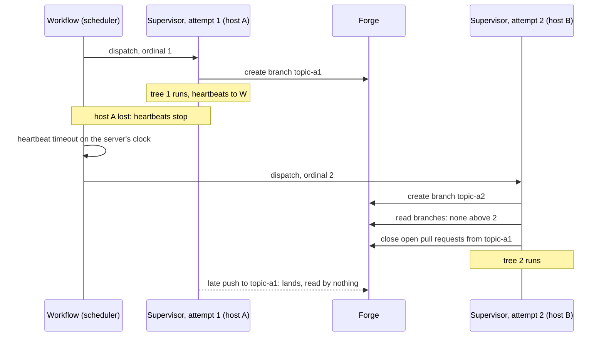

ABOUTME: Card #1461's design, a proposal for the owner: how a second attempt at a card is kept from
running alongside the first, on the same host or another, and what it rests on that no spike has measured.

# One live attempt per card

This is card #1461's design, for the owner to ratify or reject. It changes no binding document.
Every change it needs to `ARCHITECTURE.md` or `docs/spec/decisions.md` is named below as a
proposal for the owner (`D18` rule 1). Every requirement it touches is named as input to the PM's
requirement proposal on #1455, never as a requirement proposal of its own (`D18` rules 3 and 7).

Each figure below is marked **measured**, with its source, or **judgment**, with its premise. Every
citation was opened on the default branch at fbddb4b1.

## The answer

The design has two parts, one per case, and they share one rule: an attempt becomes current only by
a step the earlier attempt cannot undo, and Rigger acts only on what the current attempt wrote.

- **Same host.** Before an attempt starts any process for a card, its supervisor takes a host-local
  lock for the card and raises the card's attempt ordinal on that host. It then ends every earlier
  attempt's containment unit the host recorded or still holds. Every process an attempt starts is
  started under the same lock, after a check that its ordinal is still the host's. So an earlier
  supervisor that is still running can never start a process after the later attempt's check.
- **Another host.** Each attempt at a card's maker carries an ordinal the scheduler issues, and
  pushes to a branch of its own named by that ordinal. The attempt becomes current by creating that
  branch on the forge before its tree starts. Rigger reads, gates and merges only the branch with the
  card's highest ordinal. A stale attempt's push, pull request, note or marker therefore lands on a
  name nothing reads. A lease on the scheduler's clock decides when the next attempt may start, and
  a supervisor that loses the lease ends its own tree first.

The fence needs no clock: a stale write is refused by its ordinal, never by a time. Only liveness, which is when a
lost attempt is given up, needs a clock, and that clock is the scheduler's alone.

What the design cannot give is stated as plainly: a tree on an unreachable host whose supervisor is
dead runs on until that host's next worker start, on Linux and macOS. The design makes that tree's
writes inert; it cannot make the tree stop. "The guarantee" below says what follows for the PM.

## The problem, and its evidence

A dispatch's tree outlives a killed worker, and the scheduler starts a second tree for the same card
meanwhile. On macOS and Linux the orphan lived 293 s to 311 s after `kill -9` of its worker. The
next attempt started 5.53 s (macOS) and 6.18 s (Linux) after the kill, and its tree ran beside the
orphan (measured,
`docs/spikes/temporal-dispatch-under-failure.md`, "The worker killed outright, mid-dispatch"). On
another host, two trees for one card ran at once for 257 s (derived there from the tree logs,
"The pinned worker killed outright mid-dispatch, and not restarted").

The event history held no event for the first attempt's start; only the last heartbeat's details,
which the spike filled with the root pid, recorded it (the same section, "What the history shows,
and what it does not"). Two agents working one card push over each other's line of work, comment
twice, and can each reach the merge. #1453 records this as "every lost worker runs two agents on one
card" ("What it does not give").

The other-host half rests on judgment, not measurement: no spike partitioned a host
(`docs/spikes/temporal-dispatch-under-failure.md`, "What one machine leaves unproved about two").
"Unmeasured claims, and the spike for each" below names the spikes that would measure it.

## The guarantee

This is the condition the design is built to meet. It is **input to the PM's requirement proposal on
#1455, and not a requirement proposal.**

1. **Same host.** On one host, no process of an earlier attempt at a card's dispatch slot is alive
   once a later attempt at that slot has started its first process. This holds for every process
   the host's containment unit holds. A dispatch slot is the maker, one judge role, or the role an
   escalation goes to.
2. **Another host.** Once a later attempt at a card's maker has become current, no write an earlier
   attempt makes changes what Rigger reads as the card's line of work, its pull request, its verdicts
   or its escalation notes. No earlier attempt's pull request merges.
3. **Another host, reachable.** Where the earlier attempt's supervisor is alive and can reach the
   scheduler's verdict, it ends its tree before the later attempt starts, within the margin
   "The clocks" states.

The epic's wording, "never does work while an earlier attempt at the same card is alive, on the same
host or on another" (#1455, "What done means"), is item 1 on one host. Across hosts it is not
attainable by any design: a host that is unreachable, with its supervisor dead, cannot be told to
stop. Items 2 and 3 are what can be guaranteed there. **Open question for the PM and the owner
(blocking the requirement, not this design):** whether the requirement takes items 2 and 3 for the
other-host case, or waits on a host-side mechanism that ends a tree whose supervisor is dead.

## Where each case arises

| Case | v0's engine (`D11`, `D13`) | E3's workflow |
|---|---|---|
| Same host, earlier supervisor dead | After the engine is killed outright. The next start ends each recorded group (`R-STATE-10`), which ruling 1 gives E1 | A worker killed and restarted, as #1429's kill runs measured; or a retry scheduled on the same host queue |
| Same host, earlier supervisor still running | Does not arise. A retry of the card follows the first attempt's settle, and "a dispatch ends only once L0 has terminated the group's processes" (`ARCHITECTURE.md`, "Failure model") | A heartbeat timeout while the worker lives, for example a stall (#1429, "What would reverse this") |
| Another host | Does not arise: one engine runs one repository on one host (`D11` rule 1, `D13` rule 1) | A re-route after the `SCHEDULE_TO_START` timeout (#1429, "Pinning") |

So every part this epic carries is needed only under E3's workflow, which is ruling 2's premise
([1453#7073132437](https://github.com/williacj/rigger/issues/1453#issuecomment-7073132437)).

## Who carries which part

| Part | Carried by | Why |
|---|---|---|
| Ending a recorded containment unit (cgroup, job, or today's group) | E1's backend builds | Ruling 1: containment is L0's, per `ARCHITECTURE.md`'s layer table |
| The unit's durable record, and how a recorded unit is told from a reused one | E1's backend builds | Ruling 1: the record of each dispatch's group is L1's, "so that a later start can end what a dead engine left" (`ARCHITECTURE.md`, "Failure model") |
| The reap at a worker's or engine's start | E1's backend builds | Ruling 1 |
| The check made before each attempt, with the host-local card lock and ordinal | This epic, E2 | Ruling 1 leaves E2 the per-attempt check, which a start-time reap never runs |
| The attempt ordinal, the attempt branch, and what reads only the highest one | This epic's design; built in E3 | Ruling 2 moves the other-host build into E3 |
| The lease and the self-fence on the scheduler's heartbeat | This epic's design; built in E3 | It exists only under Temporal |

## The same-host case

### The check before each attempt

Each host keeps, beside E1's record of containment units, a lock and an ordinal for each card's
dispatch slot. Before attempt *n* at a slot starts any process for the card, its supervisor runs
these steps:

1. It takes the card's host lock. The lock is a file linked into the state directory under a name
   no other write reuses, naming the holder's pid and the start of that process, as admission's
   closers are linked (`ARCHITECTURE.md`, "Failure model"). A holder whose pid and start no longer
   match a live process holds nothing, and the next taker breaks its lock.
2. It reads the slot's ordinal on this host. Where that ordinal is above *n*, attempt *n* is stale:
   it releases the lock and starts nothing.
3. It writes *n* as the slot's ordinal.
4. It reads every unit this host recorded for the card's slot, and, on Linux, lists the card's own
   cgroup directory, so that a unit whose record was cleared is still found.
5. It ends each unit it found, through E1's kill, and reads each again until it is empty.
6. It releases the lock.

For the maker's slot, step 4 covers every slot of the card, because no judge or role of a card runs
while its maker runs (`ARCHITECTURE.md`, "Failure model", the order of an attempt). A judge's
attempt covers its own slot only, so a panel's other judges run on.

### When it finds an earlier tree alive

It ends that tree, through E1's kill of the recorded unit, before it starts anything. It does not
wait for the earlier attempt to finish, because the scheduler has already given that attempt up.
Where E1's kill cannot end a member, as `R-STATE-19` allows, the attempt starts nothing and fails.
The workflow then sees an attempt that failed to start, and the owner sees the member by name and
command line in the record. A tree the check cannot end never runs beside a new one.

### Telling a recorded unit from a reused one

This design relies on E1 for it, and adds one property. Today's record already names "what L0 needs
to tell that group from a later one given the same id" (`ARCHITECTURE.md`, "Failure model"):
`src/execution/groups.mjs` keeps the start of the group's leader beside its id. Pids are reused fast
on Windows: #1429 found pid 21388, which its stand-in tree had at 00:48:11Z, held by a conhost.exe
created at 01:14:37Z (measured, "The worker killed outright, mid-dispatch" and "No recorded pid is
still alive"). That is 26 minutes (derived from the two times).

The property it adds is that a unit's name carries the card, the slot and the ordinal. A cgroup path
or a job name is then never reused, because no two attempts share an ordinal. The process-group
fallback keeps today's id-plus-leader-start rule.

### When the earlier supervisor is still running

Both supervisors take the same host lock before they act. The earlier supervisor starts every
process the same way:

1. It takes the card's host lock.
2. It reads the slot's ordinal, and where it is no longer its own, it releases the lock, starts
   nothing, and ends its attempt with a failure.
3. Otherwise it starts the process inside its unit and records the unit.
4. It releases the lock.

Of the two critical sections, one runs first. If the earlier supervisor's runs first, its unit is
recorded, and the later check ends it. If the later check runs first, the earlier supervisor reads a
higher ordinal and starts nothing. Two supervisors in one worker process take the same file lock, so
the lock excludes them as it excludes two processes. The earlier supervisor's own heartbeat then
learns that its attempt is no longer current, and it ends its unit ("The lease, and the self-fence").

### An operating system with no measured whole-tree kill

macOS is one today. #1430 measured that today's route left M6 alive on macOS, the member that starts
a new session and moves to `/` ("The table"). On macOS the check still runs every step. Step 5 then
ends what the process group and the census of the card's directories reach, which is today's route
(`R-STATE-17`), and nothing more.

So the guarantee's item 1 holds on macOS only for members that stay in their group or work in the
card's directories. A member that escapes both runs on beside the new attempt. Item 2 still holds
for it, because its writes land on its own attempt's names. The design names macOS's item 1 as
partial until E1's macOS spike reports (#1453, "What is unknown").

## The other-host case

### Where the fence lives, and why neither host holds it

The fence is the set of the card's attempt branches on the forge. Attempt *n* at a card's maker
pushes to a branch named by the card's topic and *n*, for example `rigger-1461-a3` for the third.
The current attempt is the one whose branch carries the highest ordinal the forge holds for the
card.

Neither host holds it, because every write that matters takes effect on the forge. The forge is
also what the gate reads and what the merge changes, so the fence and the effects it guards share
one store. A forge outage stops a stale write and the check against it together.

The ordinal comes from the scheduler. Under E3, the card's workflow issues it from a counter its
history keeps, so it is monotonic per card and survives a worker's death. This needs one rule of
E3's configuration, a design choice and no figure: the dispatch activity runs with
`retry.maximumAttempts` 1, and every retry is a new activity the workflow schedules with the next ordinal. Temporal's own retry, which reached
attempt 2 unseen by the workflow in #1429, would issue attempts the workflow never numbered.

### Acquiring the fence

Before attempt *n* starts its tree, its supervisor runs these steps:

1. It creates the attempt's branch on the forge by a push that the forge refuses if the branch
   exists. The branch starts at the main line for an attempt that starts the card's work from the
   beginning, and at the previous ordinal's tip for one that continues it.
2. It reads the card's branches, and confirms that none carries an ordinal above *n*.
3. It closes every open pull request from a branch of a lower ordinal.
4. It runs the same-host check, above.

Where step 1 or 2 cannot reach the forge, the attempt starts nothing and fails, and the workflow
schedules no write for it. Where step 2 finds a higher ordinal, the attempt is stale: it starts
nothing. Where step 3 is refused, the attempt starts nothing, because a stale pull request whose
gate status is green would still be open.

A normal continuing round, after a judge returns the card, keeps the current ordinal. Only a retry
of an attempt that did not end cleanly takes the next one, because only then can an earlier tree
still be alive.

The diagram shows the proposed design. Each fact in it is also stated in the steps above.

### The lease, and the self-fence

The lease is the dispatch activity's heartbeat, and its expiry is the heartbeat timeout, measured on
the scheduler's clock. The supervisor counts, on its own monotonic clock, the time since the last
heartbeat the scheduler acknowledged. Past a threshold *S* below the heartbeat timeout *H*, it ends
its own unit and reports its attempt failed. It also ends its unit at once when the scheduler answers
a heartbeat by saying the attempt is no longer current.

The self-fence is what gives the guarantee's item 3. It is no part of item 2: a self-fence that fails
leaves a tree whose writes the ordinal already makes inert.

### Every write an attempt can make, and what refuses a stale one

A stale attempt is one whose ordinal is below the card's highest. The list is the class: every write
to the card's board state, issue, branch or pull request, by the supervisor or by the agent itself.

| Write | Made by | What refuses it from a stale attempt, or why it cannot reach the card |
|---|---|---|
| Push to the attempt's own branch | The maker's agent (`R-WORK-42`) | It lands on a branch of a lower ordinal, which nothing reads as the card's line of work |
| Push to another ref of the repository | The agent, outside its instruction | Not refused. To any `rigger-<n>-a<m>` ref it lands as a stale name too. Elsewhere it is the residual in the last row |
| Opening a pull request | The maker's agent | The gate refuses a pull request whose head branch is not the card's highest. The current attempt closes it, if it was open at step 3 of acquiring |
| An escalation note on the card's issue | The maker's agent, through the granted command (`R-ESCALATE-27`) | L2 reads notes only under the dispatch id it reads under (`ARCHITECTURE.md`, "Escalation", filter 4). The workflow hands it the current attempt's id |
| A judge's marker on the pull request | A judge's agent | A marker on a stale branch's pull request rules on nothing current. At the current head, a stale judge's marker carries a stale dispatch id, and the engine's merge decision refuses it. The forge check cannot tell it apart: residual, below |
| A column move, adding the issue to the board, an escalation comment, the escalation label, a routing comment | The supervisor, through L2 | Under E3 these are activities the workflow schedules after it accepts an attempt's result. The dispatch activity makes none of them. The workflow accepts no result from an attempt it already gave up |
| The merge | The engine's lane, or a person | The required check: the gate refuses a head branch below the card's highest. The lane merges only at the head it read, and the workflow schedules no merge for a stale attempt |
| Creating the attempt branch, and closing lower ordinals' pull requests | The supervisor, while acquiring | Made before the tree starts. A stale supervisor's create fails, or its read finds a higher ordinal |
| Writes to the attempt's own workspace and scratch directory | The agent | Each is the attempt's own directory on its own host, and no other attempt reads it |
| Any other forge write the agent's credential allows: an issue edit, a label, a board move, a pull request edit, a branch deletion | The agent, outside its instruction | Not refused. This is the residual a marker written with the owner's token carries (`ARCHITECTURE.md`, "What the gate cannot tell apart"). Under E4, the mirror undoes a board edit (#1431). Closing it needs a per-attempt forge credential the fence revokes, which no spike has measured and this design does not propose |

### When the lost host comes back with its agent still running

Two cases, by whether its supervisor lived:

- **Its supervisor is alive.** Its next heartbeat reaches the scheduler, which answers that the
  attempt is no longer current. The supervisor ends its unit. Until that answer arrives, the tree
  runs, and every write it makes lands on its own ordinal's names.
- **Its supervisor is dead.** The host's worker restarts, and E1's reap at the worker's start ends
  the recorded unit. On Windows, a job with kill-on-job-close already ended the tree with its
  supervisor (#1430, "Native Windows: a Job Object per dispatch, with kill-on-job-close"). On Linux
  and macOS the tree runs until that restart, inert.

The stale branch stays on the forge. The PM's proposal decides when Rigger removes it; until then,
nothing reads it.

### A fence held by a host that never comes back

The fence is never released, because an ordinal is never taken back. The next attempt's ordinal
supersedes it, so the stale ordinal's hold ends the moment the next attempt creates its branch.

The lease lapses at *H* after the last heartbeat the scheduler recorded. The workflow then schedules
the next attempt on the same host's queue, and re-routes after the `SCHEDULE_TO_START` timeout. The
bound on the next attempt's start is *H* plus that timeout plus one host pick (judgment, derived the
way #1429 derived its 41 s and 120 s bounds, "Waiting bounds, derived from that configuration"). With
#1429's configuration, *H* 10 s and the timeout 30 s, the re-route came 36.72 s after the kill
(measured, "The pinned worker killed outright mid-dispatch, and not restarted").

### The clocks

The fence uses no clock. Whether a write is stale is a comparison of ordinals.

The lease's expiry is decided by one clock, the scheduler's. No host's wall clock is compared with
another's, so the design tolerates any skew between hosts. #1429 measured the hosts' clocks agreeing
within about 50 ms (Windows and WSL2) and within the 0.3 s SSH round trip (the laptop and WSL2),
"Clocks". The design does not depend on those figures.

The self-fence uses the supervisor's monotonic clock, and depends on its drift. It tolerates a timer
that runs late by a fraction *d* of its interval, where *S* × (1 + *d*) + *k* + *r* < *H*. Here *k* is
the time E1's kill takes and *r* is one heartbeat's round trip. The premise for *d* is one
measurement: a 300 s timer ran 18 s late on the laptop under load, 6 % (measured: derived by #1429
from the tree's start and end lines, "The worker killed outright, mid-dispatch"). With *H* 60 s and
*S* 40 s, the left side is about 42.4 s plus *k* and *r*, against 60 s (judgment, on that one
measurement and on *k* and *r* being seconds).

A host that sleeps is outside this bound. Whether the monotonic clock counts the sleep is unmeasured,
and the design assumes it does not. A sleeping host's tree is frozen while it sleeps, so it writes
nothing then. What it writes after waking lands on its own ordinal's names.

### When a store is unavailable partway through an attempt

The design has two stores: the scheduler, which holds the lease, and the forge, which holds the
fence.

- **The forge unavailable.** A write the check cannot be made against cannot be made at all, because
  the check and the write go to the same forge. An attempt that is acquiring starts nothing (fail
  closed). An attempt already running keeps running, and its own writes fail until the forge
  returns. The gate posts nothing, so nothing merges. GitHub's parts can fail apart: a push can land
  while its API is down. That push still lands on its own attempt's branch.
- **The scheduler unavailable.** The holder cannot renew. Past *S* it ends its own unit, whether the
  outage is the scheduler's or its own partition, because it cannot tell the two apart. When the
  scheduler returns, it times the attempt out and the workflow schedules the next ordinal. No write
  is let through on the lease's account, because no write depends on the lease.

The cost is stated under "What it costs": a scheduler outage longer than *S* ends every in-flight
dispatch.

## The actors and their steps

A step is one read, write, rename or forge call. Each actor below takes the steps listed, and the
interleaving table orders them.

| Actor | Steps |
|---|---|
| **S*n***, attempt *n*'s supervisor | a1 create the attempt branch (forge call). a2 read the card's branches (forge call). a3 close a lower ordinal's pull request (forge call, once per request). h1 link the host lock (write). h2 read the slot's ordinal (read). h3 write the slot's ordinal (rename). h4 read the units recorded or present for the card (read). h5 end a unit (write: a kill). h6 read the unit until empty (read). h7 unlink the host lock (write). p1 start a process in its unit and record the unit, under h1 to h7's lock and h2's check (write). l1 send a heartbeat (call to the scheduler). l2 end its own unit on the self-fence (write). r1 remove a unit's record once it reads empty (write). e1 report its attempt's end to the scheduler (call) |
| **T*n***, attempt *n*'s agent tree | t1 push (forge call). t2 open a pull request (forge call). t3 post an escalation note (forge call). t4 post a marker, for a judge's tree (forge call). t5 any other forge write its credential allows (forge call) |
| **The scheduler** (Temporal's server and the card's workflow) | c1 record a heartbeat. c2 time out an attempt at *H*. c3 schedule the next ordinal's attempt, on the same host or another. c4 accept or refuse an attempt's result |
| **The fence store** (the forge) | f1 apply a create-only push, or refuse it (forge call). f2 answer the card's branches (forge call) |
| **The gate** | g1 read the card's branches and the pull request's head branch (forge call). g2 post its status (forge call) |
| **The merge** | m1 the lane's merge at the head it read, or a person's (forge call) |
| **The host record** (E1's) | The units h4 reads, p1 adds and r1 removes |

## Interleavings

Each row is an ordering of the steps of two or more concurrent attempts that can change the outcome.
Attempt 1 is the earlier and attempt 2 the later, unless the row says otherwise.

| # | Ordering | Required outcome |
|---|---|---|
| 1 | Same host. S1 is killed outright while T1 runs; c2; c3 schedules attempt 2 on the same host; S2's h1 to h6 find T1's unit and end it; S2's p1 | T1 is ended before T2's first process starts. On macOS, as "An operating system with no measured whole-tree kill" states |
| 2 | Same host. S1 stalls with T1 alive; c2; c3 on the same host; S2's h1 to h7 end T1; S1 resumes and tries p1 | S1's p1 reads ordinal 2 at h2 and starts nothing; S1 ends its attempt as failed; c4 refuses its result |
| 3 | Same host, the check-then-start race. S2's h4 finds no unit of T1, and S1 then tries p1 | Cannot happen as written: S2's h3 precedes its h4 under the lock, and S1's p1 reads the ordinal under the same lock. S1's p1 either runs before S2's section, so h4 finds and ends its unit, or after it, and starts nothing |
| 4 | Same host. S1's error path clears T1's unit record (r1 before the unit is empty) while T1 lives; S2's h4 | On Linux, h4 lists the card's cgroup directory and ends T1's unit. On Windows, a job with kill-on-job-close ends with S1's last handle; while S1 lives, as row 2. On macOS, h4's census of the card's directories ends what works there; an escaped member runs on, inert under item 2 |
| 5 | Another host. S1's error path reports e1 while T1 lives; c3 schedules attempt 2 elsewhere; S2's a1 | e1 follows the unit's end, as a dispatch ends today only once its group's processes are ended. Where it does not, through a defect or a member E1 cannot end, T1 lives on beside T2, and its writes land on ordinal 1's names |
| 6 | S1 is killed outright before f1 answers its a1 | Either the branch exists or it does not. S1 started no process, because p1 follows a2. S2's a1 creates ordinal 2's branch either way |
| 7 | S1 is killed outright between h1 and h7 | The lock's holder no longer matches a live process, so S2's h1 breaks it. S1 started no process outside its section |
| 8 | S1 is killed outright between h6 reading a unit empty and r1 | A stale record remains. S2's h4 or E1's reap confirms the unit's identity, finds it empty, and removes the entry |
| 9 | S1 is killed outright during l2, its self-fence's kill | T1 may survive with S1 dead: row 1 on the same host, row 13 on another |
| 10 | Another host. S2's a1 and a2; then T1's t1 | T1's push lands on ordinal 1's branch. Nothing reads it as the card's line of work |
| 11 | Another host. S2's a1 to a3; then T1's t2 | The gate's g1 reads ordinal 2 and posts a failure on T1's pull request; it never merges |
| 12 | Another host. T1's t2; g1 reads ordinal 1 and g2 posts success; S2's a1 to a3 | a3 closes T1's pull request, so its green status merges nothing. A person's m1 between S2's a1 and a3 is the residual, two forge calls long |
| 13 | Another host. T1's t3, a note, or t4, a marker, after S2's a1 | L2 reads no note under ordinal 1's dispatch id. The engine's merge decision refuses ordinal 1's marker; the forge check cannot tell it apart (residual) |
| 14 | Another host. Host A sleeps or stalls with T1 alive; c2 at *H*; c3; S2's a1; host A resumes; T1 writes; S1's l1 | T1's writes before S1's heartbeat answer land on ordinal 1's names. The answer says attempt 1 is no longer current, and S1 ends T1 |
| 15 | Another host. Host A loses the scheduler and keeps the forge; S1 counts *S* and runs l2; c2 at *H*; c3; S2's a1 | T1 is ended before S2 starts, within "The clocks"' margin. Where S1 is dead or its clock runs past the margin, T1 writes on after S2's a1, and every write lands on ordinal 1's names |
| 16 | The scheduler is unavailable. S1's l1 fails; S1 runs l2 at *S*; the scheduler returns, c2, c3; S2's a1 | T1 is ended before attempt 2 starts. Where S1 cannot end it, as row 15 |
| 17 | The forge is unavailable while attempt 1 runs; c2, c3; S2's a1 fails | Attempt 2 starts nothing and fails. The workflow schedules it again; T1's writes fail meanwhile, and nothing merges |
| 18 | Three attempts, 1 to 3. S2 stalls before its a1; S3's a1 creates ordinal 3; S2's a1 then succeeds | S2's a2 finds ordinal 3, so S2 starts nothing. Ordinals 1 and 2 are both stale, and each meets the rows above against ordinal 3 |
| 19 | Two supervisors' a1 for ordinals 2 and 3 race at f1 | Each creates its own branch, because the names differ. Each a2 then reads the other: ordinal 2 starts nothing, ordinal 3 proceeds |

## Orderings the table leaves out

Every other ordering is equivalent to a row above, or cannot change the outcome:

- **Steps of the later supervisor before its a1** are local reads and writes or a create on the
  forge. None changes what Rigger reads as the card's, so an earlier attempt's write before S2's a1 is
  a current attempt's write.
- **An earlier tree's writes after S2's a1** are equivalent by write: rows 10 to 13 cover each kind
  the write table lists. Its other writes are the residual row of that table.
- **Two stale attempts against each other** cannot change the outcome. Neither is current, and
  nothing reads either one's names.
- **Any number of attempts** reduces to pairs: ordinals are totally ordered, so each earlier attempt
  meets the newest as in a two-attempt row. Row 18 shows the reduction once.
- **c3 before c2** cannot occur. The dispatch activity runs with `retry.maximumAttempts` 1, so the
  workflow schedules the next ordinal only after the scheduler has failed or timed out the last one.
- **A gate run before and after a2** is row 12 and row 11.
- **Two processes started by one supervisor** are ordered by its own lock, and each is row 3 against
  the other supervisor.
- **E1's reap at a worker's start against a later attempt's check on that host** takes the same lock,
  so it is row 3 with the reap as one side.

## What the guarantee needs from the PM's proposal

Ruling 3 gives the PM's proposal on #1455 the amendments to `R-WORK-2` and `R-WORK-4`, and the
proposal of `D11`'s successor. This design needs the following from them. It is input, not a
proposal.

- **`R-WORK-2`.** It says "at most one actor mutates a card's board state or its workspace at any
  moment". Across hosts that cannot be kept, as "The guarantee" sets out. The design needs it
  restated as the guarantee's items: one live attempt per slot on a host, and only the current
  attempt's writes read as the card's. It also needs "its workspace" to mean the current attempt's.
- **`R-WORK-4`.** It says two engines never work one repository. Under E3, workers on several hosts
  serve one workflow per card. The design needs one scheduler issuing a card's ordinals, not one
  engine per repository.
- **`D11`'s successor.** `D11`'s deferred row says leases and fencing tokens return "when a consumer
  must run two engines against one repository", and its Notes say "a lease without fencing gives the
  appearance of exclusion without the guarantee". The successor records this design's choice: a
  fencing ordinal on the forge, carried by branch names, with the lease used only for liveness. The
  ordinal is the architect's to propose in that decision; the PM's proposal names the requirement it
  keeps.

**Ruling 3.** The design does not depart from it. It assigns no row to E2 that ruling 3 gives E3, and
it proposes no change to `D1`, `D10`, `R-STATE-2` or `R-STATE-3`.

### Other requirements the design expects the PM's proposal to change

- **`R-WORK-19`**, which refuses to start a card's work from the beginning while the forge holds its
  line of work. Under the design, a stale ordinal's branch is on the forge, so the row must name the
  current ordinal's line of work.
- **`R-WORK-25`**, the continuing attempt's workspace. A continuing attempt after a retry starts at
  the previous ordinal's tip, so the row must say which line it continues.
- **`R-WORK-42`**, a maker can push its card's line of work. The line becomes the attempt's branch.
- **`R-STATE-17`**, containment as a process group plus a census, which E1 already changes. This
  design adds nothing to it beyond E1's units.

## Which parts depend on Temporal

| Part | Depends on Temporal? |
|---|---|
| The same-host check, the host lock and the slot's ordinal | No. It holds whatever restarts the work |
| The attempt branch, and reading only the highest ordinal | No. It needs an ordinal monotonic per card, which any scheduler can issue |
| Issuing the ordinal from the workflow's history, with `retry.maximumAttempts` 1 | Yes |
| The lease on the heartbeat timeout, and the self-fence | Yes |
| The write table's rows that rest on the workflow accepting no stale result | Yes |

## Where each part would live

| Part | Layer or extension point, or what it waits on |
|---|---|
| The same-host check, the host lock and the slot's ordinal | L1, which makes the workspace an attempt runs in and records its groups (`ARCHITECTURE.md`, "The layers"). It reaches E1's kill through L0's process adapter, and lives beside `src/execution/groups.mjs` |
| The unit's kill and its identity | L0's process adapter, through E1's builds |
| The attempt branch's name | L1, which derives a card's line of work from the topic rule (the Engine settings extension point). Whether the topic rule gains the ordinal for every consumer, or only E3's package derives it, waits on the E3 placement proposal |
| Creating the attempt branch and reading the card's branches | L0's forge adapter. The create is a new write; which side admits it waits on the E3 placement proposal |
| Closing a lower ordinal's pull request | L2, through the repository-write side, which today admits a comment, a label, a merge and an issue's opening or closing, but no pull request's close. It needs that write added |
| The gate refusing a head branch below the card's highest | L2's gate rule, `src/workflow/gate.mjs`, through L0's read side |
| Reading notes and markers under the current attempt's dispatch id | L2, in `src/workflow/escalation.mjs` and the engine's merge decision |
| Issuing the ordinal, the lease and the self-fence, and the dispatch activity making no forge write | The E3 placement proposal: the planned line on #1456, "Proposal (architect): where the side-by-side Temporal package lives, and the `ARCHITECTURE.md` delta for workflows and activities", not yet filed |

## Proposed changes to `ARCHITECTURE.md` and the decisions

Each is a proposal for the owner (`D18` rule 1), made in the architecture delta #1455 plans after the
requirement is ratified. None is made here.

| Where | What would change |
|---|---|
| `ARCHITECTURE.md`, "The layers" | L1's row gains the check before each attempt and the host lock. L0's row gains the attempt branch's create |
| `ARCHITECTURE.md`, "Boundary rules", rule 2 | The forge adapter's sides: the attempt branch's create, and a pull request's close on the repository-write side |
| `ARCHITECTURE.md`, "Extension points", Engine settings | The topic rule's line of work, where the E3 placement proposal puts the ordinal in it |
| `ARCHITECTURE.md`, "Failure model" | The order of an attempt gains the acquiring steps and the check. The sentence "One engine works a repository (`D11`)" in the hold's notice changes with `D11`'s successor. The host-local lock joins what the state directory holds |
| `ARCHITECTURE.md`, "The gate" | The rule reads the card's branches and refuses a head branch below the highest. "What the gate cannot tell apart" gains a stale judge's marker at the current head |
| `ARCHITECTURE.md`, "Telemetry" | Events for an acquire, a stale attempt that started nothing, and a unit the check ended |
| `D11` | Superseded by its successor, which records the fencing ordinal and what would reverse it |

`D13` changes with E1's other operating systems, not with this design.

## Unmeasured claims, and the spike for each

| Claim the design rests on | The spike that would measure it |
|---|---|
| The forge refuses a create-only push of an existing branch, atomically, when two hosts push at once, and the gate's token can read the card's branches | **Question:** does github.com refuse a push with an expected-absent old value for an existing branch, with exactly one winner per round under concurrent pushes? **Host:** the laptop and WSL2, against a probe repository. **Measurement:** winners per round over repeated concurrent rounds, and the gate workflow's read of the branches under its `GITHUB_TOKEN` |
| A heartbeat from an attempt the server already timed out is answered with "no longer current", and the server refuses that attempt's result | **Question:** what does the TypeScript SDK 1.26 deliver to an activity whose attempt timed out while it was cut off, and how long after it reconnects? **Host:** the server in WSL2, a laptop worker, cut off by stopping its tunnel. **Measurement:** the time from reconnection to the activity's cancellation, and the server's answer to its completion |
| The SDK lets the supervisor know when the server last recorded a heartbeat | **Question:** does the SDK expose a heartbeat's acknowledgement, given that it throttles what it sends (#1429, "Why the next attempt came before the 10 s heartbeat timeout")? **Host:** any one. **Measurement:** the gap between `heartbeat()` calls and the server-recorded heartbeats a pending-activity describe shows |
| A supervisor's monotonic clock does not count a host's sleep | **Question:** does Node's monotonic clock advance across sleep? **Hosts:** the laptop (macOS sleep) and the Windows machine (sleep, and WSL2 across it). **Measurement:** monotonic delta against wall delta across a timed sleep |
| A timer's lateness stays within *d* under the load a worker host carries | **Question:** how late does a Node timer of the self-fence's interval fire under suite-level load? **Hosts:** the laptop, WSL2, Windows. **Measurement:** the distribution of lateness over repeated timers, against #1429's 18 s on 300 s |
| A scheduler that was down times out, on its return, an attempt whose heartbeat deadline passed meanwhile | **Question:** after the server restarts, when does it time out an activity whose last heartbeat is older than *H*? **Host:** the server in WSL2, a laptop worker. **Measurement:** the time from the server's return to the timeout, and to the next attempt's start |
| A host-side partition plays out as rows 14 and 15 say | **Question:** with two machines, does a worker cut from the scheduler but not from the forge self-fence before the next attempt starts, and do its later writes land only on its own names? **Hosts:** the laptop and WSL2 workers, the server in WSL2. **Measurement:** self-fence time against the next attempt's start, and where each late write landed |

## E1 results that would change it

| E1 result | How it changes the design |
|---|---|
| #1458 finds a non-elevated Windows supervisor cannot create or assign a job | Windows joins macOS as an operating system whose guarantee item 1 is partial |
| #1459 finds no delegated cgroup without a login session | A Linux worker run as a service (ruling 6) has no unit, so Linux's item 1 is partial until that service gets one |
| #1460 finds an orphaned job's members can be found after the supervisor dies | Nothing, while jobs keep kill-on-job-close. It becomes the Windows check's route if kill-on-job-close is dropped, as #1430's third reversal would have it |
| E1's macOS spike finds a whole-tree kill for a normal user | macOS's item 1 becomes whole |
| Ruling 5's spike finds a real agent escaping its unit | Item 1 is partial on that operating system for that route; item 2 is unchanged |

## What would reverse it

- **The first spike finding the create-only push not atomic, or the branches unreadable by the
  gate.** The fence would move to a store with compare-and-set that the gate can read, and the
  design would need a decision on which.
- **A stale attempt's write shown taking effect** in a two-machine run. The ordinal fence would be
  unsound for that write's kind.
- **The second spike finding no "no longer current" answer.** Row 14's tree would run until the host's
  next worker start, as with a dead supervisor; item 3 would hold only through the self-fence.
- **The owner ruling that a branch per attempt costs more than it buys.** The other-host fence
  would then rest on the agent's push alone, and a stale push could overwrite the current line.
- **The requirement taking only item 1, across hosts too.** The design cannot meet it, and the
  owner would need a host-side mechanism that ends a tree whose supervisor is dead.

## Out of scope

- **Building any part.** The card puts building outside it; #1455 and #1456 file the builds.
- **The requirement's rows.** The PM proposes them on #1455 (`D18` rules 3 and 7).
- **A per-attempt forge credential.** It would close the write table's residual row, but no spike has
  measured one and no card names it. It is left out as a future nobody asked for.
- **v0's dispatch.** No case this design covers arises under v0 beyond E1's reap ("Where each case
  arises").
- **How stale branches are removed.** The PM's proposal decides it; until then they are inert.

## What it costs

- **A branch per retried attempt.** A card retried after a lost worker gains a branch, and its pull
  request moves to a new head branch, so its earlier markers no longer govern.
- **A forge round trip before each retried attempt.** Acquiring adds a create, a read and a close
  per lower ordinal's open pull request.
- **A scheduler outage ends every in-flight dispatch** once it lasts longer than *S*. The Service on
  the mini is a single point of failure already (#1453, "What it costs", item 2); this design makes
  its outages cost work.
- **Residuals the design names but does not close:** an agent's writes outside its instruction, a
  stale judge's marker at the current head on the forge check, and a person's merge in row 12's window.

## Acceptance map

| Acceptance item | Where it is met |
|---|---|
| The guarantee, as input to the PM | "The guarantee" |
| How a second attempt establishes whether an earlier tree is alive, same host | "The check before each attempt" |
| What it does when it finds one | "When it finds an earlier tree alive" |
| A recorded unit told from a reused one | "Telling a recorded unit from a reused one" |
| An operating system with no measured whole-tree kill | "An operating system with no measured whole-tree kill" |
| Which parts E1 carries and which this epic carries | "Who carries which part" |
| The earlier supervisor still running | "When the earlier supervisor is still running" |
| Where the fence lives, and why neither host holds it | "Where the fence lives, and why neither host holds it" |
| How an attempt acquires it, and what it does when it cannot | "Acquiring the fence" |
| Every write, and what refuses each from a stale attempt | "Every write an attempt can make, and what refuses a stale one" |
| The lost host comes back | "When the lost host comes back with its agent still running" |
| A host that never comes back, and the bound | "A fence held by a host that never comes back" |
| The clock, skew and drift | "The clocks" |
| A store unavailable mid-attempt | "When a store is unavailable partway through an attempt" |
| Actors and steps; the table; omitted orderings; the required rows | "The actors and their steps", "Interleavings" (rows 6 to 9, 10 and 11, 14, 15, 16, 4 and 5, 3), "Orderings the table leaves out" |
| The dispatch model for each case | "Where each case arises" |
| What the guarantee needs from ruling 3's amendments; departure from ruling 3 | "What the guarantee needs from the PM's proposal" |
| Which parts depend on Temporal | "Which parts depend on Temporal" |
| Placement, and the E3 proposal it waits on | "Where each part would live" |
| Sections and decisions it would change; requirements it expects changed | "Proposed changes to `ARCHITECTURE.md` and the decisions", "Other requirements the design expects the PM's proposal to change" |
| Unmeasured claims and their spikes; E1 results; reversal | "Unmeasured claims, and the spike for each", "E1 results that would change it", "What would reverse it" |
