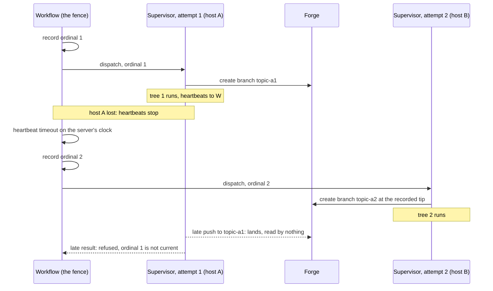

ABOUTME: Card #1461's design, a proposal for the owner: how a second attempt at a card is kept from
running alongside the first, on the same host or another, and what it rests on that no spike has measured.

# One live attempt per card

This is card #1461's design, for the owner to ratify or reject. It changes no binding document.
Every change it needs to `ARCHITECTURE.md` or `docs/spec/decisions.md` is named below as a
proposal for the owner (`D18` rule 1). Every requirement it touches is named as input to the PM's
requirement proposal on #1455, never as a requirement proposal of its own (`D18` rules 3 and 7).

Each figure below is marked **measured**, with its source, or **judgment**, with its premise. Every
citation was opened on the default branch at fbddb4b1, except #1460's report, which was read on its
pull request, #1471, before that pull request merged.

## The answer

The design has two parts, one per case. They share one rule: an attempt becomes current by a step
the earlier attempt cannot undo, and Rigger acts only on what the current attempt produced.

- **Same host.** Before an attempt starts any process for a card, its supervisor takes a host-local
  lock for the card and raises the slot's attempt ordinal on that host. It then ends every earlier
  attempt's containment unit it can find, by the record or by the unit's own name. Every process an
  attempt starts is started under the same lock, after a check that its ordinal is still the host's.
  So an earlier supervisor that is still running can never start a process after the later check.
- **Another host.** The card's workflow holds the fence: the current maker ordinal, the dispatch ids
  of the current dispatches, and the tip the current attempt's supervisor read from its own
  workspace. The workflow accepts a result only from the current ordinal, merges only at the tip it
  recorded, and reads notes and verdicts only under current dispatch ids. Each maker attempt pushes
  to a branch of its own, so a stale maker's pushes never move the current line.
- **Clocks.** The fence uses no clock: a stale write is refused by its ordinal or its dispatch id,
  never by a time. Only liveness, which is when a lost attempt is given up, needs a clock, and that
  clock is the scheduler's alone.

Two things the design cannot give are stated as plainly:

- A tree on an unreachable host whose supervisor is dead runs on until that host's next worker
  start, on Linux and macOS. The design keeps that tree from changing what the workflow merges; it
  cannot make the tree stop.
- Every attempt's agent writes to the forge with one credential, and runs as the supervisor's own
  user. A stale agent that writes outside its instruction is therefore indistinguishable on the forge
  from the current attempt. The workflow's own path refuses its effect. The forge's required check,
  and so a person's merge, cannot. "The guarantee" routes this to the owner.

## The problem, and its evidence

A dispatch's tree outlives a killed worker, and the scheduler starts a second tree for the same card
meanwhile. On macOS and Linux the orphan lived 293 s to 311 s after `kill -9` of its worker. The
next attempt started 5.53 s (macOS) and 6.18 s (Linux) after the kill, and its tree ran beside the
orphan (measured, `docs/spikes/temporal-dispatch-under-failure.md`, "The worker killed outright,
mid-dispatch"). On another host, two trees for one card ran at once for 257 s (derived there from
the tree logs, "The pinned worker killed outright mid-dispatch, and not restarted").

The event history held no event for the first attempt's start; only the last heartbeat's details,
which the spike filled with the root pid, recorded it (the same section, "What the history shows,
and what it does not"). Two agents working one card push over each other's line of work, comment
twice, and can each reach the merge. #1453 records this as "every lost worker runs two agents on one
card" ("What it does not give").

The other-host half rests on judgment, not measurement: no spike partitioned a host
(`docs/spikes/temporal-dispatch-under-failure.md`, "What one machine leaves unproved about two").
"Unmeasured claims, and the spike for each" below names the spikes that would measure it.

## The guarantee

This is the condition the design is built to meet. It is **input to the PM's requirement proposal on
#1455, and not a requirement proposal.** Two terms first:

- A **dispatch slot** is the card's maker, one judge role, or the role an escalation goes to.
- A write is **within its instruction** when it is one the attempt's instruction asks for: the
  maker's push of its own branch, its pull request and its escalation note, and a judge's marker
  carrying its own dispatch id. Every other write is **outside its instruction**.

The guarantee:

1. **Same host.** On one host, no process of an earlier attempt at a card's dispatch slot is alive
   once a later attempt at that slot has started its first process. This holds for every process
   the host's containment unit holds.
2. **Another host, within instruction.** Once a later maker attempt is current, no write an earlier
   attempt makes within its instruction changes the card's current line of work. Nor does one change
   the verdicts or escalation notes that Rigger or the forge's required check reads. No pull request
   merges at a head that only an earlier attempt's work produced.
3. **Another host, outside instruction.** No write an earlier attempt makes outside its instruction
   changes what the workflow merges, or the verdicts and notes the workflow reads. Such a write can
   change what the forge holds, and so what the forge's required check reads.
4. **Another host, reachable.** Where the earlier attempt's supervisor is alive and can reach the
   scheduler's answer, it ends its tree before the later attempt starts, within the margin
   "The clocks" states.

**Open question for the owner, blocking the requirement and not the design:** whether item 3's
residual is accepted, or closed by running each agent under an operating-system user of its own with
a forge credential its attempt alone holds. The forge cannot refuse a write made with a credential
the current attempt also holds, and any secret the supervisor keeps, an agent of the same user can
read. That second option is unmeasured, and "Unmeasured claims" names its spike. Item 3's residual is
the one `ARCHITECTURE.md` already names for a marker written with the owner's token ("What the gate
cannot tell apart"), stretched in time to a stale attempt.

**Open question for the PM and the owner, blocking the requirement and not the design:** the epic
asks that a second attempt "never does work while an earlier attempt at the same card is alive, on
the same host or on another" (#1455, "What done means"). On one host, that is item 1. Across hosts no design can meet it,
because an unreachable host whose supervisor is dead cannot be told to stop. Items 2 to 4 are what
this design guarantees there.

## Where each case arises

| Case | v0's engine (`D11`, `D13`) | E3's workflow |
|---|---|---|
| Same host, earlier supervisor dead | After the engine is killed outright. The next start ends each recorded group (`R-STATE-10`), which ruling 1 gives E1 | A worker killed and restarted, as #1429's kill runs measured; or a retry scheduled on the same host queue |
| Same host, earlier supervisor still running | Does not arise. A retry of the card follows the first attempt's settle, and "a dispatch ends only once L0 has terminated the group's processes" (`ARCHITECTURE.md`, "Failure model") | A heartbeat timeout while the worker lives, for example a stall (#1429, "What would reverse this") |
| Another host | Does not arise: one engine runs one repository on one host (`D11` rule 1, `D13` rule 1) | A re-route after the `SCHEDULE_TO_START` timeout (#1429, "Pinning") |

So every part this epic carries is needed only under E3's workflow, which is ruling 2's premise
([1453#7073132437](https://github.com/williacj/rigger/issues/1453#issuecomment-7073132437)).

## Who carries which part

| Part | Carried by | Why |
|---|---|---|
| Ending a containment unit (cgroup, job, or today's group) | E1's backend builds | Ruling 1: containment is L0's, per `ARCHITECTURE.md`'s layer table |
| The unit's durable record, and how a recorded unit is told from a reused one | E1's backend builds | Ruling 1: the record of each dispatch's group is L1's, "so that a later start can end what a dead engine left" (`ARCHITECTURE.md`, "Failure model") |
| The reap at a worker's or engine's start | E1's backend builds | Ruling 1 |
| The start gate that holds a new process until its unit holds it | E1's backend builds | #1430 names a gate for Windows ("Recommendations"); the order in "Starting a process" below needs it on every operating system |
| The check made before each attempt, the host lock and ordinal, and finding a unit by its name | This epic, E2 | Ruling 1 leaves E2 the per-attempt check, which a start-time reap never runs |
| The workflow's fence: the ordinal, the current dispatch ids and the recorded tip | This epic's design; built in E3 | Ruling 2 moves the other-host build into E3 |
| The lease and the self-fence on the scheduler's heartbeat | This epic's design; built in E3 | It exists only under Temporal |

## The same-host case

### The check before each attempt

Each host keeps, beside E1's record of containment units, a lock and an ordinal for each card's
dispatch slot. A unit's name carries the card, the slot and the ordinal, so the check can find a
unit by its name as well as by the record. Before attempt *n* at a slot starts any process for the
card, its supervisor runs these steps:

1. It takes the card's host lock. The lock is a file linked into the state directory under a name
   no other write reuses, naming the holder's pid and the start of that process, as admission's
   closers are linked (`ARCHITECTURE.md`, "Failure model"). A holder whose pid and start no longer
   match a live process holds nothing, and the next taker breaks its lock.
2. It reads the slot's ordinal on this host. Where that ordinal is above *n*, attempt *n* is stale:
   it releases the lock and starts nothing.
3. It writes *n* as the slot's ordinal.
4. It reads every unit this host recorded for the slot.
5. It finds every unit of an earlier ordinal by its name, whatever the record holds:
   - **Linux:** it lists the card's own cgroup directory.
   - **Windows:** it opens the job by name for each ordinal below *n*, as "Windows" below sets out.
   - **macOS:** it has no unit to name, and reads the census of the card's directories instead.
6. It ends each unit it found, through E1's kill, and reads each again until it is empty.
7. It releases the lock.

Where any read in steps 4 to 6 gives no answer, or one the step cannot read, the attempt starts
nothing and fails. An uncertain check never lets a new attempt start.

For the maker's slot, steps 4 and 5 cover every slot of the card, because no judge or role of a card
runs while its maker runs (`ARCHITECTURE.md`, "Failure model", the order of an attempt). A judge's
attempt covers its own slot only, so a panel's other judges run on.

### Windows

The supervisor creates each job under the name the card, slot and ordinal give, with
kill-on-job-close set. A job's members are then alive only while some handle to the job is open,
and the name answers only while some handle is open:

- #1430 measured kill-on-job-close ending every member when the supervisor's handle closed
  (`docs/spikes/whole-tree-containment.md`, "E2 with kill-on-job-close set").
- #1460's report measured a fresh process opening a job by name while a holder lived, and ending
  every member with `TerminateJobObject`. With the last holder gone, the open failed with
  error 2, `ERROR_FILE_NOT_FOUND`, and kill-on-job-close had already ended every member (measured,
  runs a1 and a3, "The answer", on #1471). Both were elevated, one run per cell.

So step 5's open answers one of three things. An open that succeeds finds a live job, which step 6
ends. An open failing with error 2 means no handle is open, so no member lives. Any other answer is
uncertain, and the attempt starts nothing. This holds after the record is cleared, because the name
does not come from the record.

The supervisors must create jobs in a namespace every later supervisor on the host opens. Whether a
supervisor in another logon session, such as a worker run as a service (ruling 6), opens the same
names is unmeasured; "Unmeasured claims" names its spike.

### When it finds an earlier tree alive

It ends that tree, through E1's kill of the unit, before it starts anything. It does not wait for the
earlier attempt to finish, because the scheduler has already given that attempt up. Where E1's kill
cannot end a member, as `R-STATE-19` allows, the attempt starts nothing and fails. The workflow then
sees an attempt that failed to start, and the owner sees the member by name and command line in the
record. A tree the check cannot end never runs beside a new one.

### Telling a recorded unit from a reused one

This design relies on E1 for it, and adds one property. Today's record already names "what L0 needs
to tell that group from a later one given the same id" (`ARCHITECTURE.md`, "Failure model"):
`src/execution/groups.mjs` keeps the start of the group's leader beside its id. Pids are reused fast
on Windows: #1429 found pid 21388, which its stand-in tree had at 00:48:11Z, held by a conhost.exe
created at 01:14:37Z (measured, "The worker killed outright, mid-dispatch" and "No recorded pid is
still alive"). That is 26 minutes (derived from the two times).

The property it adds is the unit's name. A cgroup path or a job name is never reused, because no two
attempts at one slot share an ordinal. The process-group fallback on macOS keeps today's
id-plus-leader-start rule.

### Starting a process

Every process an attempt starts for the card, the first included, is started in these steps:

1. q1: it takes the card's host lock.
2. q2: it reads the slot's ordinal. Where it is no longer its own, it releases the lock, starts
   nothing, and ends its attempt with a failure.
3. q3: it writes the unit's record entry, naming the unit before the unit exists.
4. q4: it creates the unit: the cgroup directory, or the named job. macOS has no unit to create.
5. q5: it starts the process held at E1's start gate. On macOS the process leads a new group, and
   the supervisor then writes the group's id and leader start into the record entry.
6. q6: it places the process in the unit.
7. q7: it releases the gate, and the process runs its command.
8. q8: it releases the lock.

Each crash boundary leaves a state the next check handles:

| The supervisor dies after | What is left | What the next check or E1's reap does |
|---|---|---|
| q3 | A record entry naming a unit that does not exist | Reads no unit, and removes the entry |
| q4 | An empty unit. On Windows, the job's only handle closed with the supervisor, so the name is gone | Reads the unit empty, removes it and the entry |
| q5 | A gated process outside every unit | Nothing: the gate ends the process when its holder dies, so it never runs its command |
| q6 | A gated process inside the unit | Ends the unit |
| q7 | A running process inside the unit | Ends the unit |

The q5 row rests on E1's gate: a gated process waits on a channel from its supervisor, and exits when
that channel closes without a release. That is a property E1's build must give and test. Without it,
a supervisor dying at q5 leaves a process outside every unit, which only the census of the card's
directories could still find.

### When the earlier supervisor is still running

Both supervisors take the same host lock before they act. Of the two critical sections, one runs
first:

- If the earlier supervisor's q1 to q8 run first, its unit is recorded and named, and the later
  check ends it.
- If the later check runs first, the earlier supervisor's q2 reads a higher ordinal, and it starts
  nothing.

Two supervisors in one worker process take the same file lock, because the lock is a linked name and
not a per-process lock. The earlier supervisor's own heartbeat then learns that its attempt is no
longer current, and it ends its unit ("The lease, and the self-fence").

### An operating system with no measured whole-tree kill

macOS is one today. #1430 measured that today's route left M6 alive on macOS, the member that starts
a new session and moves to `/` ("The table"). On macOS the check still runs every step. Step 6 then
ends what the process group and the census of the card's directories reach, which is today's route
(`R-STATE-17`), and nothing more.

So the guarantee's item 1 holds on macOS only for members that stay in their group or work in the
card's directories. A member that escapes both runs on beside the new attempt. Items 2 and 3 still
hold for it, because they rest on the workflow and not on the host. The design names macOS's item 1
as partial until E1's macOS spike reports (#1453, "What is unknown").

## The other-host case

### Where the fence lives, and why neither host holds it

The fence is the card's workflow record, kept in the history of the card's workflow on the Temporal
Service. It holds three facts:

- the current maker ordinal;
- the dispatch id of each current dispatch, the maker's and each judge's;
- the tip of the current attempt's line of work, as its supervisor read it from its own workspace
  once the maker exited. L1 reads that tip today, for a continuing attempt ("Boundary rules",
  rule 2) and for one that started the card's work from the beginning ("Failure model").

Neither worker host holds it. The Service runs on a machine of its own, the Mac mini in #1453's plan
("What it costs", item 2). One workflow runs per card, because the workflow id is the card's
(#1429, "What ran"), so one writer changes the fence. A worker host reaches it only through the
activity results the workflow accepts.

The ordinal is a counter in the workflow's history, so it is monotonic per card and survives a
worker's death. This needs one rule of E3's configuration, a design choice and no figure: the
dispatch activity runs with `retry.maximumAttempts` 1. Every retry is then a new activity the
workflow schedules with the next ordinal. Temporal's own retry reached attempt 2 in #1429 without
the workflow's code numbering it.

### Acquiring the fence

Attempt *n* becomes current in these steps:

1. The workflow records ordinal *n* in its history, and only then schedules the attempt's activity.
   From that record on, the workflow accepts no result from a lower ordinal.
2. The supervisor creates the attempt's branch, named by the card's topic and *n*, for example
   `rigger-1461-a3`. It pushes it create-only, so the forge refuses it if the branch exists. The
   branch starts at the main line for an attempt that starts the card's work from the beginning. For
   one that continues it, the branch starts at the tip the workflow recorded, never at a tip the
   forge shows.
3. The supervisor runs the same-host check, above, and starts its tree.

Where the supervisor cannot reach the forge at step 2, or the branch already exists, it starts
nothing and fails. The workflow then records the next ordinal and schedules again. Where the
scheduler is unreachable, no attempt is recorded or scheduled.

A normal continuing round, after a judge returns the card, keeps the current ordinal. Only a retry
of an attempt that did not end cleanly takes the next one, because only then can an earlier tree
still be alive.

The diagram shows the proposed design. Each fact in it is also stated in the steps above.

### What the workflow accepts, and what the forge's required check reads

The workflow acts on the forge only through activities it schedules after it accepts a result:

- **The merge.** The workflow merges only at the tip it recorded, by a merge call carrying that head
  SHA, which the forge refuses where the pull request's head differs. It merges only on verdicts
  whose dispatch ids are current.
- **Judges.** It dispatches judges at the tip it recorded. Where the forge's head for the card's pull
  request differs from that tip, it dispatches none. It pushes the recorded tip back to the current
  branch, with the forge's head as the expected old value, and reads again.
- **Notes.** It reads escalation notes only under the current maker's dispatch id, as L2 reads notes
  today "by the dispatch id L2 reads notes under" (`ARCHITECTURE.md`, "Escalation").

The forge's required check, the gate, reads only the forge. The design changes one rule there: a
judge's dispatch id carries that judge slot's ordinal. The governing marker for a role becomes the
one with the highest ordinal at the head and acceptance digest, in place of the latest by creation
time. A stale judge's late marker therefore never governs over the current judge's. An owner's
marker carries no dispatch id, and governs the owner's role as today, by creation time.

### Why no stale pull request merges at a head only stale work produced

A person merges through the gate's status, so a stale pull request merges only where the gate admits
its head. The gate admits a head only where every judge of the card's kind governs it as sound
(`ARCHITECTURE.md`, "The gate"). At the moment the workflow records a new maker ordinal, no head of
the card's is admitted, for these reasons:

- The workflow schedules a maker only where L2's answer is a maker's dispatch. L2 answers a merge, or
  a wait for the owner, where every judge governs the head as sound.
- While the maker runs, no judge of the card is dispatched, so no current judge posts.
- A stale judge's marker carries a lower ordinal, and under the gate's changed rule never governs.
- A stale maker's push within its instruction lands on its own branch. Where that branch has an open
  pull request, its head moves to a commit no judge ruled on.

A gate run that read the card before the new ordinal and posts after it posts what it read, and by
the same reasons that was no admission. The owner can still write a sound owner marker at any head,
and so admit a stale pull request, which is the owner's ruling and no stale attempt's write.

### The lease, and the self-fence

The lease is the dispatch activity's heartbeat, and its expiry is the heartbeat timeout, measured on
the scheduler's clock. The supervisor counts, on its own monotonic clock, the time since the last
heartbeat the scheduler acknowledged. Past a threshold *S* below the heartbeat timeout *H*, it ends
its own unit and reports its attempt failed. It also ends its unit at once when the scheduler answers
a heartbeat by saying the attempt is no longer current.

The self-fence gives the guarantee's item 4. It is no part of items 2 and 3: a self-fence that fails
leaves a tree whose writes the workflow's fence already keeps from taking effect.

### Every write an attempt can make, and what refuses a stale one

A stale attempt is one whose ordinal is below the card's current one. The list is the class: every
write to the card's board state, issue, branch or pull request, by the supervisor or by the agent
itself.

| Write | Made by | Within instruction? | What refuses it from a stale attempt, or why it cannot reach the card |
|---|---|---|---|
| Push to the attempt's own branch | The maker's agent (`R-WORK-42`) | Yes | It lands on a branch the current line never derives from, because a continuing branch starts at the workflow's recorded tip |
| Opening a pull request from its own branch | The maker's agent | Yes | Its head has no current judge's verdict, so the gate admits no merge of it ("Why no stale pull request merges") |
| An escalation note on the card's issue | The maker's agent, through the granted command (`R-ESCALATE-27`) | Yes | The workflow reads notes only under the current maker's dispatch id |
| A judge's marker carrying its own dispatch id | A judge's agent | Yes | It carries a lower slot ordinal, so it governs neither the workflow's merge nor, under the changed rule, the gate |
| A column move, adding the issue to the board, an escalation comment, the escalation label, a routing comment | The supervisor, through L2 | Yes | Under E3 these are activities the workflow schedules after it accepts a result. The dispatch activity makes none of them. The workflow accepts no result from a lower ordinal |
| Creating the attempt's branch | The supervisor, while acquiring | Yes | Made before the tree starts, under its own ordinal's name, which no current attempt uses |
| Writes to the attempt's own workspace and scratch directory | The agent | Yes | Each is the attempt's own directory on its own host, and no other attempt reads it |
| A push to the current attempt's branch | The agent | No | The forge does not refuse it, because the credential is shared. The workflow refuses its effect: it merges and dispatches judges only at its recorded tip, and pushes that tip back. The gate reads the forge, so it can admit a head this push made only where every judge governs that head as sound |
| Deleting a branch, editing or closing a pull request | The agent | No | The forge does not refuse it. The workflow recreates the current branch at its recorded tip; a closed pull request is reopened or opened again from it |
| A marker carrying a dispatch id that is not its own | A judge's agent | No | The forge does not refuse it. The workflow merges only on verdicts under the current dispatch ids it handed out. The gate cannot tell it apart |
| An issue edit, a label, a board move, a comment | The agent | No | The forge does not refuse it. Under E4, the mirror undoes a board edit (#1431). The escalation label is the residual today's v0 already carries |
| A signal or result sent to the Temporal Service | The agent | No | A Service that admits any client on its network admits it. The production Service's client authentication is #1463's question, not this design's |

The rows marked outside instruction are item 3's residual, routed to the owner above.

### When the lost host comes back with its agent still running

Two cases, by whether its supervisor lived:

- **Its supervisor is alive.** Its next heartbeat reaches the scheduler, which answers that the
  attempt is no longer current. The supervisor ends its unit. Until that answer arrives, the tree
  runs, and the workflow refuses everything it writes within its instruction.
- **Its supervisor is dead.** The host's worker restarts, and E1's reap at the worker's start ends
  the recorded unit. On Windows, a job with kill-on-job-close already ended the tree with its
  supervisor (#1430, "Native Windows: a Job Object per dispatch, with kill-on-job-close"). On Linux
  and macOS the tree runs until that restart.

The stale branch, and any pull request from it, stay on the forge. The PM's proposal decides when
Rigger removes them; until then, nothing the workflow does reads them.

### A fence held by a host that never comes back

The fence is never released, because an ordinal is never taken back. The workflow's record of the
next ordinal supersedes it, at the moment the workflow records that ordinal.

The lease lapses at *H* after the last heartbeat the scheduler recorded. The workflow then schedules
the next attempt on the same host's queue, and re-routes after the `SCHEDULE_TO_START` timeout. The
bound on the next attempt's start is *H* plus that timeout plus one host pick (judgment, derived the
way #1429 derived its 41 s and 120 s bounds, "Waiting bounds, derived from that configuration"). With
#1429's configuration, *H* 10 s and the timeout 30 s, the re-route came 36.72 s after the kill
(measured, "The pinned worker killed outright mid-dispatch, and not restarted").

### The clocks

The fence uses no clock. Whether a write is stale is a comparison of ordinals and dispatch ids.

The lease's expiry is decided by one clock, the scheduler's. No host's wall clock is compared with
another's, so the design tolerates any skew between hosts. #1429 measured the hosts' clocks agreeing
within about 50 ms (Windows and WSL2) and within the 0.3 s SSH round trip (the laptop and WSL2),
"Clocks". The design does not depend on those figures.

The self-fence uses the supervisor's monotonic clock, and depends on its drift. It tolerates a timer
that runs late by a fraction *d* of its interval, where *S* × (1 + *d*) + *k* + *r* < *H*. Here *k* is
the time E1's kill takes and *r* is one heartbeat's round trip. The premise for *d* is one
measurement: a 300 s timer ran 18 s late on the laptop under load, 6 % (measured: derived by #1429
from the tree's start and end lines, "The worker killed outright, mid-dispatch"). With *H* 60 s and
*S* 40 s, the left side is about 42.4 s plus *k* and *r*, against 60 s (judgment, on that one
measurement and on *k* and *r* being seconds).

A host that sleeps is outside this bound. Whether the monotonic clock counts the sleep is unmeasured,
and the design assumes it does not. A sleeping host's tree is frozen while it sleeps, so it writes
nothing then. What it writes after waking meets the workflow's fence.

### When a store is unavailable partway through an attempt

The design has two stores: the Service, which holds the fence and the lease, and the forge, which
holds the effects.

- **The Service unavailable.** No ordinal is recorded, no result is accepted, and no merge is
  scheduled, so nothing a stale attempt wrote can take effect through the workflow. The holder
  cannot renew. Past *S* it ends its own unit, because it cannot tell the Service's outage from its
  own partition. When the Service returns, it times the attempt out, and the workflow records the
  next ordinal.
- **The forge unavailable.** An acquiring attempt cannot create its branch, so it starts nothing
  (fail closed). An attempt already running keeps running, and its writes fail until the forge
  returns. The gate posts nothing, so nothing merges. GitHub's parts can fail apart: a push can land
  while its API is down. That push still lands on its own attempt's branch.

No write is let through because a check could not run: every check the workflow makes is against its
own history, which is unavailable only when the workflow is too.

## The actors and their steps

A step is one read, write, rename or forge call. Each actor below takes the steps listed, and the
interleaving table orders them.

| Actor | Steps |
|---|---|
| **S*n***, attempt *n*'s supervisor | a1 create the attempt branch (forge call). h1 link the host lock (write). h2 read the slot's ordinal (read). h3 write the slot's ordinal (rename). h4 read the units recorded for the slot (read). h5 find units by name: list the cgroup directory, open each job name, or read the census (read, once per name). h6 end a unit (write: a kill). h7 read the unit until empty (read). h8 unlink the host lock (write). q1 to q8, each process's start, as "Starting a process" lists them. l1 send a heartbeat (call to the scheduler). l2 end its own unit on the self-fence (write). r1 remove a unit and its record once it reads empty (write). e1 report its attempt's end to the scheduler (call) |
| **T*n***, attempt *n*'s agent tree | t1 push its own branch (forge call). t2 open a pull request from it (forge call). t3 post an escalation note (forge call). t4 post a marker, for a judge's tree (forge call). t5 a write outside its instruction (forge call) |
| **The workflow**, on the Service | w1 record an ordinal. w2 schedule an attempt's activity. w3 record a heartbeat. w4 time out an attempt at *H*. w5 accept or refuse a result. w6 record the tip. w7 schedule the merge at the recorded tip (forge call through an activity). w8 push the recorded tip back (forge call through an activity) |
| **The gate** | g1 read the pull request's head, markers and acceptance (forge call). g2 post its status (forge call) |
| **A person's merge** | m1 merge where the gate's status admits (forge call) |
| **The host record** (E1's) | The units h4 reads, q3 adds and r1 removes |

## Interleavings

Each row is an ordering of the steps of two or more concurrent attempts that can change the outcome.
Attempt 1 is the earlier and attempt 2 the later, unless the row says otherwise.

| # | Ordering | Required outcome |
|---|---|---|
| 1 | Same host. S1 is killed outright while T1 runs; w4; w1 and w2 schedule attempt 2 on the same host; S2's h1 to h7 find T1's unit and end it; S2's q1 | T1 is ended before T2's first process starts. On macOS, as "An operating system with no measured whole-tree kill" states |
| 2 | Same host. S1 stalls with T1 alive; w4; w1 and w2 on the same host; S2's h1 to h8 end T1; S1 resumes at q1 | S1's q2 reads ordinal 2 and starts nothing; S1 ends its attempt as failed; w5 refuses its result |
| 3 | Same host, the check-then-start race. S2's h4 and h5 find no unit of T1, and S1 then starts a process | Cannot happen as written: S2's h3 precedes h4 under the lock, and S1's q2 reads the ordinal under the same lock. S1's q1 to q8 run either before S2's section, so h4 and h5 find and end the unit, or after it, and start nothing |
| 4 | Same host. S1's error path removes T1's unit record while T1 lives; S2's h4 and h5 | h5 finds the unit by name. Linux: the cgroup directory lists it. Windows: S1's open handle keeps the name, so the open succeeds and h6 ends the job. macOS: the census ends what works in the card's directories; an escaped member runs on, with items 2 and 3 unchanged |
| 5 | Same host, Windows. S1 is killed outright after its record was removed, with T1 alive | S1's handle closes with it; kill-on-job-close ends every member of T1. S2's open fails with error 2, which h5 reads as no live member |
| 6 | Another host. S1's error path reports e1 while T1 lives; w2 schedules attempt 2 elsewhere | e1 follows the unit's end, as a dispatch ends today only once its group's processes are ended. Where it does not, through a defect or a member E1 cannot end, T1 lives on beside T2, and items 2 and 3 hold for its writes |
| 7 | S1 dies after q3, before q4 | h4 reads an entry with no unit; r1 removes the entry. No process of S1's started |
| 8 | S1 dies after q4, before q5 | An empty unit, or on Windows a job whose name went with S1's handle. h7 reads it empty; r1 removes it |
| 9 | S1 dies after q5, before q6 | The gated process exits when S1's channel closes, without running its command. Nothing is left to end |
| 10 | S1 dies after q6, or after q7 | The unit is recorded and named; S2's h4 to h7, or E1's reap, end it |
| 11 | S1 dies between h1 and h8, or between q1 and q8, holding the lock | The lock's holder no longer matches a live process, so S2's h1 breaks it |
| 12 | S1 dies between h7 reading a unit empty and r1 | A stale record remains. S2's h4 or E1's reap confirms the unit's identity, finds it empty, and removes it |
| 13 | S1 dies during l2, its self-fence's kill | T1 may survive with S1 dead: row 1 on the same host, row 18 on another |
| 14 | S2 dies after a1, before its tree starts | Its branch exists, empty of work. w4 or w5 fails attempt 2; w1 records ordinal 3, whose branch has another name |
| 15 | Another host. w1 records ordinal 2; then T1's t1, t2 or t3 | Each lands as its write-table row says: on T1's own branch, as a pull request no judge ruled on, or as a note under a stale dispatch id. None changes what the workflow merges or reads |
| 16 | Another host. T1's judge slot is stale; its t4 posts a sound marker at the current head after the current judge posted needs revision | Under the gate's changed rule, the current judge's higher ordinal governs, so the gate does not admit. The workflow reads only the current dispatch id |
| 17 | Another host. g1 reads the card before w1 records ordinal 2; g2 posts after it; m1 | g2 posts what g1 read, which admitted no head, because a maker's dispatch was in flight ("Why no stale pull request merges"). m1 finds no admission |
| 18 | Another host. Host A sleeps or stalls with T1 alive; w4 at *H*; w1 and w2 for ordinal 2; host A resumes; T1 writes; S1's l1 | T1's writes before S1's heartbeat answer meet the workflow's fence, as row 15. The answer says attempt 1 is no longer current, and S1 ends T1 |
| 19 | Another host. Host A loses the Service and keeps the forge; S1 counts *S* and runs l2; w4 at *H*; w1 and w2 | T1 is ended before S2 starts, within "The clocks"' margin. Where S1 is dead or its clock runs past the margin, T1 writes on after w1, as row 15 |
| 20 | The Service is unavailable. S1's l1 fails; S1 runs l2 at *S*; the Service returns; w4; w1 and w2; S2's a1 | T1 is ended before attempt 2 starts. Where S1 cannot end it, as row 19. While the Service is down, w5 and w7 run for no attempt, so nothing takes effect through the workflow |
| 21 | The forge is unavailable while attempt 1 runs; w4; w1 and w2; S2's a1 fails | Attempt 2 starts nothing and fails; w1 records ordinal 3 later. T1's writes fail meanwhile, and nothing merges |
| 22 | Three attempts. S2 stalls before its a1; w4 times out attempt 2; w1 records ordinal 3; S2 resumes | S2's a1 creates ordinal 2's branch, which nothing derives from. Its same-host check, where it shares a host with S3, reads ordinal 3 at h2 and starts nothing. Its result is refused at w5 |
| 23 | Another host. T1's t5 pushes to the current attempt's branch | The forge takes it. The workflow, at its next judge dispatch or merge, reads a head other than its recorded tip, dispatches and merges nothing, and w8 pushes the tip back. Item 3's residual: the gate could admit that head only where every judge governs it as sound |
| 24 | Another host. T1's t5 deletes the current attempt's branch, or closes its pull request | The workflow recreates the branch at its recorded tip and opens the pull request again. Nothing merges meanwhile |
| 25 | Another host. T1's t5 posts a marker under a current dispatch id, or one forging a higher ordinal | The workflow merges only on verdicts it reads under the dispatch ids it handed out, and on its recorded tip, so its merge takes no effect from it. The gate cannot tell it apart: item 3's residual |

## Orderings the table leaves out

Every other ordering is equivalent to a row above, or cannot change the outcome:

- **Steps of the later attempt before w1 records its ordinal** change nothing on the forge or the
  host. An earlier attempt's write before w1 is a current attempt's write.
- **An earlier tree's writes after w1** are equivalent by write: rows 15 and 16 cover each write within
  its instruction, and rows 23 to 25 each kind outside it. The write table covers the rest of that
  class with the same answer as row 23.
- **Two stale attempts against each other** cannot change the outcome. Neither's result is accepted,
  and nothing the workflow does reads either one's names.
- **Any number of attempts** reduces to pairs: ordinals are totally ordered, so each earlier attempt
  meets the newest as in a two-attempt row. Row 22 shows the reduction once.
- **w2 for a new ordinal before w4 or w5 ends the last** cannot occur. The dispatch activity runs
  with `retry.maximumAttempts` 1, so the workflow records the next ordinal only after the last attempt
  failed or timed out.
- **A gate run spanning w1** is row 17, whichever of g1 and g2 falls on which side.
- **Two processes started by one supervisor** are ordered by its own lock, and each is row 3 against
  the other supervisor.
- **E1's reap at a worker's start against a later attempt's check on that host** takes the same lock,
  so it is row 3 with the reap as one side.
- **A crash between any two of a supervisor's steps** is rows 7 to 14: every boundary between q1 and
  q8, between h1 and h8, inside l2, after r1's read, and after a1.

## What the guarantee needs from the PM's proposal

Ruling 3 gives the PM's proposal on #1455 the amendments to `R-WORK-2` and `R-WORK-4`, and the
proposal of `D11`'s successor. This design needs the following from them. It is input, not a
proposal.

- **`R-WORK-2`.** It says "at most one actor mutates a card's board state or its workspace at any
  moment". Across hosts that cannot be kept, as "The guarantee" sets out. The design needs it
  restated as the guarantee's items. It also needs "its workspace" to mean the current attempt's.
- **`R-WORK-4`.** It says two engines never work one repository. Under E3, workers on several hosts
  serve one workflow per card. The design needs one workflow per card holding that card's fence, not
  one engine per repository.
- **`D11`'s successor.** `D11`'s deferred row says leases and fencing tokens return "when a consumer
  must run two engines against one repository", and its Notes say "a lease without fencing gives the
  appearance of exclusion without the guarantee". The successor records this design's choice: a
  fencing ordinal and current dispatch ids held by the card's workflow, with the lease used only for
  liveness. The ordinal is the architect's to propose in that decision; the PM's proposal names the
  requirement it keeps.

**Ruling 3.** The design does not depart from it. It assigns no row to E2 that ruling 3 gives E3, and
it proposes no change to `D1`, `D10`, `R-STATE-2` or `R-STATE-3`.

### Other requirements the design expects the PM's proposal to change

- **`R-WORK-19`**, which refuses to start a card's work from the beginning while the forge holds its
  line of work. Under the design, a stale ordinal's branch is on the forge, so the row must name the
  current ordinal's line of work.
- **`R-WORK-25`**, the continuing attempt's workspace. A continuing attempt after a retry starts at
  the tip the workflow recorded, so the row must say which line it continues.
- **`R-WORK-42`**, a maker can push its card's line of work. The line becomes the attempt's branch.
- **`R-STATE-17`**, containment as a process group plus a census, which E1 already changes. This
  design adds a unit's name to it, beside E1's units.

## Which parts depend on Temporal

| Part | Depends on Temporal? |
|---|---|
| The same-host check, the host lock, the slot's ordinal and finding a unit by name | No. It holds whatever restarts the work |
| The attempt branch, and starting a continuing branch at a recorded tip | No. It needs an ordinal monotonic per card and a recorded tip, which any scheduler with a durable record can hold |
| The gate governing by a judge slot's ordinal | No |
| The fence in the workflow's history, with `retry.maximumAttempts` 1 | Yes |
| The lease on the heartbeat timeout, and the self-fence | Yes |
| The write table's rows that rest on the workflow refusing a lower ordinal's result | Yes |

## Where each part would live

| Part | Layer or extension point, or what it waits on |
|---|---|
| The same-host check, the host lock, the slot's ordinal and the order of a process's start | L1, which makes the workspace an attempt runs in and records its groups (`ARCHITECTURE.md`, "The layers"). It reaches E1's kill and gate through L0's process adapter, and lives beside `src/execution/groups.mjs` |
| The unit's kill, its gate, its name and its identity | L0's process adapter, through E1's builds |
| The attempt branch's name | L1, which derives a card's line of work from the topic rule (the Engine settings extension point). Whether the topic rule gains the ordinal for every consumer, or only E3's package derives it, waits on the E3 placement proposal |
| Creating the attempt branch create-only, and pushing the recorded tip back | L0's workspace or forge adapter. Which side admits each write waits on the E3 placement proposal |
| The gate governing by a judge slot's ordinal | L2's gate rule, `src/workflow/gate.mjs`, and `src/workflow/marker.mjs`, which composes and parses the dispatch id |
| Reading notes and verdicts under current dispatch ids | L2, in `src/workflow/escalation.mjs` and the engine's merge decision |
| The fence in the workflow, the lease and the self-fence, and the dispatch activity making no forge write | The E3 placement proposal: the planned line on #1456, "Proposal (architect): where the side-by-side Temporal package lives, and the `ARCHITECTURE.md` delta for workflows and activities", not yet filed |

## Proposed changes to `ARCHITECTURE.md` and the decisions

Each is a proposal for the owner (`D18` rule 1), made in the architecture delta #1455 plans after the
requirement is ratified. None is made here.

| Where | What would change |
|---|---|
| `ARCHITECTURE.md`, "The layers" | L1's row gains the check before each attempt, the host lock and the order of a process's start. L0's row gains the unit's name and the create-only branch push |
| `ARCHITECTURE.md`, "Boundary rules", rule 2 | Which side admits the create-only branch push and the push of a recorded tip |
| `ARCHITECTURE.md`, "Extension points", Engine settings | The topic rule's line of work, where the E3 placement proposal puts the ordinal in it |
| `ARCHITECTURE.md`, "Failure model" | The order of an attempt gains the check and the start order. The sentence "One engine works a repository (`D11`)" in the hold's notice changes with `D11`'s successor. The host-local lock joins what the state directory holds |
| `ARCHITECTURE.md`, "The gate" | The governing marker for a role becomes the highest judge-slot ordinal at the head and digest. "What the gate cannot tell apart" gains a stale agent's write outside its instruction |
| `ARCHITECTURE.md`, "Telemetry" | Events for an ordinal recorded, a stale result refused, a stale attempt that started nothing, a unit the check ended, and a recorded tip pushed back |
| `D11` | Superseded by its successor, which records the fencing ordinal and what would reverse it |

`D13` changes with E1's other operating systems, not with this design.

## Unmeasured claims, and the spike for each

| Claim the design rests on | The spike that would measure it |
|---|---|
| The forge refuses a create-only push of an existing branch, and refuses a merge call whose head SHA differs from the pull request's head | **Question:** does github.com refuse a push with an expected-absent old value for an existing branch, with one winner per round under concurrent pushes, and refuse a merge carrying a stale head SHA? **Host:** the laptop and WSL2, against a probe repository. **Measurement:** winners per round over repeated concurrent rounds, and the merge call's answer after the head moves |
| A heartbeat from an attempt the server already timed out is answered with "no longer current", and the server refuses that attempt's result | **Question:** what does the TypeScript SDK 1.26 deliver to an activity whose attempt timed out while it was cut off, and how long after it reconnects? **Host:** the server in WSL2, a laptop worker, cut off by stopping its tunnel. **Measurement:** the time from reconnection to the activity's cancellation, and the server's answer to its completion |
| The SDK lets the supervisor know when the server last recorded a heartbeat | **Question:** does the SDK expose a heartbeat's acknowledgement, given that it throttles what it sends (#1429, "Why the next attempt came before the 10 s heartbeat timeout")? **Host:** any one. **Measurement:** the gap between `heartbeat()` calls and the server-recorded heartbeats a pending-activity describe shows |
| A supervisor's monotonic clock does not count a host's sleep | **Question:** does Node's monotonic clock advance across sleep? **Hosts:** the laptop (macOS sleep) and the Windows machine (sleep, and WSL2 across it). **Measurement:** monotonic delta against wall delta across a timed sleep |
| A timer's lateness stays within *d* under the load a worker host carries | **Question:** how late does a Node timer of the self-fence's interval fire under suite-level load? **Hosts:** the laptop, WSL2, Windows. **Measurement:** the distribution of lateness over repeated timers, against #1429's 18 s on 300 s |
| A Service that was down times out, on its return, an attempt whose heartbeat deadline passed meanwhile | **Question:** after the server restarts, when does it time out an activity whose last heartbeat is older than *H*? **Host:** the server in WSL2, a laptop worker. **Measurement:** the time from the server's return to the timeout, and to the next attempt's start |
| A host-side partition plays out as rows 18 and 19 say | **Question:** with two machines, does a worker cut from the Service but not from the forge self-fence before the next attempt starts, and does the workflow refuse every late write's effect? **Hosts:** the laptop and WSL2 workers, the server in WSL2. **Measurement:** self-fence time against the next attempt's start, and where each late write landed |
| A job's name opens from every supervisor on a Windows host, whatever its logon session | **Question:** does a supervisor in another logon session, or one run as a service, open a job by the name another supervisor created? **Host:** the Windows machine, non-elevated where #1458 allows. **Measurement:** the open's answer from each session, with the creator alive and with it killed |
| A gated process exits when its supervisor dies before releasing the gate | **Question:** does E1's gate end the held process on each operating system when the supervisor is killed outright between start and release? **Hosts:** the laptop, WSL2, Windows. **Measurement:** whether the held process ran its command, and when it exited, over repeated kills at that boundary |
| Only if the owner chooses to close item 3: an agent under a user of its own, with a forge credential its attempt alone holds, can do its work and loses forge access when revoked | **Question:** can a maker run under a separate operating-system user with a per-attempt credential, and does revoking it refuse that attempt's next push and comment? **Host:** the laptop. **Measurement:** the maker's run under that user, and the forge's answer to a write after revocation |

## E1 results that would change it

| E1 result | How it changes the design |
|---|---|
| #1458 finds a non-elevated Windows supervisor cannot create or assign a job | Windows joins macOS as an operating system whose guarantee item 1 is partial |
| #1459 finds no delegated cgroup without a login session | A Linux worker run as a service (ruling 6) has no unit, so Linux's item 1 is partial until that service gets one |
| #1460's report on #1471 holds once merged: a job opens by name while a holder lives, and not after | The Windows route in step 5 rests on it as written. Were it reversed, Windows's item 1 would be partial after a cleared record |
| E1's gate is shown not to end a held process when its supervisor dies | Row 9 fails, and the check must also read the census of the card's directories on Linux and Windows |
| E1's macOS spike finds a whole-tree kill for a normal user | macOS's item 1 becomes whole |
| Ruling 5's spike finds a real agent escaping its unit | Item 1 is partial on that operating system for that route; items 2 and 3 are unchanged |

## What would reverse it

- **The first spike finding the create-only push or the merge's head check not enforced.** The
  attempt branch would need another create-once name, and the merge another way to pin its head.
- **A stale write within instruction shown taking effect** in a two-machine run. The fence would be
  unsound for that write's kind.
- **The second spike finding no "no longer current" answer.** Row 18's tree would run until the
  host's next worker start, as with a dead supervisor; item 4 would hold only through the self-fence.
- **The owner ruling that item 3 must close.** Each agent would need its own credential and user, and
  the design would gain the revocation step the last spike measures.
- **The requirement taking the epic's wording across hosts.** The design cannot meet it, and the owner
  would need a host-side mechanism that ends a tree whose supervisor is dead.

## Out of scope

- **Building any part.** The card puts building outside it; #1455 and #1456 file the builds.
- **The requirement's rows.** The PM proposes them on #1455 (`D18` rules 3 and 7).
- **A per-attempt forge credential.** It would close item 3, but the owner has not asked for it; the
  design routes the choice and names its spike.
- **v0's dispatch.** No case this design covers arises under v0 beyond E1's reap ("Where each case
  arises").
- **How stale branches and their pull requests are removed.** The PM's proposal decides it; until
  then the workflow reads none of them.

## What it costs

- **A branch per retried attempt.** A card retried after a lost worker gains a branch, and its pull
  request moves to a new head branch, so its earlier markers no longer govern.
- **A create-only push before each retried attempt**, and a forge read of the head before each judge
  dispatch and merge.
- **A Service outage ends every in-flight dispatch** once it lasts longer than *S*. The Service on
  the mini is a single point of failure already (#1453, "What it costs", item 2); this design makes
  its outages cost work.
- **A gate rule change** that every consumer's judges see: the governing marker is chosen by
  ordinal, not by time.
- **Item 3's residual**, until the owner rules on it.

## Acceptance map

| Acceptance item | Where it is met |
|---|---|
| The guarantee, as input to the PM | "The guarantee" |
| How a second attempt establishes whether an earlier tree is alive, same host | "The check before each attempt", "Windows" |
| What it does when it finds one | "When it finds an earlier tree alive" |
| A recorded unit told from a reused one | "Telling a recorded unit from a reused one" |
| An operating system with no measured whole-tree kill | "An operating system with no measured whole-tree kill" |
| Which parts E1 carries and which this epic carries | "Who carries which part" |
| The earlier supervisor still running | "When the earlier supervisor is still running", "Starting a process" |
| Where the fence lives, and why neither host holds it | "Where the fence lives, and why neither host holds it" |
| How an attempt acquires it, and what it does when it cannot | "Acquiring the fence" |
| Every write, and what refuses each from a stale attempt | "Every write an attempt can make, and what refuses a stale one" |
| The lost host comes back | "When the lost host comes back with its agent still running" |
| A host that never comes back, and the bound | "A fence held by a host that never comes back" |
| The clock, skew and drift | "The clocks" |
| A store unavailable mid-attempt | "When a store is unavailable partway through an attempt" |
| Actors and steps; the table; omitted orderings | "The actors and their steps", "Interleavings", "Orderings the table leaves out" |
| The required rows | Killed partway through acquiring or releasing: rows 7 to 14. A push after the second acquired: row 15, and row 23 outside instruction. Sleep or stall past expiry: row 18. Losing the scheduler and keeping the forge: row 19. A renewal lost to a store outage: row 20. A record or fence released while the tree lives: rows 4 to 6. The check-then-start race: row 3 |
| The dispatch model for each case | "Where each case arises" |
| What the guarantee needs from ruling 3's amendments; departure from ruling 3 | "What the guarantee needs from the PM's proposal" |
| Which parts depend on Temporal | "Which parts depend on Temporal" |
| Placement, and the E3 proposal it waits on | "Where each part would live" |
| Sections and decisions it would change; requirements it expects changed | "Proposed changes to `ARCHITECTURE.md` and the decisions", "Other requirements the design expects the PM's proposal to change" |
| Unmeasured claims and their spikes; E1 results; reversal | "Unmeasured claims, and the spike for each", "E1 results that would change it", "What would reverse it" |
